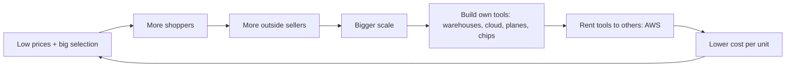

# Amazon, 1997 to 2022: building the tools

**Thesis:** Amazon keeps building giant tools for its own use (warehouses, servers, planes, chips), then rents those same tools to everyone else, rivals included. This era is the building. Part of the [[journeys/amazon-journey|Amazon journey]]; next era: [[journeys/amazon-journey-2023-2026|Amazon, 2023 to 2026]].

## The story so far

Amazon took nine years to turn a profit ([[2025-Gallaugher-Ch08-Amazon|Gallaugher ch.8]], p.237). For years it put nearly every penny into warehouses and cloud capacity, and it now harvests profits from that build ([[2025-Gallaugher-Ch08-Amazon|Gallaugher ch.8]], p.249). AWS launched in 2006 ([[2025-Gallaugher-Ch08-Amazon|Gallaugher ch.8]], p.284). AWS earns most of Amazon's operating profit ([[2025-Gallaugher-Ch08-Amazon|Gallaugher ch.8]], p.284).

## Hook: the Christmas UPS could not deliver

In December 2013, UPS could not handle Amazon's holiday volume, which cost Amazon millions in refunds and hurt its name for reliable delivery ([[2025-Gallaugher-Ch08-Amazon|Gallaugher ch.8]], p.260). As late as 2015, FedEx, UPS and the Postal Service still carried more than 97 percent of its U.S. packages ([[2025-Gallaugher-Ch08-Amazon|Gallaugher ch.8]], p.259). By a 2021 estimate, Amazon's own network handled about one of every three U.S. packages ([[2025-Gallaugher-Ch08-Amazon|Gallaugher ch.8]], p.259). In the 2020 holidays, FedEx and UPS failed to deliver a million packages by Christmas, while Amazon still promised Christmas Day delivery ([[2025-Gallaugher-Ch08-Amazon|Gallaugher ch.8]], p.260).

## The journey

**1997: a letter about patience.** Amazon's first shareholder letter was titled "It's all about the long term" ([[2025-Gallaugher-Ch08-Amazon|Gallaugher ch.8]], p.239). Bezos's reasoning: on a seven-year clock you face only a fraction of rivals, because few firms will wait that long ([[2025-Gallaugher-Ch08-Amazon|Gallaugher ch.8]], p.239). So Amazon accepted billions in losses while the press asked if it would ever make money ([[2025-Gallaugher-Ch08-Amazon|Gallaugher ch.8]], p.237).

**2000: "Amazon.bomb."** After it went public, pundits called it "Amazon.toast" and "Amazon.bomb" ([[2025-Gallaugher-Ch08-Amazon|Gallaugher ch.8]], p.237). Its stock fell from above $100 to below $3 ([[2025-Gallaugher-Ch08-Amazon|Gallaugher ch.8]], p.237). Its early warehouses were "a shambles" of money-burning processes ([[2025-Gallaugher-Ch08-Amazon|Gallaugher ch.8]], p.243). Its warehouses came to pack boxes of mixed single items for millions of homes, not pallets for stores ([[2025-Gallaugher-Ch08-Amazon|Gallaugher ch.8]], p.243).

**2006: AWS opens.** Amazon had become expert at running a huge, reliable website, so it turned that skill into a business; its CTO calls the "spare computers" story a myth ([[2025-Gallaugher-Ch08-Amazon|Gallaugher ch.8]], p.284). AWS launched in 2006 ([[2025-Gallaugher-Ch08-Amazon|Gallaugher ch.8]], p.284). Google's rival arrived in 2008 and Microsoft's in 2010 ([[2025-Gallaugher-Ch08-Amazon|Gallaugher ch.8]], p.284). So Bezos says AWS had a seven-year head start ([[2025-Gallaugher-Ch08-Amazon|Gallaugher ch.8]], p.284). (Cloud means renting computers over the internet instead of owning them.)

**2007: Kindle.** Media was over 20 percent of Amazon's revenue and going digital, so Bezos wanted to own the reading device ([[2025-Gallaugher-Ch08-Amazon|Gallaugher ch.8]], p.271). The book argues the Kindle is really an always-on Amazon store in the customer's hand ([[2025-Gallaugher-Ch08-Amazon|Gallaugher ch.8]], p.270). It now holds over 70 percent of the e-reader market ([[2025-Gallaugher-Ch08-Amazon|Gallaugher ch.8]], p.238).

**2013: own chips, then own planes.** Amazon has designed its own chips since 2013 ([[2025-Gallaugher-Ch08-Amazon|Gallaugher ch.8]], p.298). Because of the UPS failure that same year, it cared more about controlling delivery ([[2025-Gallaugher-Ch08-Amazon|Gallaugher ch.8]], p.260). In 2016 it tested six planes and leased 20 more ([[2026-05-05-Amazons-Durability|Amazon's Durability]]). By late 2023 it shipped more than FedEx or UPS ([[2025-Gallaugher-Ch08-Amazon|Gallaugher ch.8]], p.259). Doing its own shipping saves about a third of what carriers would charge ([[2025-Gallaugher-Ch08-Amazon|Gallaugher ch.8]], p.260).

**2017: Whole Foods.** The book's case: over 90 percent of purchases still happened in physical stores, and U.S. grocery alone is worth three-quarters of a trillion dollars ([[2025-Gallaugher-Ch08-Amazon|Gallaugher ch.8]], p.266). So Amazon paid $13.7 billion for Whole Foods and its then 450 stores ([[2025-Gallaugher-Ch08-Amazon|Gallaugher ch.8]], p.266).

**2020: the pandemic test.** Because the pandemic was a growth accelerant for Amazon, its sales rose nearly 60 percent in a year ([[2025-Gallaugher-Ch08-Amazon|Gallaugher ch.8]], p.238). In late 2020 its cash conversion cycle was almost negative 25 days, while Macy's was positive 71 days ([[2025-Gallaugher-Ch08-Amazon|Gallaugher ch.8]], p.248). (That cycle counts the days between paying suppliers and getting paid by customers. Negative means customers pay Amazon before Amazon pays suppliers.)

**2021: the cloud boss takes over.** Cloud was so profitable that Bezos picked Andy Jassy, the former head of AWS, as the next CEO ([[2025-Gallaugher-Ch08-Amazon|Gallaugher ch.8]], p.238). AWS earns most of Amazon's operating profit ([[2025-Gallaugher-Ch08-Amazon|Gallaugher ch.8]], p.284). (Operating profit is what the business earns from its work, before interest and taxes.) AWS brought in $80.1 billion in 2022 and held about a third of the world cloud market in 2023 ([[2025-Gallaugher-Ch08-Amazon|Gallaugher ch.8]], p.283).

## The rival: Walmart

Walmart ran its stores on data. Its Retail Link system records each sale at the register and triggers reordering and delivery on its own ([[2025-Gallaugher-S17-7-Walmart|Gallaugher §17.7]], p.641). More than 17,000 suppliers can see their daily sales in Walmart's data ([[2025-Gallaugher-S17-7-Walmart|Gallaugher §17.7]], p.643). But its warehouses ship big pallets of identical items to stores, a model that made Amazon's hard to copy ([[2025-Gallaugher-Ch08-Amazon|Gallaugher ch.8]], p.243). Walmart had lost Diapers.com's parent, Quidsi, when Amazon outbid it ([[2025-Gallaugher-S17-7-Walmart|Gallaugher §17.7]], p.647). Because it needed e-commerce skill, in 2016 it bought Jet.com, started by the same founders, for $3.3 billion ([[2025-Gallaugher-S17-7-Walmart|Gallaugher §17.7]], p.647). A year later its U.S. online sales were up 63 percent ([[2025-Gallaugher-S17-7-Walmart|Gallaugher §17.7]], p.647). How the two came to look alike is in the [[journeys/amazon-journey-2023-2026|next era]].

## The idea behind it

- [[First-Best-Customer]]: Amazon uses a tool first, then sells it; Prime Video Channels worked because Amazon was its own first customer for video ([[2026-08-25-Netflix-to-Sell-Streaming-Services-Streamers-as-Aggregators-Revisiting-Roku|Netflix to Sell Streaming Services?]]).
- [[Two-Sided-Marketplace]] and [[Network-Effects]]: more shoppers bring more outside sellers, which bring more shoppers ([[2025-Gallaugher-Ch08-Amazon|Gallaugher ch.8]], p.243).
- [[Scale-Economies]] and [[Vertical-Integration]]: scale justifies owning shipping and robots, which keeps prices down ([[2025-Gallaugher-Ch08-Amazon|Gallaugher ch.8]], p.242).
- [[Cash-Conversion-Cycle]]: getting paid before paying suppliers funds growth ([[2025-Gallaugher-Ch08-Amazon|Gallaugher ch.8]], p.248).

## The loop

> [!warning] Misstep: the Fire Phone
> The Fire Phone launched at $199 with a contract, in line with Apple and Samsung, not Amazon's usual value pricing ([[2025-Gallaugher-Ch08-Amazon|Gallaugher ch.8]], p.275). It ran a version of Android without most Android apps ([[2025-Gallaugher-Ch08-Amazon|Gallaugher ch.8]], p.275). Amazon cut the price to $99 in under a year, killed it a little over a year after launch, and took a $170 million write-off ([[2025-Gallaugher-Ch08-Amazon|Gallaugher ch.8]], p.275). (A write-off admits money spent is gone.)
>
> **Lesson (the book's):** a late mover with a high price, entrenched rivals, [[Switching-Costs]] (the pain of changing) and missing apps will sink ([[2025-Gallaugher-Ch08-Amazon|Gallaugher ch.8]], p.275).

## Three "why?" questions

Why could Amazon survive nine years of losses?

Among its peers, only Amazon consistently collects from customers weeks before paying suppliers ([[2025-Gallaugher-Ch08-Amazon|Gallaugher ch.8]], p.247). That gives it an extra pool of cash to invest ([[2025-Gallaugher-Ch08-Amazon|Gallaugher ch.8]], p.248). And Bezos said Amazon likes things to work in five to seven years ([[2025-Gallaugher-Ch08-Amazon|Gallaugher ch.8]], p.239).

Why did Amazon build its own delivery network?

Because of the UPS failure in 2013, it cared more about controlling delivery ([[2025-Gallaugher-Ch08-Amazon|Gallaugher ch.8]], p.260). Doing its own shipping saves about a third of what carriers would charge ([[2025-Gallaugher-Ch08-Amazon|Gallaugher ch.8]], p.260).

Why didn't Walmart's data lead stop Amazon?

Walmart's systems moved pallets to stores, not single boxes to homes ([[2025-Gallaugher-Ch08-Amazon|Gallaugher ch.8]], p.243). And the book argues past data offers little help when retail changes radically ([[2025-Gallaugher-S17-7-Walmart|Gallaugher §17.7]], p.648).

## Sources

1. [[2025-Gallaugher-Ch08-Amazon|Gallaugher, *Information Systems* v10, ch.8 Amazon]] (FlatWorld, 2025).
2. [[2025-Gallaugher-S17-7-Walmart|Gallaugher, *Information Systems* v10, §17.7 Walmart]] (FlatWorld, 2025).
3. [[2026-05-05-Amazons-Durability|Amazon's Durability]] (Stratechery, 2026-05-05).
4. [[2026-08-25-Netflix-to-Sell-Streaming-Services-Streamers-as-Aggregators-Revisiting-Roku|Netflix to Sell Streaming Services?]] (Stratechery, 2026-08-25).

**Older than 2 years.** The book is from 2025, but many of its numbers describe 2023 or earlier: the 70 percent Kindle share, AWS's $80.1 billion (2022) and one-third cloud share (2023), the Q4 2020 cash cycle and Whole Foods' 450 stores.

**Where sources disagree.**
- Annapurna, Amazon's chip designer: bought in 2016 per the book (p.291), in 2015 per [[2026-05-05-Amazons-Durability|Amazon's Durability]].
- Jet.com price: $3.3 billion in §17.7 (p.647), $3 billion in ch.8 (p.256).

See also: [[journeys/amazon-journey|Amazon journey (hub)]], [[journeys/amazon-journey-2023-2026|Amazon, 2023 to 2026]], [[stories/retail-stores-boxes-agents|Retail, from stores to boxes to agents]], [[what-changed]].

## Change log

- 2026-10-08: Split from amazon-journey.md on 2026-10-08 (proposal 2026-10-08). Text moved unchanged; added a story-so-far, a third "why?" question and the era links from existing cited text.

<!-- claims: clm-721998298bef0c547184, clm-890f584ea2f3b3b4e6ee, clm-c3f9f5f964575520904f, clm-b09ff17ea5e21b34e5cd, clm-2143b1d5ef230745091f, clm-df00b039f8f98c3daf60, clm-d67e5b8cb5cc20549416, clm-218195a1b14cb2747fcb, clm-01f2b9346843e0ba3418, clm-abf3348a19c6e16551e1, clm-90b8ee6099abe799c809, clm-840cb7241fe67482328b, clm-c1850bd8983dcd240acf, clm-2a24f0930fd5e88ae05a, clm-708b6e6073946f607c4a, clm-bd0a33cfd7b85b11f8ff, clm-344effddeb146ff7f8b3, clm-ce7ea73c8412103d3f7d, clm-2fc23ef5f6f78d8ed7f1, clm-d02fe0507d9c6035e123, clm-784a7d59f2e9f955e49a, clm-42e4175e56e99f8a5305, clm-90934c886b39ad4016d2, clm-d54691e27df63ed0bdc9, clm-17af8ffd01b0c2bb7964, clm-7df1f80333900a6f2e58, clm-a3da4f5c495215e58bfb, clm-18c773f21986205b3f04, clm-1264697facd951fcc097, clm-8191fb79eb858069886f, clm-4edc2826a70fb50a658c, clm-67c0b6a739fa16cb30a1, clm-0d51d23348d6ea00b93b, clm-1b4fed1e952af5466ad1, clm-132849342d8d16290686, clm-3fdba35f04dc8c462986, clm-9af9229107d6d938e48d, clm-8527a891e224136950ff, clm-57d0c29a296e89ef82da, clm-b043c1e17b39ba9e9472, clm-f772085daff1853be9b6, clm-56b7665f8d4694156dd8, clm-9930ce3618b6b95ffb6f, clm-207c09d3bee3b4dd3719, clm-e88d546d108de99f3257, clm-9c1addfa2d999076ba28, clm-473bd2d654305d469733, clm-b8f83714a8fc08077528, clm-b5fe25ecdf562e234a62, clm-2c1025f3a16bf3dd62ee, clm-cbe37b09910030bc62ae, clm-f3820d68aae2a553bf8b, clm-db445fc62f7860041c35, clm-249e7fd5715485171fa8, clm-7658105bf0c043a304c8, clm-17d6df585ac0fb0232e2, clm-29189d0de64da315ab4d, clm-7cbe960648324f6453cd, clm-3dcfefdf73cabd158a86, clm-13482e342484d2624b6d, clm-c0f5c066b7a3d31a8a26, clm-e629fa6598d732768f7c, clm-64b99ccecac84c3d435a, clm-040d6119909321d24b3c, clm-f0229615c05f95c760be, clm-41e1b0fbffc6fee1f5fb, clm-50f6b5977ea30cb1e4a7, clm-44b71fd2e0e60c30a644, clm-396423cff5aec9fc5934, clm-5da871ca1ec6a2bd9b0f, clm-136a5e454021713ca30f, clm-7bc16eb02700e33c12c4, clm-e3780eb0cba8d69b8207, clm-8648de40861ab5761c49, clm-1a08fa5a0bf55e60eecb, clm-d47e5d02aace123f5413 -->
