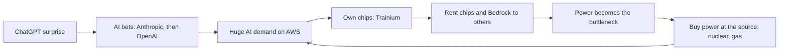

# Amazon, 2023 to 2026: renting out AI, freight and power

**Thesis:** Amazon keeps building giant tools for its own use (warehouses, servers, planes, chips), then rents those same tools to everyone else, rivals included. In this era the tools are AI chips, AI services and its freight network. Part of the [[journeys/amazon-journey|Amazon journey]]; previous era: [[journeys/amazon-journey-1997-2022|Amazon, 1997 to 2022]].

## The story so far

It sold computing as AWS, and in 2026 it began selling its freight and delivery network the same way ([[2026-05-05-Amazons-Durability|Amazon's Durability]]). Now it is doing the same with AI chips, while outside AI shopping agents send it only a small share of shoppers so far ([[2026-04-30-Amazon-Earnings-Trainium|Amazon Earnings, Trainium]]). AWS earns most of Amazon's operating profit ([[2025-Gallaugher-Ch08-Amazon|Gallaugher ch.8]], p.284).

## The journey

**2023: an AI bet and a lawsuit.** Microsoft's big OpenAI investment pushed Amazon into its own AI bet ([[2025-Gallaugher-Ch08-Amazon|Gallaugher ch.8]], p.297). So in September 2023 Amazon put $1.25 billion into Anthropic, with the option to go up to $4 billion ([[2025-Gallaugher-Ch08-Amazon|Gallaugher ch.8]], p.297). That month, the FTC and seventeen states sued, saying Amazon locks sellers into its platform and its extra services ([[2025-Gallaugher-Ch08-Amazon|Gallaugher ch.8]], p.300). Amazon's Bedrock, its service for renting out other firms' AI models, launched that fall in a rush after ChatGPT caught Amazon off guard ([[2026-09-08-How-Six-AWS-Engineers-Rebuilt-Bedrock-to-Challenge-Microsoft|Bedrock Rebuilt]]).

**2025: Bedrock rebuilt.** In early 2025 Bedrock was buggy, and customers waited weeks for computing capacity ([[2026-09-08-How-Six-AWS-Engineers-Rebuilt-Bedrock-to-Challenge-Microsoft|Bedrock Rebuilt]]). Customers complained all year about throttled access to Anthropic's models on it ([[2026-09-08-How-Six-AWS-Engineers-Rebuilt-Bedrock-to-Challenge-Microsoft|Bedrock Rebuilt]]). So six senior engineers rebuilt it as Project Mantle, which treats AI serving as a scheduling problem rather than a website ([[2026-09-08-How-Six-AWS-Engineers-Rebuilt-Bedrock-to-Challenge-Microsoft|Bedrock Rebuilt]]). It launched in December 2025, and the wait for extra capacity fell from three weeks to two days ([[2026-09-08-How-Six-AWS-Engineers-Rebuilt-Bedrock-to-Challenge-Microsoft|Bedrock Rebuilt]]). Bedrock also moved to running mostly on Amazon's own Trainium chips, easing its need for scarce Nvidia chips ([[2026-09-08-How-Six-AWS-Engineers-Rebuilt-Bedrock-to-Challenge-Microsoft|Bedrock Rebuilt]]). Amazon says it added more Bedrock customers in the first half of 2026 than in the service's first two years ([[2026-09-08-How-Six-AWS-Engineers-Rebuilt-Bedrock-to-Challenge-Microsoft|Bedrock Rebuilt]]). AWS growth sped up 9 points to 37% in Q2 2026, though Microsoft's Azure grew 42% ([[2026-09-08-How-Six-AWS-Engineers-Rebuilt-Bedrock-to-Challenge-Microsoft|Bedrock Rebuilt]]). Two of Mantle's leaders have since left AWS for Meta ([[2026-09-08-How-Six-AWS-Engineers-Rebuilt-Bedrock-to-Challenge-Microsoft|Bedrock Rebuilt]]).

**February 2026: a second AI partner.** Anthropic limits how much customers like Amazon can customize its models, so OpenAI's models could power Rufus or Alexa ([[2026-02-27-What-Amazon-and-Microsoft-Will-Win-or-Lose-From-OpenAIs-New-Deals|OpenAI's New Deals]]). So Amazon agreed to invest $15 billion in OpenAI up front, and $35 billion more when OpenAI goes public or hits milestones ([[2026-02-27-What-Amazon-and-Microsoft-Will-Win-or-Lose-From-OpenAIs-New-Deals|OpenAI's New Deals]]). OpenAI's AWS cloud deal grew from $38 billion over seven years to $138 billion over eight, and OpenAI committed to about 2 gigawatts of Trainium chips ([[2026-02-27-What-Amazon-and-Microsoft-Will-Win-or-Lose-From-OpenAIs-New-Deals|OpenAI's New Deals]]). Amazon also became the only outside seller of OpenAI's Frontier tool for managing agents ([[2026-02-27-What-Amazon-and-Microsoft-Will-Win-or-Lose-From-OpenAIs-New-Deals|OpenAI's New Deals]]). That year Amazon raised its capital spending (money for buildings and machines) by 50%, to $200 billion, mostly for AWS ([[2026-02-27-What-Amazon-and-Microsoft-Will-Win-or-Lose-From-OpenAIs-New-Deals|OpenAI's New Deals]]). By October the 2026 figure was $220 billion, a bet that business demand for AI services takes off ([[2026-10-11-Amazons-Bargains-Include-Its-Stock|Amazon's Bargains]]).

**2026: chips and trucks for rent.** Amazon's Q1 2026 profit jump was attributed to its Anthropic investment ([[2026-04-30-Amazon-Earnings-Trainium|Amazon Earnings, Trainium]]). AWS now holds over $225 billion in promised Trainium revenue, including from Anthropic and OpenAI ([[2026-04-30-Amazon-Earnings-Trainium|Amazon Earnings, Trainium]]). (Trainium is Amazon's own AI chip.) On May 4, Amazon unveiled Supply Chain Services, which packages its air and ocean freight, trucking and last-mile delivery for other firms ([[2026-05-05-Amazons-Durability|Amazon's Durability]]). Procter & Gamble and 3M already use it ([[2026-05-05-Amazons-Durability|Amazon's Durability]]).

**2026: the power wall.** Because AI data centers need so much electricity, power has become one of the biggest bottlenecks of the build-out ([[2026-10-08-How-Amazon-Rewired-Its-Data-Centers-After-Mississippi-Power-Warning|Amazon Power Warning]]). Earlier in 2026 the utility Entergy told Amazon it would start cutting its Mississippi data centers off the grid at peak times ([[2026-10-08-How-Amazon-Rewired-Its-Data-Centers-After-Mississippi-Power-Warning|Amazon Power Warning]]). So AWS built Project Falcon, which lets the utility itself switch AWS sites to backup power without calling first ([[2026-10-08-How-Amazon-Rewired-Its-Data-Centers-After-Mississippi-Power-Warning|Amazon Power Warning]]). Backup is limited too: in 2025 Minnesota regulators rejected Amazon's plan for 250 generators at a site in Becker, and Amazon abandoned that data center ([[2026-10-08-How-Amazon-Rewired-Its-Data-Centers-After-Mississippi-Power-Warning|Amazon Power Warning]]). So Amazon now goes to the source: Constellation Energy says an Amazon deal will help fund a $3 billion, 190-megawatt expansion of a Constellation nuclear plant in Maryland ([[2026-10-08-How-Amazon-Rewired-Its-Data-Centers-After-Mississippi-Power-Warning|Amazon Power Warning]]). It also bought GW Ranch, a gas power plant in Texas, to run its first data center fully off the grid; its permit allows 33 million tons of carbon dioxide, more than the largest US coal plant ([[2026-10-08-How-Amazon-Rewired-Its-Data-Centers-After-Mississippi-Power-Warning|Amazon Power Warning]]).

**October 2026: the bill comes due.** AWS grew 37% in the June 2026 quarter and made nearly $150 billion over the 12 months to June ([[2026-10-13-Microsoft-Cloud-President-Asks-Leaders-to-Find-20-Cost-Cuts|Azure Cost Cuts]]). But because rising AI data center spending hurt its free cash flow, AWS has made cuts, including layoffs ([[2026-10-13-Microsoft-Cloud-President-Asks-Leaders-to-Find-20-Cost-Cuts|Azure Cost Cuts]]). (Free cash flow is the cash left after running costs and new buildings and machines.) Martin Peers argues AWS now needs cash from the shopping business to pay for that building, so Amazon will not split AWS off soon ([[2026-10-11-Amazons-Bargains-Include-Its-Stock|Amazon's Bargains]]).

## The rivals: Walmart and AliExpress

Walmart, the rival of the [[journeys/amazon-journey-1997-2022|first era]], and Amazon began to look alike. Walmart+ is a copy of Prime at about $100 a year ([[2025-Gallaugher-S17-7-Walmart|Gallaugher §17.7]], p.647). Walmart uses RFID tags (small radio labels) so its stores can act as warehouses ([[2025-Gallaugher-S17-7-Walmart|Gallaugher §17.7]], p.641). Its ad business made $2.7 billion in 2022, with ad margins near 80 percent ([[2025-Gallaugher-S17-7-Walmart|Gallaugher §17.7]], p.646). (Margin is the share of each sale kept as profit.) Walmart still reported more 2023 revenue, $611 billion to Amazon's $538 billion, but Amazon counts only its cut of outside sellers' sales ([[2025-Gallaugher-Ch08-Amazon|Gallaugher ch.8]], p.248). In 2026, Amazon's same-day grocery reached price parity with Walmart in Morton's basket test ([[2026-06-18-Interview-Michael-Morton-E-Commerce-AI|Morton interview]]). Asked which stores they prefer, AI models ranked Amazon first and Walmart second ([[2026-06-18-Interview-Michael-Morton-E-Commerce-AI|Morton interview]]). Walmart has its own AI shopping helper: its CEO said in September 2026 that customers using Sparky spent 40% more per order on average ([[2026-10-13-Why-Companies-Cant-Prove-Their-AI-Spending-Pays-Off|AI Spending Payoff]]). Investors still prize Walmart more: in October 2026 Amazon traded at about 29 times forward earnings, against 37 for Walmart, though Walmart's expected 2026 revenue growth of about 5.6% is a third of Amazon's ([[2026-10-11-Amazons-Bargains-Include-Its-Stock|Amazon's Bargains]]). (Forward earnings is next year's expected profit; the multiple is how many dollars investors pay for each dollar of it.)

A newer challenger comes from China. AliExpress is testing Elite, a free, invitation-only membership for shoppers who spend over $800 a year, as a challenge to Amazon Prime ([[2026-09-30-Alibabas-AliExpress-Tests-Membership-Program-in-Challenge-to-Amazon|AliExpress Elite]]). In Europe it had 157.6 million monthly users in June 2026, against Amazon's 193.9 million ([[2026-09-30-Alibabas-AliExpress-Tests-Membership-Program-in-Challenge-to-Amazon|AliExpress Elite]]).

## The idea behind it

- [[Commodity-Cost-Advantage]]: in a commodity market the lowest-cost supplier earns the most ([[2026-04-30-Amazon-Earnings-Trainium|Amazon Earnings, Trainium]]).
- [[Custom-Silicon]]: Jassy argues AWS will win the agent era partly because its own chips lower its costs ([[2026-04-30-Amazon-Earnings-Trainium|Amazon Earnings, Trainium]]).

## The loop

## Moving forward (as of 2026-10-13)

- **Agents as storefronts.** Jassy wants to work with outside shopping agents, though their referrals are still small ([[2026-04-30-Amazon-Earnings-Trainium|Amazon Earnings, Trainium]]). He argues agent chats create room for sponsored products and sponsored prompts; Rufus is Amazon's own shopping agent ([[2026-04-30-Amazon-Earnings-Trainium|Amazon Earnings, Trainium]]). The stakes are large: Amazon's ad business brings in $80 billion a year and grows 20% to 25% a year ([[2026-10-11-Amazons-Bargains-Include-Its-Stock|Amazon's Bargains]]). Martin Peers warns it could be wiped out if agent traffic largely replaces humans scrolling on Amazon ([[2026-10-11-Amazons-Bargains-Include-Its-Stock|Amazon's Bargains]]). See [[Agentic-Commerce]].
- **Walls going up.** Amazon blocks most AI discovery platforms ([[2026-06-18-Interview-Michael-Morton-E-Commerce-AI|Morton interview]]) and is fighting Perplexity in court ([[2026-06-18-Interview-Michael-Morton-E-Commerce-AI|Morton interview]]). AI traffic to brands' own sites grows 4 to 8 times faster than to marketplaces like Amazon ([[2026-06-18-Interview-Michael-Morton-E-Commerce-AI|Morton interview]]).
- **The physical moat.** Thompson argues [[Aggregation-Theory]] does not apply to physical businesses, so Amazon's warehouses capture value even if chatbots front the purchase ([[2026-05-14-Interview-Ben-Thompson-MoffettNathanson|Thompson at MoffettNathanson]]).
- **Will Trainium win?** OpenAI announced a Trainium deal, but as of May 2026 all its work ran on Nvidia ([[2026-05-26-Nvidia-Earnings-The-AI-Stack-Nvidias-New-Reporting|Nvidia Earnings, May]]). Thompson argues power limits are the one thing that would favor Nvidia ([[2026-04-30-Amazon-Earnings-Trainium|Amazon Earnings, Trainium]]). Update: in February 2026 OpenAI committed to about 2 gigawatts of Trainium3 and Trainium4 ([[2026-02-27-What-Amazon-and-Microsoft-Will-Win-or-Lose-From-OpenAIs-New-Deals|OpenAI's New Deals]]), and Bedrock itself now runs mostly on Trainium ([[2026-09-08-How-Six-AWS-Engineers-Rebuilt-Bedrock-to-Challenge-Microsoft|Bedrock Rebuilt]]). In August 2026 Amazon said Trainium would use Nvidia's networking and memory hardware, in racks that can sit beside Nvidia GPUs ([[2026-10-08-Nvidia-to-Invest-in-Chip-Rival-d-Matrix-as-Its-Challengers-Choose-Partnership|Nvidia and d-Matrix]]). In October 2026 Amazon was in talks to buy Decart, an Israeli startup whose software helps developers switch between AI chips, for around $7 billion, per the Wall Street Journal ([[2026-10-12-OpenAIs-Plan-To-Revive-Sora|OpenAI's Sora Plan]]).
- **Next rental.** Jassy plans over 20 Amazon Leo satellite launches in 2026 and over 30 in 2027, and hopes for AWS-like economics ([[2026-05-05-Amazons-Durability|Amazon's Durability]]).
- **Anthropic's landlord.** Amazon and Google remain Anthropic's biggest suppliers, with 11 gigawatts costing more than $300 billion over about 10 years ([[2026-09-06-How-Anthropic-Clinched-517-Billion-in-Compute-Deals-in-11-Months|Anthropic's $517 Billion]]). But Anthropic also rents from SpaceX and is talking about leasing data centers directly ([[2026-09-22-Anthropic-in-Talks-for-1-Gigawatt-Data-Center-Lease-With-Apollo-Backed-Developer|Anthropic Lease Talks]]). By October 2026 it had committed to rent or lease about 15 gigawatts from AWS, Google, SpaceXAI and more than a dozen others ([[2026-10-11-The-Attractive-Economics-Behind-Anthropic-Data-Center-Sprint|Anthropic Data Center Sprint]]).
- **Discounts to win coders.** AWS offered one consultancy about four months of Kiro, its AI coding tool, for free; it declined because it already uses Claude Code ([[2026-09-22-Software-Firms-Discount-AI-to-Keep-Customers-From-Anthropic-OpenAI|Software Discounts]]). AWS says Kiro's developer numbers doubled from Q1 to Q2 2026 ([[2026-09-22-Software-Firms-Discount-AI-to-Keep-Customers-From-Anthropic-OpenAI|Software Discounts]]).
- **More power cutoffs.** Texas, Duke Energy in North Carolina and PJM, the largest US grid operator, are all moving toward cutting off big users in a crunch ([[2026-10-08-How-Amazon-Rewired-Its-Data-Centers-After-Mississippi-Power-Warning|Amazon Power Warning]]).

## Three "why?" questions

Why would Amazon rent its tools to rivals?

Thompson argues Amazon turns running costs into up-front building costs, then sells that capacity to other firms ([[2026-05-05-Amazons-Durability|Amazon's Durability]]). Even rivals like Netflix run on AWS ([[2025-Gallaugher-Ch08-Amazon|Gallaugher ch.8]], p.283).

Why did Amazon back OpenAI when it already backed Anthropic?

Anthropic limits how much customers like Amazon can customize its models, so OpenAI's models could power Rufus or Alexa ([[2026-02-27-What-Amazon-and-Microsoft-Will-Win-or-Lose-From-OpenAIs-New-Deals|OpenAI's New Deals]]).

Why is electricity now Amazon's problem?

Because AI data centers need so much electricity, power has become one of the biggest bottlenecks of the build-out ([[2026-10-08-How-Amazon-Rewired-Its-Data-Centers-After-Mississippi-Power-Warning|Amazon Power Warning]]). Backup is limited too: Minnesota regulators rejected Amazon's plan for 250 generators at Becker ([[2026-10-08-How-Amazon-Rewired-Its-Data-Centers-After-Mississippi-Power-Warning|Amazon Power Warning]]).

## Sources

1. [[2025-Gallaugher-Ch08-Amazon|Gallaugher, *Information Systems* v10, ch.8 Amazon]] (FlatWorld, 2025).
2. [[2025-Gallaugher-S17-7-Walmart|Gallaugher, *Information Systems* v10, §17.7 Walmart]] (FlatWorld, 2025).
3. [[2026-04-30-Amazon-Earnings-Trainium|Amazon Earnings, Trainium and Commodity Markets]] (Stratechery, 2026-04-30).
4. [[2026-05-05-Amazons-Durability|Amazon's Durability]] (Stratechery, 2026-05-05).
5. [[2026-05-14-Interview-Ben-Thompson-MoffettNathanson|Interview with Ben Thompson at MoffettNathanson]] (Stratechery, 2026-05-14).
6. [[2026-05-26-Nvidia-Earnings-The-AI-Stack-Nvidias-New-Reporting|Nvidia Earnings, The AI Stack]] (Stratechery, 2026-05-26).
7. [[2026-06-18-Interview-Michael-Morton-E-Commerce-AI|Interview with Michael Morton on e-commerce and AI]] (Stratechery, 2026-06-18).
8. [[2026-02-27-What-Amazon-and-Microsoft-Will-Win-or-Lose-From-OpenAIs-New-Deals|What Amazon and Microsoft Will Win or Lose From OpenAI's New Deals]] (The Information, 2026-02-27).
9. [[2026-09-06-How-Anthropic-Clinched-517-Billion-in-Compute-Deals-in-11-Months|How Anthropic Clinched $517 Billion in Compute Deals in 11 Months]] (The Information, 2026-09-06).
10. [[2026-09-08-How-Six-AWS-Engineers-Rebuilt-Bedrock-to-Challenge-Microsoft|How Six AWS Engineers Rebuilt Bedrock to Challenge Microsoft]] (The Information, 2026-09-08).
11. [[2026-09-22-Anthropic-in-Talks-for-1-Gigawatt-Data-Center-Lease-With-Apollo-Backed-Developer|Anthropic in Talks for 1-Gigawatt Data Center Lease With Apollo-Backed Developer]] (The Information, 2026-09-22).
12. [[2026-09-22-Software-Firms-Discount-AI-to-Keep-Customers-From-Anthropic-OpenAI|Software Firms Discount AI to Keep Customers From Anthropic, OpenAI]] (The Information, 2026-09-22).
13. [[2026-09-30-Alibabas-AliExpress-Tests-Membership-Program-in-Challenge-to-Amazon|Alibaba's AliExpress Tests Membership Program in Challenge to Amazon]] (The Information, 2026-09-30).
14. [[2026-10-08-How-Amazon-Rewired-Its-Data-Centers-After-Mississippi-Power-Warning|How Amazon Rewired Its Data Centers After Mississippi Power Warning]] (The Information, 2026-10-08).
15. [[2026-10-08-Nvidia-to-Invest-in-Chip-Rival-d-Matrix-as-Its-Challengers-Choose-Partnership|Nvidia and d-Matrix]] (The Information, 2026-10-08).
16. [[2026-10-11-Amazons-Bargains-Include-Its-Stock|Amazon's Bargains Include Its Stock]] (The Information, 2026-10-11).
17. [[2026-10-11-The-Attractive-Economics-Behind-Anthropic-Data-Center-Sprint|The Attractive Economics Behind Anthropic Data Center Sprint]] (The Information, 2026-10-11).
18. [[2026-10-12-OpenAIs-Plan-To-Revive-Sora|OpenAI's Plan To Revive Sora]] (The Information, 2026-10-12).
19. [[2026-10-13-Microsoft-Cloud-President-Asks-Leaders-to-Find-20-Cost-Cuts|Microsoft Cloud President Asks Leaders to Find 20% Cost Cuts]] (The Information, 2026-10-13).
20. [[2026-10-13-Why-Companies-Cant-Prove-Their-AI-Spending-Pays-Off|Why Companies Can't Prove Their AI Spending Pays Off]] (The Information, 2026-10-13).

**Older than 2 years.** The book is from 2025, but some of its numbers describe 2023 or earlier: Walmart's $2.7 billion in ads (2022) and the 2023 revenue comparison.

**Where sources disagree.**
- Microsoft's OpenAI investment: $11 billion on p.297, $13 billion on p.284 of the same book.
- Amazon's 2026 capital spending: $200 billion in February ([[2026-02-27-What-Amazon-and-Microsoft-Will-Win-or-Lose-From-OpenAIs-New-Deals|OpenAI's New Deals]]), $220 billion by October ([[2026-10-11-Amazons-Bargains-Include-Its-Stock|Amazon's Bargains]]). The newer figure supersedes the older.
- Azure's growth in the June 2026 quarter: 42% ([[2026-09-08-How-Six-AWS-Engineers-Rebuilt-Bedrock-to-Challenge-Microsoft|Bedrock Rebuilt]]) or 43% ([[2026-10-13-Microsoft-Cloud-President-Asks-Leaders-to-Find-20-Cost-Cuts|Azure Cost Cuts]]).

See also: [[journeys/amazon-journey|Amazon journey (hub)]], [[journeys/amazon-journey-1997-2022|Amazon, 1997 to 2022]], [[stories/retail-stores-boxes-agents|Retail, from stores to boxes to agents]], [[stories/ai-shift-2024-2026|The AI shift, 2024 to 2026]], [[what-changed]], [[journeys/apple-journey|Apple journey]], [[journeys/meta-journey|Meta journey]].

## Change log

- 2026-09-29: first build of amazon-journey.md from proposal 2026-09-29.
- 2026-10-08: added beats for Bedrock's 2025 rebuild, the February 2026 OpenAI deal and the 2026 power wall; Bedrock's 2023 launch; AliExpress Elite as a new Prime challenger; updated Moving forward [Bedrock Rebuilt, OpenAI's New Deals, Amazon Power Warning, AliExpress Elite, Anthropic's $517 Billion, Anthropic Lease Talks, Software Discounts].
- 2026-10-08: Split from amazon-journey.md on 2026-10-08 (proposal 2026-10-08). Text moved unchanged; added a story-so-far line, a new loop diagram, two "why?" questions and the era links from existing cited text.
- 2026-10-09: Moving forward: Trainium will use Nvidia networking and memory [Nvidia and d-Matrix, 2026-10-08]
- 2026-10-13: 2026 capex raised to $220 billion (supersedes $200 billion); new beat on AWS cuts and its need for shopping cash; Walmart valuation and Sparky in rivals; ad-business risk from agents, Decart talks and Anthropic's 15 GW in Moving forward; two disagreements added [Amazon's Bargains, Azure Cost Cuts, OpenAI's Sora Plan, Anthropic Data Center Sprint, AI Spending Payoff]

<!-- claims: clm-721998298bef0c547184, clm-890f584ea2f3b3b4e6ee, clm-c3f9f5f964575520904f, clm-45195098beeb7020ff14, clm-b09ff17ea5e21b34e5cd, clm-2143b1d5ef230745091f, clm-df00b039f8f98c3daf60, clm-d67e5b8cb5cc20549416, clm-218195a1b14cb2747fcb, clm-01f2b9346843e0ba3418, clm-abf3348a19c6e16551e1, clm-90b8ee6099abe799c809, clm-840cb7241fe67482328b, clm-c1850bd8983dcd240acf, clm-2a24f0930fd5e88ae05a, clm-708b6e6073946f607c4a, clm-bd0a33cfd7b85b11f8ff, clm-344effddeb146ff7f8b3, clm-ce7ea73c8412103d3f7d, clm-2fc23ef5f6f78d8ed7f1, clm-d02fe0507d9c6035e123, clm-784a7d59f2e9f955e49a, clm-42e4175e56e99f8a5305, clm-90934c886b39ad4016d2, clm-d54691e27df63ed0bdc9, clm-17af8ffd01b0c2bb7964, clm-7df1f80333900a6f2e58, clm-a3da4f5c495215e58bfb, clm-18c773f21986205b3f04, clm-1264697facd951fcc097, clm-8191fb79eb858069886f, clm-4edc2826a70fb50a658c, clm-67c0b6a739fa16cb30a1, clm-0d51d23348d6ea00b93b, clm-1b4fed1e952af5466ad1, clm-132849342d8d16290686, clm-2142dcd77db4cc138757, clm-19581e27de7ced00ff1c, clm-3fdba35f04dc8c462986, clm-9af9229107d6d938e48d, clm-8527a891e224136950ff, clm-57d0c29a296e89ef82da, clm-b043c1e17b39ba9e9472, clm-f772085daff1853be9b6, clm-56b7665f8d4694156dd8, clm-9930ce3618b6b95ffb6f, clm-207c09d3bee3b4dd3719, clm-e88d546d108de99f3257, clm-9c1addfa2d999076ba28, clm-473bd2d654305d469733, clm-85b498127c5f5565516a, clm-1d4b95f11acf01417afa, clm-b5fe25ecdf562e234a62, clm-2c1025f3a16bf3dd62ee, clm-c40b6055bf2baa89bccb, clm-68900ca801eea1bc3ce3, clm-cbe37b09910030bc62ae, clm-f3820d68aae2a553bf8b, clm-db445fc62f7860041c35, clm-06b3d9af71385ecd8d9a, clm-692c1118fa6bfadbd822, clm-70f74d1ab8f04d152961, clm-fcbe54e74115146cd4a3, clm-8716702558c0d8a63cae, clm-b77c656a72328b241648, clm-249e7fd5715485171fa8, clm-7658105bf0c043a304c8, clm-17d6df585ac0fb0232e2, clm-29189d0de64da315ab4d, clm-7cbe960648324f6453cd, clm-3dcfefdf73cabd158a86, clm-13482e342484d2624b6d, clm-c0f5c066b7a3d31a8a26, clm-e629fa6598d732768f7c, clm-64b99ccecac84c3d435a, clm-040d6119909321d24b3c, clm-f0229615c05f95c760be, clm-41e1b0fbffc6fee1f5fb, clm-50f6b5977ea30cb1e4a7, clm-44b71fd2e0e60c30a644, clm-396423cff5aec9fc5934, clm-5da871ca1ec6a2bd9b0f, clm-136a5e454021713ca30f, clm-7bc16eb02700e33c12c4, clm-e3780eb0cba8d69b8207, clm-8648de40861ab5761c49, clm-1a08fa5a0bf55e60eecb, clm-d47e5d02aace123f5413, clm-069978eab4ddb584afa1, clm-1098b8f49f5a8f9ce9ce, clm-0ae297ab8468385cf1b9, clm-ee103f356949c58989b1, clm-65f6dcf826990755cc96, clm-ef1ce3a3b6270f31ccf1, clm-56d4e914938889314d59, clm-b34a0967fb912a3670ec, clm-d90f72f3a4e7d8c52d92, clm-69ad99419ff055fcdd63, clm-46639ec9d714809ecaf3, clm-653b43cca4eda2eff26a, clm-5926571819a7fcb8648f, clm-27c0a9808f5f3bc50677, clm-a1eaf1fae864edfe3440, clm-4491144b7f4520f9c8ed, clm-d2ed4708f3c75b1ffc05, clm-1e5d1b1096724f953371, clm-93922d4e31933fe411da, clm-71e0ff2c405c97388615, clm-452b64e03dbe4f90dba5, clm-73b3319edbfd51354e88, clm-4e90e336161467bf40ed, clm-470f7d3676511e5f0209, clm-308db1e6ca3053a224ea, clm-f44d80174e82b0898932, clm-ce539863f6b1ec8d2bde, clm-fe5dfcbddc9ff566ede1, clm-a9f9546b460cc79c4f7b, clm-3dbd0e8941c38857607b, clm-e672a838a0f31ca6e99e, clm-97aad8388ffde3454b2f, clm-d5f9fa15dea742464d15, clm-3771fb17b114f78aad81, clm-cb3e55a4804a689e59e4, clm-9f511388c14bd1abe3fa, clm-4ad7c497ef90ad71343d -->
