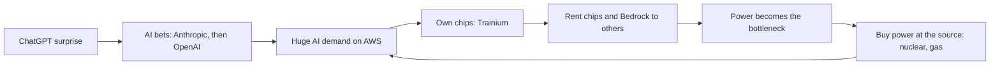

# Amazon, 2026: chips, power and money

**Thesis:** Amazon keeps building giant tools for its own use (warehouses, servers, planes, chips), then rents those same tools to everyone else, rivals included. In 2026 the tools are AI chips, AI services and its freight network, and the bill for them comes due. Part of the [[journeys/amazon-journey|Amazon journey]]; previous era: [[journeys/amazon-journey-2023-2026|Amazon, 2023 to 2025: the AI bet, Bedrock and the rivals]].

## The story so far

It sold computing as AWS, and in 2026 it began selling its freight and delivery network the same way ([[2026-05-05-Amazons-Durability|Amazon's Durability]]). Now it is doing the same with AI chips, while outside AI shopping agents send it only a small share of shoppers so far ([[2026-04-30-Amazon-Earnings-Trainium|Amazon Earnings, Trainium]]). AWS earns most of Amazon's operating profit ([[2025-Gallaugher-Ch08-Amazon|Gallaugher ch.8]], p.284).

## The journey

**February 2026: a second AI partner.** Anthropic limits how much customers like Amazon can customize its models, so OpenAI's models could power Rufus or Alexa ([[2026-02-27-What-Amazon-and-Microsoft-Will-Win-or-Lose-From-OpenAIs-New-Deals|OpenAI's New Deals]]). So Amazon agreed to invest $15 billion in OpenAI up front, and $35 billion more when OpenAI goes public or hits milestones ([[2026-02-27-What-Amazon-and-Microsoft-Will-Win-or-Lose-From-OpenAIs-New-Deals|OpenAI's New Deals]]). OpenAI's AWS cloud deal grew from $38 billion over seven years to $138 billion over eight, and OpenAI committed to about 2 gigawatts of Trainium chips ([[2026-02-27-What-Amazon-and-Microsoft-Will-Win-or-Lose-From-OpenAIs-New-Deals|OpenAI's New Deals]]). Amazon also became the only outside seller of OpenAI's Frontier tool for managing agents ([[2026-02-27-What-Amazon-and-Microsoft-Will-Win-or-Lose-From-OpenAIs-New-Deals|OpenAI's New Deals]]). That year Amazon raised its capital spending (money for buildings and machines) by 50%, to $200 billion, mostly for AWS ([[2026-02-27-What-Amazon-and-Microsoft-Will-Win-or-Lose-From-OpenAIs-New-Deals|OpenAI's New Deals]]). By October the 2026 figure was $220 billion, a bet that business demand for AI services takes off ([[2026-10-11-Amazons-Bargains-Include-Its-Stock|Amazon's Bargains]]).

**2026: chips and trucks for rent.** Amazon's Q1 2026 profit jump was attributed to its Anthropic investment ([[2026-04-30-Amazon-Earnings-Trainium|Amazon Earnings, Trainium]]). AWS now holds over $225 billion in promised Trainium revenue, including from Anthropic and OpenAI ([[2026-04-30-Amazon-Earnings-Trainium|Amazon Earnings, Trainium]]). (Trainium is Amazon's own AI chip.) On May 4, Amazon unveiled Supply Chain Services, which packages its air and ocean freight, trucking and last-mile delivery for other firms ([[2026-05-05-Amazons-Durability|Amazon's Durability]]). Procter & Gamble and 3M already use it ([[2026-05-05-Amazons-Durability|Amazon's Durability]]).

**2026: the power wall.** Because AI data centers need so much electricity, power has become one of the biggest bottlenecks of the build-out ([[2026-10-08-How-Amazon-Rewired-Its-Data-Centers-After-Mississippi-Power-Warning|Amazon Power Warning]]). Earlier in 2026 the utility Entergy told Amazon it would start cutting its Mississippi data centers off the grid at peak times ([[2026-10-08-How-Amazon-Rewired-Its-Data-Centers-After-Mississippi-Power-Warning|Amazon Power Warning]]). So AWS built Project Falcon, which lets the utility itself switch AWS sites to backup power without calling first ([[2026-10-08-How-Amazon-Rewired-Its-Data-Centers-After-Mississippi-Power-Warning|Amazon Power Warning]]). Backup is limited too: in 2025 Minnesota regulators rejected Amazon's plan for 250 generators at a site in Becker, and Amazon abandoned that data center ([[2026-10-08-How-Amazon-Rewired-Its-Data-Centers-After-Mississippi-Power-Warning|Amazon Power Warning]]). So Amazon now goes to the source: Constellation Energy says an Amazon deal will help fund a $3 billion, 190-megawatt expansion of a Constellation nuclear plant in Maryland ([[2026-10-08-How-Amazon-Rewired-Its-Data-Centers-After-Mississippi-Power-Warning|Amazon Power Warning]]). It also bought GW Ranch, a gas power plant in Texas, to run its first data center fully off the grid; its permit allows 33 million tons of carbon dioxide, more than the largest US coal plant ([[2026-10-08-How-Amazon-Rewired-Its-Data-Centers-After-Mississippi-Power-Warning|Amazon Power Warning]]).

**October 2026: the bill comes due.** AWS grew 37% in the June 2026 quarter and made nearly $150 billion over the 12 months to June ([[2026-10-13-Microsoft-Cloud-President-Asks-Leaders-to-Find-20-Cost-Cuts|Azure Cost Cuts]]). But because rising AI data center spending hurt its free cash flow, AWS has made cuts, including layoffs ([[2026-10-13-Microsoft-Cloud-President-Asks-Leaders-to-Find-20-Cost-Cuts|Azure Cost Cuts]]). (Free cash flow is the cash left after running costs and new buildings and machines.) Martin Peers argues AWS now needs cash from the shopping business to pay for that building, so Amazon will not split AWS off soon ([[2026-10-11-Amazons-Bargains-Include-Its-Stock|Amazon's Bargains]]).

## The idea behind it

- [[Commodity-Cost-Advantage]]: in a commodity market the lowest-cost supplier earns the most ([[2026-04-30-Amazon-Earnings-Trainium|Amazon Earnings, Trainium]]).
- [[Custom-Silicon]]: Jassy argues AWS will win the agent era partly because its own chips lower its costs ([[2026-04-30-Amazon-Earnings-Trainium|Amazon Earnings, Trainium]]).

## The loop

## Moving forward (as of 2026-10-13)

- **Agents as storefronts.** Jassy wants to work with outside shopping agents, though their referrals are still small ([[2026-04-30-Amazon-Earnings-Trainium|Amazon Earnings, Trainium]]). He argues agent chats create room for sponsored products and sponsored prompts; Rufus is Amazon's own shopping agent ([[2026-04-30-Amazon-Earnings-Trainium|Amazon Earnings, Trainium]]). The stakes are large: Amazon's ad business brings in $80 billion a year and grows 20% to 25% a year ([[2026-10-11-Amazons-Bargains-Include-Its-Stock|Amazon's Bargains]]). Martin Peers warns it could be wiped out if agent traffic largely replaces humans scrolling on Amazon ([[2026-10-11-Amazons-Bargains-Include-Its-Stock|Amazon's Bargains]]). See [[Agentic-Commerce]].
- **Walls going up.** Amazon blocks most AI discovery platforms ([[2026-06-18-Interview-Michael-Morton-E-Commerce-AI|Morton interview]]) and is fighting Perplexity in court ([[2026-06-18-Interview-Michael-Morton-E-Commerce-AI|Morton interview]]). AI traffic to brands' own sites grows 4 to 8 times faster than to marketplaces like Amazon ([[2026-06-18-Interview-Michael-Morton-E-Commerce-AI|Morton interview]]).
- **The physical moat.** Thompson argues [[Aggregation-Theory]] does not apply to physical businesses, so Amazon's warehouses capture value even if chatbots front the purchase ([[2026-05-14-Interview-Ben-Thompson-MoffettNathanson|Thompson at MoffettNathanson]]).
- **Will Trainium win?** OpenAI announced a Trainium deal, but as of May 2026 all its work ran on Nvidia ([[2026-05-26-Nvidia-Earnings-The-AI-Stack-Nvidias-New-Reporting|Nvidia Earnings, May]]). Thompson argues power limits are the one thing that would favor Nvidia ([[2026-04-30-Amazon-Earnings-Trainium|Amazon Earnings, Trainium]]). Update: in February 2026 OpenAI committed to about 2 gigawatts of Trainium3 and Trainium4 ([[2026-02-27-What-Amazon-and-Microsoft-Will-Win-or-Lose-From-OpenAIs-New-Deals|OpenAI's New Deals]]), and Bedrock itself now runs mostly on Trainium ([[2026-09-08-How-Six-AWS-Engineers-Rebuilt-Bedrock-to-Challenge-Microsoft|Bedrock Rebuilt]]). In August 2026 Amazon said Trainium would use Nvidia's networking and memory hardware, in racks that can sit beside Nvidia GPUs ([[2026-10-08-Nvidia-to-Invest-in-Chip-Rival-d-Matrix-as-Its-Challengers-Choose-Partnership|Nvidia and d-Matrix]]). In October 2026 Amazon was in talks to buy Decart, an Israeli startup whose software helps developers switch between AI chips, for around $7 billion, per the Wall Street Journal ([[2026-10-12-OpenAIs-Plan-To-Revive-Sora|OpenAI's Sora Plan]]).
- **Next rental.** Jassy plans over 20 Amazon Leo satellite launches in 2026 and over 30 in 2027, and hopes for AWS-like economics ([[2026-05-05-Amazons-Durability|Amazon's Durability]]).
- **Anthropic's landlord.** Amazon and Google remain Anthropic's biggest suppliers, with 11 gigawatts costing more than $300 billion over about 10 years ([[2026-09-06-How-Anthropic-Clinched-517-Billion-in-Compute-Deals-in-11-Months|Anthropic's $517 Billion]]). But Anthropic also rents from SpaceX and is talking about leasing data centers directly ([[2026-09-22-Anthropic-in-Talks-for-1-Gigawatt-Data-Center-Lease-With-Apollo-Backed-Developer|Anthropic Lease Talks]]). By October 2026 it had committed to rent or lease about 15 gigawatts from AWS, Google, SpaceXAI and more than a dozen others ([[2026-10-11-The-Attractive-Economics-Behind-Anthropic-Data-Center-Sprint|Anthropic Data Center Sprint]]).
- **Discounts to win coders.** AWS offered one consultancy about four months of Kiro, its AI coding tool, for free; it declined because it already uses Claude Code ([[2026-09-22-Software-Firms-Discount-AI-to-Keep-Customers-From-Anthropic-OpenAI|Software Discounts]]). AWS says Kiro's developer numbers doubled from Q1 to Q2 2026 ([[2026-09-22-Software-Firms-Discount-AI-to-Keep-Customers-From-Anthropic-OpenAI|Software Discounts]]).
- **More power cutoffs.** Texas, Duke Energy in North Carolina and PJM, the largest US grid operator, are all moving toward cutting off big users in a crunch ([[2026-10-08-How-Amazon-Rewired-Its-Data-Centers-After-Mississippi-Power-Warning|Amazon Power Warning]]).

## Three "why?" questions

Why did Amazon back OpenAI when it already backed Anthropic?

Anthropic limits how much customers like Amazon can customize its models, so OpenAI's models could power Rufus or Alexa ([[2026-02-27-What-Amazon-and-Microsoft-Will-Win-or-Lose-From-OpenAIs-New-Deals|OpenAI's New Deals]]).

Why is electricity now Amazon's problem?

Because AI data centers need so much electricity, power has become one of the biggest bottlenecks of the build-out ([[2026-10-08-How-Amazon-Rewired-Its-Data-Centers-After-Mississippi-Power-Warning|Amazon Power Warning]]). Backup is limited too: Minnesota regulators rejected Amazon's plan for 250 generators at Becker ([[2026-10-08-How-Amazon-Rewired-Its-Data-Centers-After-Mississippi-Power-Warning|Amazon Power Warning]]).

## Sources

1. [[2025-Gallaugher-Ch08-Amazon|Gallaugher, *Information Systems* v10, ch.8 Amazon]] (FlatWorld, 2025).
2. [[2026-04-30-Amazon-Earnings-Trainium|Amazon Earnings, Trainium and Commodity Markets]] (Stratechery, 2026-04-30).
3. [[2026-05-05-Amazons-Durability|Amazon's Durability]] (Stratechery, 2026-05-05).
4. [[2026-05-14-Interview-Ben-Thompson-MoffettNathanson|Interview with Ben Thompson at MoffettNathanson]] (Stratechery, 2026-05-14).
5. [[2026-05-26-Nvidia-Earnings-The-AI-Stack-Nvidias-New-Reporting|Nvidia Earnings, The AI Stack]] (Stratechery, 2026-05-26).
6. [[2026-06-18-Interview-Michael-Morton-E-Commerce-AI|Interview with Michael Morton on e-commerce and AI]] (Stratechery, 2026-06-18).
7. [[2026-02-27-What-Amazon-and-Microsoft-Will-Win-or-Lose-From-OpenAIs-New-Deals|What Amazon and Microsoft Will Win or Lose From OpenAI's New Deals]] (The Information, 2026-02-27).
8. [[2026-09-06-How-Anthropic-Clinched-517-Billion-in-Compute-Deals-in-11-Months|How Anthropic Clinched $517 Billion in Compute Deals in 11 Months]] (The Information, 2026-09-06).
9. [[2026-09-08-How-Six-AWS-Engineers-Rebuilt-Bedrock-to-Challenge-Microsoft|How Six AWS Engineers Rebuilt Bedrock to Challenge Microsoft]] (The Information, 2026-09-08).
10. [[2026-09-22-Anthropic-in-Talks-for-1-Gigawatt-Data-Center-Lease-With-Apollo-Backed-Developer|Anthropic in Talks for 1-Gigawatt Data Center Lease With Apollo-Backed Developer]] (The Information, 2026-09-22).
11. [[2026-09-22-Software-Firms-Discount-AI-to-Keep-Customers-From-Anthropic-OpenAI|Software Firms Discount AI to Keep Customers From Anthropic, OpenAI]] (The Information, 2026-09-22).
12. [[2026-10-08-How-Amazon-Rewired-Its-Data-Centers-After-Mississippi-Power-Warning|How Amazon Rewired Its Data Centers After Mississippi Power Warning]] (The Information, 2026-10-08).
13. [[2026-10-08-Nvidia-to-Invest-in-Chip-Rival-d-Matrix-as-Its-Challengers-Choose-Partnership|Nvidia and d-Matrix]] (The Information, 2026-10-08).
14. [[2026-10-11-Amazons-Bargains-Include-Its-Stock|Amazon's Bargains Include Its Stock]] (The Information, 2026-10-11).
15. [[2026-10-11-The-Attractive-Economics-Behind-Anthropic-Data-Center-Sprint|The Attractive Economics Behind Anthropic Data Center Sprint]] (The Information, 2026-10-11).
16. [[2026-10-12-OpenAIs-Plan-To-Revive-Sora|OpenAI's Plan To Revive Sora]] (The Information, 2026-10-12).
17. [[2026-10-13-Microsoft-Cloud-President-Asks-Leaders-to-Find-20-Cost-Cuts|Microsoft Cloud President Asks Leaders to Find 20% Cost Cuts]] (The Information, 2026-10-13).

**Where sources disagree.**
- Amazon's 2026 capital spending: $200 billion in February ([[2026-02-27-What-Amazon-and-Microsoft-Will-Win-or-Lose-From-OpenAIs-New-Deals|OpenAI's New Deals]]), $220 billion by October ([[2026-10-11-Amazons-Bargains-Include-Its-Stock|Amazon's Bargains]]). The newer figure supersedes the older.
- Azure's growth in the June 2026 quarter: 42% ([[2026-09-08-How-Six-AWS-Engineers-Rebuilt-Bedrock-to-Challenge-Microsoft|Bedrock Rebuilt]]) or 43% ([[2026-10-13-Microsoft-Cloud-President-Asks-Leaders-to-Find-20-Cost-Cuts|Azure Cost Cuts]]).

See also: [[journeys/amazon-journey|Amazon journey (hub)]], [[journeys/amazon-journey-2023-2026|Amazon, 2023 to 2025: the AI bet, Bedrock and the rivals]], [[journeys/amazon-journey-1997-2022|Amazon, 1997 to 2022]], [[stories/ai-shift-2024-2026|The AI shift, 2024 to 2026]], [[what-changed]], [[journeys/apple-journey|Apple journey]], [[journeys/meta-journey|Meta journey]].

## Change log

- 2026-10-13: created per proposal 2026-10-13 by splitting [[journeys/amazon-journey-2023-2026|Amazon, 2023 to 2025: the AI bet, Bedrock and the rivals]]. The February 2026, chips and trucks, power wall and October 2026 beats, the idea links, the loop diagram, Moving forward and two "why?" questions moved unchanged. Earlier history of these beats is in that page's change log.

<!-- claims: clm-c3f9f5f964575520904f, clm-45195098beeb7020ff14, clm-8191fb79eb858069886f, clm-2142dcd77db4cc138757, clm-19581e27de7ced00ff1c, clm-3fdba35f04dc8c462986, clm-9af9229107d6d938e48d, clm-8527a891e224136950ff, clm-c40b6055bf2baa89bccb, clm-68900ca801eea1bc3ce3, clm-06b3d9af71385ecd8d9a, clm-692c1118fa6bfadbd822, clm-70f74d1ab8f04d152961, clm-fcbe54e74115146cd4a3, clm-8716702558c0d8a63cae, clm-b77c656a72328b241648, clm-249e7fd5715485171fa8, clm-069978eab4ddb584afa1, clm-1098b8f49f5a8f9ce9ce, clm-0ae297ab8468385cf1b9, clm-ee103f356949c58989b1, clm-65f6dcf826990755cc96, clm-b34a0967fb912a3670ec, clm-d90f72f3a4e7d8c52d92, clm-69ad99419ff055fcdd63, clm-46639ec9d714809ecaf3, clm-653b43cca4eda2eff26a, clm-5926571819a7fcb8648f, clm-27c0a9808f5f3bc50677, clm-a1eaf1fae864edfe3440, clm-4491144b7f4520f9c8ed, clm-93922d4e31933fe411da, clm-71e0ff2c405c97388615, clm-452b64e03dbe4f90dba5, clm-f44d80174e82b0898932, clm-ce539863f6b1ec8d2bde, clm-fe5dfcbddc9ff566ede1, clm-a9f9546b460cc79c4f7b, clm-3dbd0e8941c38857607b, clm-e672a838a0f31ca6e99e, clm-3771fb17b114f78aad81, clm-cb3e55a4804a689e59e4, clm-9f511388c14bd1abe3fa, clm-4ad7c497ef90ad71343d -->
