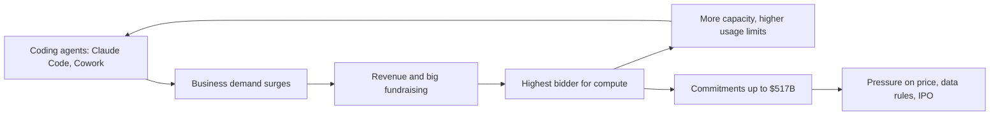

# Anthropic, 2026: the biggest buyer of compute

**Thesis:** Anthropic was founded to build safer AI, but it won by selling coding agents to businesses, and that success made it the hungriest, highest-paying buyer of computing power. In this era the agent demand turns into record growth, a compute spree and a fight over customer data. Part of the [[journeys/anthropic-journey|Anthropic journey]]; previous era: [[journeys/anthropic-journey-2023-2025|Anthropic, 2023 to 2025]].

## The story so far

By July 2026 its annualized revenue passed $65 billion, above OpenAI's $40 billion plus, and it had signed compute deals worth up to $517 billion ([[2026-09-06-How-Anthropic-Clinched-517-Billion-in-Compute-Deals-in-11-Months|Anthropic's $517 Billion]]). (Annualized revenue is the current monthly pace times twelve.)

## Hook: renting a rival's data center

Colossus 1 in Memphis was the first data center of xAI, a rival AI lab ([[2026-05-27-The-SpaceX-IPO-and-Data-Centers-in-Space|SpaceX IPO]]). In May 2026 Anthropic agreed to use all of it: over 300 megawatts and more than 220,000 Nvidia chips ([[2026-05-11-The-Inference-Shift|The Inference Shift]]). (A megawatt is a unit of electric power.) Anthropic will pay SpaceX $1.25 billion a month through May 2029, up to $45 billion in all ([[2026-09-06-How-Anthropic-Clinched-517-Billion-in-Compute-Deals-in-11-Months|Anthropic's $517 Billion]]).

## The journey

**Early 2026: growth no one planned for.** Dario Amodei said revenue and usage grew 80 times in the first quarter of 2026 ([[2026-05-12-SpaceX-and-Anthropic-xAIs-Two-Companies-Elon-Musk-and-SpaceXAIs-Future|SpaceX and Anthropic]]). Anthropic raised $30 billion at a $380 billion valuation in February, more than double its September 2025 value ([[2026-05-04-Google-Earnings-Meta-Earnings|Google and Meta Earnings]]). (Valuation is what investors say the whole company is worth.) By May it was $965 billion ([[2026-10-04-Anthropics-Big-Charity-Bill-for-Shareholders|Anthropic's Charity Bill]]). Because demand for Claude Code and Cowork surprised it, Anthropic rushed to sign compute deals ([[2026-09-06-How-Anthropic-Clinched-517-Billion-in-Compute-Deals-in-11-Months|Anthropic's $517 Billion]]).

**October 2025 to September 2026: the compute spree.** Anthropic went from 1 to 2 gigawatts of planned compute to at least 14.8 ([[2026-09-06-How-Anthropic-Clinched-517-Billion-in-Compute-Deals-in-11-Months|Anthropic's $517 Billion]]). The bill is up to $517 billion, far above the $180 billion it told investors in December 2025 it would spend through 2029 ([[2026-09-06-How-Anthropic-Clinched-517-Billion-in-Compute-Deals-in-11-Months|Anthropic's $517 Billion]]). Amazon and Google remain its biggest suppliers, with 11 gigawatts costing over $300 billion over about 10 years ([[2026-09-06-How-Anthropic-Clinched-517-Billion-in-Compute-Deals-in-11-Months|Anthropic's $517 Billion]]).

**October 2026: private equity rollups.** Beyond tech firms, private equity owners began deploying Claude across service rollups ([[2026-10-14-Inside-a-TPG-Backed-Accounting-Firms-Plans-for-AI-and-More-Acquisitions|TPG Accounting Firm AI]]). TPG backed a companywide Claude rollout across Smith + Howard's 800 employees in seven states to automate basic audit work, and outside AI trainers partnered with Anthropic to train staff in exchange for minimum spending commitments ([[2026-10-14-Inside-a-TPG-Backed-Accounting-Firms-Plans-for-AI-and-More-Acquisitions|TPG Accounting Firm AI]]). In security research, Anthropic in July 2026 broke a proposed post-quantum algorithm and shared its findings early with the U.S. government ([[2026-10-14-OpenAIs-Math-Breakthroughs-Rattle-Cryptography-Leaders|OpenAI Math Breakthroughs]]).

**October 2026: Q3 results and distillation.** Anthropic reported third-quarter 2026 revenue of $16.8 billion, up about 45% from the second quarter and more than 3.6 times its total revenue for all of 2025 ([[2026-10-14-Anthropics-Rapid-Slowing-Growth-Weigh-IPO-Valuation|Anthropic IPO Valuation]]). Growth slowed from the second quarter, when Claude Code lifted revenue over 140% from the first quarter ([[2026-10-14-Anthropics-Rapid-Slowing-Growth-Weigh-IPO-Valuation|Anthropic IPO Valuation]]). Operating margin reached 11% through the quarter on an adjusted basis, yet Anthropic revealed that 5% to 7% of its revenue came from distillation, which it expects to decline as it combats unauthorized copying by Chinese labs ([[2026-10-14-Anthropics-Rapid-Slowing-Growth-Weigh-IPO-Valuation|Anthropic IPO Valuation]]). To secure enterprise customer data for agents, Anthropic agreed to license technology and hire engineers from startup Opaque Systems ([[2026-10-14-CoreWeave-Co-Founders-Stock-Sales-Arent-Helping-Investor-Confidence|CoreWeave Stock Sales]]).

**October 2026: racing to plug in.** Because each server switched on sooner can earn a lot, Anthropic is pushing partners to speed up its $530 billion of data center leases ([[2026-10-11-The-Attractive-Economics-Behind-Anthropic-Data-Center-Sprint|Data Center Economics]]). One Louisiana site of 330 megawatts, run by former bitcoin miner Hut 8, could earn $1.3 billion or more if it opens just one month early ([[2026-10-11-The-Attractive-Economics-Behind-Anthropic-Data-Center-Sprint|Data Center Economics]]). Its commitments now top 15 gigawatts across more than 10 cloud providers, including a quiet deal with bitcoin miner IREN ([[2026-10-12-OpenAIs-Plan-To-Revive-Sora|OpenAI's Sora Plan]]). For scale, Microsoft's whole Azure cloud ran at about 5 gigawatts at the end of 2023 ([[2026-10-11-The-Attractive-Economics-Behind-Anthropic-Data-Center-Sprint|Data Center Economics]]). Small ex-crypto firms matter because they hold rare rights to grid power at old smelters and failed hydrogen sites ([[2026-10-11-The-Attractive-Economics-Behind-Anthropic-Data-Center-Sprint|Data Center Economics]]). The hunt is also going abroad: NTT Data is in final talks to build Anthropic's first dedicated Japan data center, up to 500 megawatts in Osaka ([[2026-10-13-Neocloud-Prime-Intellect-Acquires-Startup-To-Speed-Up-Inference|Prime Intellect Deal]]).

**June to September 2026: the data fight.** With Fable 5 and Mythos 5 in June, Anthropic required 30-day storage of all customer traffic to defend against cyberattacks, pledging not to train on it ([[2026-09-02-Fable-5-1-Enterprise-Frontier-Safeguards|Fable 5.1]]). Because firms feared the models would learn from their code, Palantir held Fable back and a large utility dropped a test ([[2026-09-14-Anthropic-Data-Fears-Prompt-Nvidia-Palantir-and-Booz-Allen-to-Restrict-Model-Use|Anthropic Data Fears]]). So in September, with Fable 5.1, Anthropic dropped the rule and promised safeguards that keep data on servers the customer controls ([[2026-09-21-Frontier-Overhangs|Frontier Overhangs]]; [[2026-09-02-Fable-5-1-Enterprise-Frontier-Safeguards|Fable 5.1]]).

## The rival: OpenAI

OpenAI is the company Anthropic's founders left ([[2025-Gallaugher-Ch08-Amazon|Gallaugher ch.8]], p.297). Both chase business customers, which pay more than consumers, and both are preparing to go public ([[2026-07-14-The-OpenAI-Super-App-ChatGPT-Codex-Whither-Chat|The OpenAI Super App]]). Anthropic pulled far ahead in revenue in 2026 and widened the gap from May to August ([[2026-09-28-Anthropic-Moves-to-Cut-Off-Discounts-When-Customers-Hit-Their-Cap|Anthropic Discount Caps]]). OpenAI responded by expanding its enterprise AI offerings and pricing below Anthropic ([[2026-10-14-Anthropics-Rapid-Slowing-Growth-Weigh-IPO-Valuation|Anthropic IPO Valuation]]). OpenAI's ChatGPT Work is a direct answer to Cowork ([[2026-07-14-The-OpenAI-Super-App-ChatGPT-Codex-Whither-Chat|The OpenAI Super App]]).

In a September 2026 survey of The Information's subscribers, Claude gained on ChatGPT, which still leads, and Claude Code now leads coding tools ([[2026-10-08-Chinese-Open-Models-Win-Over-One-in-Five-of-The-Informations-Subscribers|Subscriber Survey]]).

But OpenAI has a cost edge: Thompson says it almost certainly pays less for the same unit of compute ([[2026-05-12-SpaceX-and-Anthropic-xAIs-Two-Companies-Elon-Musk-and-SpaceXAIs-Future|SpaceX and Anthropic]]).

Microsoft shows both sides of that race. In summer 2025 it agreed to pay for Anthropic models in Copilot, because demos showed them better than OpenAI's at Excel math and PowerPoint ([[2026-10-12-How-Microsofts-New-Office-Chief-Fixed-Copilot-and-Won-Over-Nadella|Microsoft's Copilot Fix]]). But as OpenAI models caught back up over the six months to October 2026, Copilot leaned more on OpenAI, which Microsoft runs for free ([[2026-10-12-How-Microsofts-New-Office-Chief-Fixed-Copilot-and-Won-Over-Nadella|Microsoft's Copilot Fix]]). So Microsoft's Copilot payments to Anthropic are still on track to top $2 billion a year, but their growth has slowed ([[2026-10-12-How-Microsofts-New-Office-Chief-Fixed-Copilot-and-Won-Over-Nadella|Microsoft's Copilot Fix]]).

## The idea behind it

- [[Aggregation-Theory]]: compute flowing to Anthropic shows whoever controls demand pulls in supply ([[2026-05-14-Interview-Ben-Thompson-MoffettNathanson|Thompson at MoffettNathanson]]).
- [[Price-Umbrella]]: Chinese models only look cheap because short supply lets Anthropic and OpenAI price high ([[2026-09-21-Frontier-Overhangs|Frontier Overhangs]]).
- [[Zero-Data-Retention]]: for most large firms, anything but zero data retention is a no-go ([[2026-09-02-Fable-5-1-Enterprise-Frontier-Safeguards|Fable 5.1]]).

## The loop

> [!warning] Misstep: the data retention rule
> Anthropic made Fable use depend on keeping customer data for at least a month, and Fable usage stayed low ([[2026-09-21-Frontier-Overhangs|Frontier Overhangs]]). Anthropic reversed course after customer feedback ([[2026-09-02-Fable-5-1-Enterprise-Frontier-Safeguards|Fable 5.1]]).
>
> **Lesson (Thompson's):** pure capability is no longer a moat; once models are good enough, customers weigh data policy too ([[2026-09-21-Frontier-Overhangs|Frontier Overhangs]]).

## Moving forward (as of 2026-10-16)

- **The IPO and peak valuation debate.** The offering is planned for November 2026 before Thanksgiving ([[2026-10-14-Anthropics-Rapid-Slowing-Growth-Weigh-IPO-Valuation|Anthropic IPO Valuation]]). Following disclosures that Q3 revenue growth slowed to 45% sequentially, Manhattan Venture Partners managing partner Jared Carmel projected the IPO will need to price to sell at $1.4 trillion to $1.5 trillion, below earlier $2 trillion banker expectations ([[2026-10-15-Did-Anthropic-Miss-Its-Peak-IPO-Moment|Did Anthropic Miss Peak IPO]]). That valuation would rank Anthropic as the ninth-largest tech company, below Broadcom and above Tesla ([[2026-10-15-Did-Anthropic-Miss-Its-Peak-IPO-Moment|Did Anthropic Miss Peak IPO]]). Columnist Martin Peers argued Anthropic may have missed its peak valuation window around June 2026 as enterprises substitute cheaper models and the company carries more than $500 billion in long-term compute debt ([[2026-10-15-Did-Anthropic-Miss-Its-Peak-IPO-Moment|Did Anthropic Miss Peak IPO]]).
- **Internal safety evaluators.** Anthropic began deploying embedded internal AI evaluators with direct system access to assess safety protocols and publish independent reports ([[2026-10-15-Did-Anthropic-Miss-Its-Peak-IPO-Moment|Did Anthropic Miss Peak IPO]]).
- **Big customers pulling back.** Two customers made up nearly a quarter of 2025 revenue ([[2026-10-05-Microsoft-Slashes-Internal-Claude-Spending-by-a-Third|Microsoft Cuts Claude Spend]]). Microsoft cut its internal Claude spend by over a third, and Meta's Claude Code users fell from about 60,000 to 30,000 ([[2026-10-05-Microsoft-Slashes-Internal-Claude-Spending-by-a-Third|Microsoft Cuts Claude Spend]]).
- **Can the compute arrive?** Towns push back over noise and power, and the SpaceX deal can be cancelled on 90 days' notice ([[2026-09-06-How-Anthropic-Clinched-517-Billion-in-Compute-Deals-in-11-Months|Anthropic's $517 Billion]]). To get power fast, developers say Anthropic will accept power cuts when the grid is strained, backup power, or sites far from customers ([[2026-10-11-The-Attractive-Economics-Behind-Anthropic-Data-Center-Sprint|Data Center Economics]]). Many partners are ex-bitcoin firms, some of which struggle to raise money ([[2026-10-11-The-Attractive-Economics-Behind-Anthropic-Data-Center-Sprint|Data Center Economics]]).
- **Washington is watching closer.** The Trump administration put export controls on Anthropic in June 2026 over security worries about Mythos and Fable ([[2026-10-12-Trump-Administration-Plans-to-Move-AI-Testing-Agency-Officials-to-White-House|AI Testing Agency]]). (Export controls are rules that limit selling a product abroad.) In October, Anthropic said its AI, browsing the web, sent a false homicide tip to police, and officials then said AI firms must report and fix such incidents ([[2026-10-12-OpenAIs-Plan-To-Revive-Sora|OpenAI's Sora Plan]]).

## One "why?" question

Why would a rival's data center work for Anthropic?

Demand exceeds supply, and Anthropic had the most willingness to pay ([[2026-05-12-SpaceX-and-Anthropic-xAIs-Two-Companies-Elon-Musk-and-SpaceXAIs-Future|SpaceX and Anthropic]]). Buyers still want Anthropic and OpenAI specifically, so SpaceXAI and Meta sell spare capacity to Anthropic ([[2026-07-20-Whos-Afraid-of-Chinese-Models|Who's Afraid of Chinese Models?]]).

## Sources

1. [[2025-Gallaugher-Ch08-Amazon|Gallaugher, Information Systems v10, ch.8 Amazon]] (FlatWorld, 2025).
2. [[2026-05-04-Google-Earnings-Meta-Earnings|Google and Meta Earnings]] (Stratechery, 2026-05-04).
3. [[2026-05-11-The-Inference-Shift|The Inference Shift]] (Stratechery, 2026-05-11).
4. [[2026-05-12-SpaceX-and-Anthropic-xAIs-Two-Companies-Elon-Musk-and-SpaceXAIs-Future|SpaceX and Anthropic]] (Stratechery, 2026-05-12).
5. [[2026-05-14-Interview-Ben-Thompson-MoffettNathanson|Thompson at MoffettNathanson]] (Stratechery, 2026-05-14).
6. [[2026-05-27-The-SpaceX-IPO-and-Data-Centers-in-Space|SpaceX IPO]] (Stratechery, 2026-05-27).
7. [[2026-07-14-The-OpenAI-Super-App-ChatGPT-Codex-Whither-Chat|The OpenAI Super App]] (Stratechery, 2026-07-14).
8. [[2026-07-20-Whos-Afraid-of-Chinese-Models|Who's Afraid of Chinese Models?]] (Stratechery, 2026-07-20).
9. [[2026-09-02-Fable-5-1-Enterprise-Frontier-Safeguards|Fable 5.1]] (Stratechery, 2026-09-02).
10. [[2026-09-04-Anthropics-In-House-Payments-Tech-Push-Could-Chip-Away-at-Stripe|Anthropic Payments Push]] (The Information, 2026-09-04).
11. [[2026-09-06-How-Anthropic-Clinched-517-Billion-in-Compute-Deals-in-11-Months|Anthropic's $517 Billion]] (The Information, 2026-09-06).
12. [[2026-09-14-Anthropic-Data-Fears-Prompt-Nvidia-Palantir-and-Booz-Allen-to-Restrict-Model-Use|Anthropic Data Fears]] (The Information, 2026-09-14).
13. [[2026-09-21-Frontier-Overhangs|Frontier Overhangs]] (Stratechery, 2026-09-21).
14. [[2026-09-22-Anthropic-in-Talks-for-1-Gigawatt-Data-Center-Lease-With-Apollo-Backed-Developer|Anthropic Lease Talks]] (The Information, 2026-09-22).
15. [[2026-09-28-Anthropic-Moves-to-Cut-Off-Discounts-When-Customers-Hit-Their-Cap|Anthropic Discount Caps]] (The Information, 2026-09-28).
16. [[2026-09-30-Cracks-Emerge-in-AIs-Debt-Fueled-Data-Center-Boom|Data Center Debt Cracks]] (The Information, 2026-09-30).
17. [[2026-09-30-Wall-Street-and-Silicon-Valley-Split-Over-AIs-Price-Tag|AI's Price Tag]] (The Information, 2026-09-30).
18. [[2026-10-04-Anthropics-Big-Charity-Bill-for-Shareholders|Anthropic's Charity Bill]] (The Information, 2026-10-04).
19. [[2026-10-05-Microsoft-Slashes-Internal-Claude-Spending-by-a-Third|Microsoft Cuts Claude Spend]] (The Information, 2026-10-05).
20. [[2026-10-08-Chinese-Open-Models-Win-Over-One-in-Five-of-The-Informations-Subscribers|Subscriber Survey]] (The Information, 2026-10-08).
21. [[2026-07-22-OpenAI-Hacks-Hugging-Face-What-Happened-Alignment-and-Paper-Clips|OpenAI Hacks Hugging Face]] (Stratechery, 2026-07-22).
22. [[2026-10-11-The-Attractive-Economics-Behind-Anthropic-Data-Center-Sprint|Data Center Economics]] (The Information, 2026-10-11).
23. [[2026-10-12-How-Microsofts-New-Office-Chief-Fixed-Copilot-and-Won-Over-Nadella|Microsoft's Copilot Fix]] (The Information, 2026-10-12).
24. [[2026-10-12-OpenAIs-Plan-To-Revive-Sora|OpenAI's Sora Plan]] (The Information, 2026-10-12).
25. [[2026-10-12-Trump-Administration-Plans-to-Move-AI-Testing-Agency-Officials-to-White-House|AI Testing Agency]] (The Information, 2026-10-12).
26. [[2026-10-13-Neocloud-Prime-Intellect-Acquires-Startup-To-Speed-Up-Inference|Prime Intellect Deal]] (The Information, 2026-10-13).
27. [[2026-10-14-Inside-a-TPG-Backed-Accounting-Firms-Plans-for-AI-and-More-Acquisitions|TPG Accounting Firm AI]] (The Information, 2026-10-14).
28. [[2026-10-14-OpenAIs-Math-Breakthroughs-Rattle-Cryptography-Leaders|OpenAI Math Breakthroughs]] (The Information, 2026-10-14).
29. [[2026-10-14-Anthropics-Rapid-Slowing-Growth-Weigh-IPO-Valuation|Anthropic IPO Valuation]] (The Information, 2026-10-14).
30. [[2026-10-14-CoreWeave-Co-Founders-Stock-Sales-Arent-Helping-Investor-Confidence|CoreWeave Stock Sales]] (The Information, 2026-10-14).
31. [[2026-10-15-Did-Anthropic-Miss-Its-Peak-IPO-Moment|Did Anthropic Miss Peak IPO]] (The Information, 2026-10-15).

**Where sources disagree.**
- Compute deals: $517 billion in 11 months ([[2026-09-06-How-Anthropic-Clinched-517-Billion-in-Compute-Deals-in-11-Months|Anthropic's $517 Billion]]) versus $531 billion ([[2026-09-22-Anthropic-in-Talks-for-1-Gigawatt-Data-Center-Lease-With-Apollo-Backed-Developer|Anthropic Lease Talks]]) versus $530 billion of leases ([[2026-10-11-The-Attractive-Economics-Behind-Anthropic-Data-Center-Sprint|Data Center Economics]]), all The Information.
- Profit: positive adjusted operating income, and Thompson was told it is profitable even counting training ([[2026-09-21-Frontier-Overhangs|Frontier Overhangs]]). But draft IPO papers reportedly show a $42 billion net loss last year ([[2026-09-30-Cracks-Emerge-in-AIs-Debt-Fueled-Data-Center-Boom|Data Center Debt Cracks]]). "Adjusted" leaves out stock pay, a legal settlement and the charity match ([[2026-10-04-Anthropics-Big-Charity-Bill-for-Shareholders|Anthropic's Charity Bill]]). On operations alone, it went from spending about $2.30 per $1 of revenue in spring 2025 to a slight profit in the June 2026 quarter ([[2026-10-11-The-Attractive-Economics-Behind-Anthropic-Data-Center-Sprint|Data Center Economics]]).
- Valuation: private market valuation reached $965 billion in May 2026, bankers floated $2 trillion for the IPO, but slowing Q3 growth led investors to expect targets under $1.5 trillion ([[2026-10-14-Anthropics-Rapid-Slowing-Growth-Weigh-IPO-Valuation|Anthropic IPO Valuation]]).
- Margin: above 80 percent per the Financial Times ([[2026-09-21-Frontier-Overhangs|Frontier Overhangs]]), about 75 percent per what Anthropic told a partner ([[2026-09-28-Anthropic-Moves-to-Cut-Off-Discounts-When-Customers-Hit-Their-Cap|Anthropic Discount Caps]]). One analyst estimates 85 percent at a single Louisiana site if used only for inference, leaving out training and payroll ([[2026-10-11-The-Attractive-Economics-Behind-Anthropic-Data-Center-Sprint|Data Center Economics]]). (Gross margin is the share of a sale left after the direct cost of serving it.)
- Export limits: Bloomberg said Washington stopped short of limiting foreign access to Fable 5 and Mythos 5 after Anthropic added guardrails ([[2026-07-22-OpenAI-Hacks-Hugging-Face-What-Happened-Alignment-and-Paper-Clips|OpenAI Hacks Hugging Face]]). The Information says export controls were imposed in June 2026 ([[2026-10-12-Trump-Administration-Plans-to-Move-AI-Testing-Agency-Officials-to-White-House|AI Testing Agency]]).
- Growth: 80 times in Q1 2026 per Amodei ([[2026-05-12-SpaceX-and-Anthropic-xAIs-Two-Companies-Elon-Musk-and-SpaceXAIs-Future|SpaceX and Anthropic]]), nearly fivefold in the five months to May per The Information ([[2026-09-04-Anthropics-In-House-Payments-Tech-Push-Could-Chip-Away-at-Stripe|Anthropic Payments Push]]).

See also: [[journeys/anthropic-journey|Anthropic journey (hub)]], [[journeys/anthropic-journey-2023-2025|Anthropic, 2023 to 2025]], [[journeys/openai-journey|OpenAI journey]], [[journeys/google-journey|Google journey]], [[journeys/nvidia-journey|Nvidia journey]], [[stories/ai-shift-2024-2026|The AI shift, 2024 to 2026]], [[Anthropic]].

## Change log

- 2026-10-13: Split from anthropic-journey.md per proposal 2026-10-13. Hook, beats, rival, loop, misstep, Moving forward, citations and sources moved unchanged; added era links and glue sentences only.
- 2026-10-14: added private equity rollout of Claude at Smith + Howard and post-quantum crypto disclosure [TPG Accounting Firm AI, OpenAI Math Breakthroughs, 2026-10-14]
- 2026-10-15: added Q3 revenue ($16.8B, up 45%), 11% operating margin, distillation share, Opaque Systems deal, and lower IPO valuation expectations [Anthropic IPO Valuation, CoreWeave Stock Sales, 2026-10-15]
- 2026-10-16: added $1.4T to $1.5T IPO valuation projection, peak valuation debate, and internal safety evaluators [Did Anthropic Miss Peak IPO, 2026-10-15]

<!-- claims: clm-1b4fed1e952af5466ad1, clm-8648de40861ab5761c49, clm-a6f46b4de3c3a3ac749e, clm-a06e39cc581a7da9ba62, clm-04e5d642160dbaa142fc, clm-a5ea26b5a4576a0ec89f, clm-ac0875e378a4e722820e, clm-ecf330fefff606b208d4, clm-8b1ec7542ed0373fe7c9, clm-59f9878c8a4a74ccc7e2, clm-b2a565fe69377805503e, clm-06734bbff379e00ef7d7, clm-0b84a1148e96291cce69, clm-1f09345bd5aec832df0e, clm-a9af6fd1eb06ecd6cc24, clm-37551a42eab3a9b8f31e, clm-4bafd89b440ea84b8867, clm-b383ac45a4a58c129c55, clm-bcca8278e8628748800f, clm-7847a3be956ce8d91ec8, clm-10d1cdfb48e1874ef233, clm-452b64e03dbe4f90dba5, clm-537cafc6f534ef0d5bb6, clm-6d6ee9aa61174afda74a, clm-71e0ff2c405c97388615, clm-93922d4e31933fe411da, clm-97efca683d49ae8bd454, clm-c7e4c1cae1b5d6b987b7, clm-1fefa158949545de3016, clm-410fcedc16acddf244f5, clm-02321f8333e8a34c126e, clm-0bde8d4379302c37ea95, clm-406c6b82d3479c0b0079, clm-6d11785bc5cc78e3d4cb, clm-83f3a0f05d74c9ba9e7a, clm-c5c11119d9a23c9067bf, clm-e7658eb251b288e3ef37, clm-321ac1798e7bd5d3648a, clm-b342f1fbd10ad8f3db3f, clm-a2241a6b09cf622f1b1a, clm-7f6851b98b751f9f325b, clm-ba5f8ee9743727dcd2d9, clm-6488806113efd6beadc0, clm-0601af34f51a144d51aa, clm-32b53c401a64bbc35b01, clm-f376c564f5327d0910d7, clm-fc27167ab9f3ffa16168, clm-0b10242c58f41ed6f8dc, clm-fcd74c1c7540f769cb89, clm-03c9dd7b7d668f6719dd, clm-9ac3ed07c00d2d0411ca, clm-5cb298e48431540be7c9, clm-4f85252aca2f2291b488, clm-a1430578fa76dad07f6a, clm-de328d1cdff1e66ec842, clm-29378b0bce986420c97b, clm-54e1da4c6315bfaa6136, clm-2c2e4a6dd2aeabf81b98, clm-fff4d53fdb3947acf1fe, clm-ee8150521a3f48dc09b6, clm-484bc22ca47b6cfa1627, clm-4f8d6b9ac8c8aa19d852, clm-d1cf9ab13f48fa77239f, clm-c4f9e51e933ca099c33f, clm-4182d4bfe2aa9f958d4e, clm-c91441d2d502ea5f4f56, clm-7029830f50eee43a701d, clm-f207d00bd58d95d082c7, clm-4930d454444507985f9e, clm-7e456e3a0353cb58b6d5, clm-ed2eee7102d53db2be7f, clm-090d16732cf8de245cd0, clm-e3bd260d987a621a092b, clm-050ac743ad4f435b812b, clm-34e874a222abc86eac2a, clm-559be22f39d3bd9a8807, clm-069a4fc13787763bfa68, clm-3e6b42103f23e124f52c, clm-d9774e86ec2afe186f6a, clm-b6a6b68806d65f7fa62c, clm-e557855a0924f288f3cf, clm-6180963be726e2c226aa, clm-46d9539dda1c4a27ccbc, clm-ca316a456908fe8bd197, clm-dd323faaa4d7461918e6, clm-521f7236c45bdba4eaf2, clm-523458448874d80daeab -->
