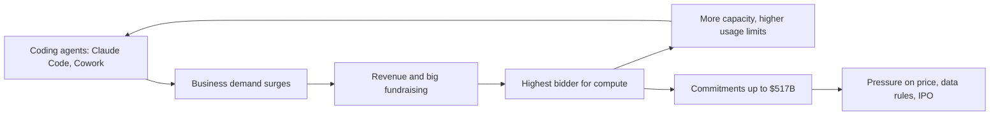

# Anthropic: the safety lab that became the biggest buyer of compute

**Thesis:** Anthropic was founded to build safer AI, but it won by selling coding agents to businesses, and that success made it the hungriest, highest-paying buyer of computing power.

## The story so far

Anthropic was started by people who left OpenAI, largely to build safer AI ([[2025-Gallaugher-Ch08-Amazon|Gallaugher ch.8]], p.297). It bet almost entirely on businesses, which pay for productivity, while most consumers will not pay for AI ([[2026-03-16-Agents-Over-Bubbles|Agents Over Bubbles]]). Its Opus 4.5 model and Claude Code tool brought the first usable agents in late 2025 ([[2026-05-11-The-Inference-Shift|The Inference Shift]]). By July 2026 its annualized revenue passed $65 billion, above OpenAI's $40 billion plus, and it had signed compute deals worth up to $517 billion ([[2026-09-06-How-Anthropic-Clinched-517-Billion-in-Compute-Deals-in-11-Months|Anthropic's $517 Billion]]). (Annualized revenue is the current monthly pace times twelve.)

## Hook: renting a rival's data center

Colossus 1 in Memphis was the first data center of xAI, a rival AI lab ([[2026-05-27-The-SpaceX-IPO-and-Data-Centers-in-Space|SpaceX IPO]]). In May 2026 Anthropic agreed to use all of it: over 300 megawatts and more than 220,000 Nvidia chips ([[2026-05-11-The-Inference-Shift|The Inference Shift]]). (A megawatt is a unit of electric power.) Anthropic will pay SpaceX $1.25 billion a month through May 2029, up to $45 billion in all ([[2026-09-06-How-Anthropic-Clinched-517-Billion-in-Compute-Deals-in-11-Months|Anthropic's $517 Billion]]).

## The journey

**Up to 2023: a safety lab with little revenue.** Siblings Dario and Daniela Amodei, both OpenAI vice presidents during GPT-3, founded Anthropic as a public benefit corporation ([[2023-01-09-Six-OpenAI-Rivals-Google-and-Microsoft-Are-Watching|Six OpenAI Rivals]]). (That is a company legally allowed to weigh a public mission next to profit.) By January 2023 it had raised $704 million, was valued at $4 billion, and had 80 staff and almost no revenue ([[2023-01-09-Six-OpenAI-Rivals-Google-and-Microsoft-Are-Watching|Six OpenAI Rivals]]).

**September 2023: cloud money, cloud chips.** Amazon put in $1.25 billion, with the option to go up to $4 billion; Google was also an investor ([[2025-Gallaugher-Ch08-Amazon|Gallaugher ch.8]], p.297). Because Google and AWS invested so it would use their computers, Anthropic ran on Google's TPUs and Amazon's Trainium, not Nvidia chips ([[2026-05-26-Nvidia-Earnings-The-AI-Stack-Nvidias-New-Reporting|Nvidia Earnings, May]]). (Both are custom AI chips the clouds design themselves.)

**November 2025: the agent unlock.** Anthropic released Opus 4.5 on November 24, 2025, and by December Claude Code could do things never possible before ([[2026-03-16-Agents-Over-Bubbles|Agents Over Bubbles]]). Thompson says agents are so hungry for tokens that AI building is not a bubble ([[2026-09-21-Frontier-Overhangs|Frontier Overhangs]]). (A token is a small chunk of text; AI use is billed in tokens.) So Anthropic launched Claude Cowork, an agent for office tasks, in January 2026 ([[2026-07-14-The-OpenAI-Super-App-ChatGPT-Codex-Whither-Chat|The OpenAI Super App]]).

**Early 2026: growth no one planned for.** Dario Amodei said revenue and usage grew 80 times in the first quarter of 2026 ([[2026-05-12-SpaceX-and-Anthropic-xAIs-Two-Companies-Elon-Musk-and-SpaceXAIs-Future|SpaceX and Anthropic]]). Anthropic raised $30 billion at a $380 billion valuation in February, more than double its September 2025 value ([[2026-05-04-Google-Earnings-Meta-Earnings|Google and Meta Earnings]]). (Valuation is what investors say the whole company is worth.) By May it was $965 billion ([[2026-10-04-Anthropics-Big-Charity-Bill-for-Shareholders|Anthropic's Charity Bill]]). Because demand for Claude Code and Cowork surprised it, Anthropic rushed to sign compute deals ([[2026-09-06-How-Anthropic-Clinched-517-Billion-in-Compute-Deals-in-11-Months|Anthropic's $517 Billion]]).

**October 2025 to September 2026: the compute spree.** Anthropic went from 1 to 2 gigawatts of planned compute to at least 14.8 ([[2026-09-06-How-Anthropic-Clinched-517-Billion-in-Compute-Deals-in-11-Months|Anthropic's $517 Billion]]). The bill is up to $517 billion, far above the $180 billion it told investors in December 2025 it would spend through 2029 ([[2026-09-06-How-Anthropic-Clinched-517-Billion-in-Compute-Deals-in-11-Months|Anthropic's $517 Billion]]). Amazon and Google remain its biggest suppliers, with 11 gigawatts costing over $300 billion over about 10 years ([[2026-09-06-How-Anthropic-Clinched-517-Billion-in-Compute-Deals-in-11-Months|Anthropic's $517 Billion]]).

**June to September 2026: the data fight.** With Fable 5 and Mythos 5 in June, Anthropic required 30-day storage of all customer traffic to defend against cyberattacks, pledging not to train on it ([[2026-09-02-Fable-5-1-Enterprise-Frontier-Safeguards|Fable 5.1]]). Because firms feared the models would learn from their code, Palantir held Fable back and a large utility dropped a test ([[2026-09-14-Anthropic-Data-Fears-Prompt-Nvidia-Palantir-and-Booz-Allen-to-Restrict-Model-Use|Anthropic Data Fears]]). So in September, with Fable 5.1, Anthropic dropped the rule and promised safeguards that keep data on servers the customer controls ([[2026-09-21-Frontier-Overhangs|Frontier Overhangs]]; [[2026-09-02-Fable-5-1-Enterprise-Frontier-Safeguards|Fable 5.1]]).

## The rival: OpenAI

OpenAI is the company Anthropic's founders left ([[2025-Gallaugher-Ch08-Amazon|Gallaugher ch.8]], p.297). Both chase business customers, which pay more than consumers, and both are preparing to go public ([[2026-07-14-The-OpenAI-Super-App-ChatGPT-Codex-Whither-Chat|The OpenAI Super App]]). Anthropic pulled far ahead in revenue in 2026 and widened the gap from May to August ([[2026-09-28-Anthropic-Moves-to-Cut-Off-Discounts-When-Customers-Hit-Their-Cap|Anthropic Discount Caps]]). OpenAI's ChatGPT Work is a direct answer to Cowork ([[2026-07-14-The-OpenAI-Super-App-ChatGPT-Codex-Whither-Chat|The OpenAI Super App]]).

In a September 2026 survey of The Information's subscribers, Claude gained on ChatGPT, which still leads, and Claude Code now leads coding tools ([[2026-10-08-Chinese-Open-Models-Win-Over-One-in-Five-of-The-Informations-Subscribers|Subscriber Survey]]).

But OpenAI has a cost edge: Thompson says it almost certainly pays less for the same unit of compute ([[2026-05-12-SpaceX-and-Anthropic-xAIs-Two-Companies-Elon-Musk-and-SpaceXAIs-Future|SpaceX and Anthropic]]).

## The idea behind it

- [[Aggregation-Theory]]: compute flowing to Anthropic shows whoever controls demand pulls in supply ([[2026-05-14-Interview-Ben-Thompson-MoffettNathanson|Thompson at MoffettNathanson]]).
- [[Price-Umbrella]]: Chinese models only look cheap because short supply lets Anthropic and OpenAI price high ([[2026-09-21-Frontier-Overhangs|Frontier Overhangs]]).
- [[Zero-Data-Retention]]: for most large firms, anything but zero data retention is a no-go ([[2026-09-02-Fable-5-1-Enterprise-Frontier-Safeguards|Fable 5.1]]).

## The loop

> [!warning] Misstep: the data retention rule
> Anthropic made Fable use depend on keeping customer data for at least a month, and Fable usage stayed low ([[2026-09-21-Frontier-Overhangs|Frontier Overhangs]]). Anthropic reversed course after customer feedback ([[2026-09-02-Fable-5-1-Enterprise-Frontier-Safeguards|Fable 5.1]]).
>
> **Lesson (Thompson's):** pure capability is no longer a moat; once models are good enough, customers weigh data policy too ([[2026-09-21-Frontier-Overhangs|Frontier Overhangs]]).

## Moving forward (as of 2026-10-09)

- **The IPO.** The listing is likely weeks from its roadshow, the investor sales tour ([[2026-09-30-Wall-Street-and-Silicon-Valley-Split-Over-AIs-Price-Tag|AI's Price Tag]]). Two large investors said it should be valued nearer $1.5 trillion, not the $2 trillion some bankers floated ([[2026-09-30-Wall-Street-and-Silicon-Valley-Split-Over-AIs-Price-Tag|AI's Price Tag]]).
- **Big customers pulling back.** Two customers made up nearly a quarter of 2025 revenue ([[2026-10-05-Microsoft-Slashes-Internal-Claude-Spending-by-a-Third|Microsoft Cuts Claude Spend]]). Microsoft cut its internal Claude spend by over a third, and Meta's Claude Code users fell from about 60,000 to 30,000 ([[2026-10-05-Microsoft-Slashes-Internal-Claude-Spending-by-a-Third|Microsoft Cuts Claude Spend]]).
- **Can the compute arrive?** Towns push back over noise and power, and the SpaceX deal can be cancelled on 90 days' notice ([[2026-09-06-How-Anthropic-Clinched-517-Billion-in-Compute-Deals-in-11-Months|Anthropic's $517 Billion]]).

## Three "why?" questions

Why did Anthropic pass OpenAI in revenue?

It focused almost entirely on businesses, which pay for productivity ([[2026-03-16-Agents-Over-Bubbles|Agents Over Bubbles]]). It was long the only frontier model on every major cloud ([[2026-05-05-Amazons-Durability|Amazon's Durability]]).

Why would a rival's data center work for Anthropic?

Demand exceeds supply, and Anthropic had the most willingness to pay ([[2026-05-12-SpaceX-and-Anthropic-xAIs-Two-Companies-Elon-Musk-and-SpaceXAIs-Future|SpaceX and Anthropic]]). Buyers still want Anthropic and OpenAI specifically, so SpaceXAI and Meta sell spare capacity to Anthropic ([[2026-07-20-Whos-Afraid-of-Chinese-Models|Who's Afraid of Chinese Models?]]).

Why did Nvidia barely sell to the fastest-growing lab?

Anthropic took Google and Amazon money and ran on their chips ([[2026-05-26-Nvidia-Earnings-The-AI-Stack-Nvidias-New-Reporting|Nvidia Earnings, May]]). Even its Mythos model appears to have been trained on Google TPUs ([[2026-04-20-TSMC-Earnings-New-N3-Fabs-The-Nvidia-Ramp|TSMC Earnings]]).

## Sources

1. [[2023-01-09-Six-OpenAI-Rivals-Google-and-Microsoft-Are-Watching|Six OpenAI Rivals]] (The Information, 2023-01-09).
2. [[2025-Gallaugher-Ch08-Amazon|Gallaugher, Information Systems v10, ch.8 Amazon]] (FlatWorld, 2025).
3. [[2026-03-16-Agents-Over-Bubbles|Agents Over Bubbles]] (Stratechery, 2026-03-16).
4. [[2026-04-20-TSMC-Earnings-New-N3-Fabs-The-Nvidia-Ramp|TSMC Earnings]] (Stratechery, 2026-04-20).
5. [[2026-05-04-Google-Earnings-Meta-Earnings|Google and Meta Earnings]] (Stratechery, 2026-05-04).
6. [[2026-05-05-Amazons-Durability|Amazon's Durability]] (Stratechery, 2026-05-05).
7. [[2026-05-11-The-Inference-Shift|The Inference Shift]] (Stratechery, 2026-05-11).
8. [[2026-05-12-SpaceX-and-Anthropic-xAIs-Two-Companies-Elon-Musk-and-SpaceXAIs-Future|SpaceX and Anthropic]] (Stratechery, 2026-05-12).
9. [[2026-05-14-Interview-Ben-Thompson-MoffettNathanson|Thompson at MoffettNathanson]] (Stratechery, 2026-05-14).
10. [[2026-05-26-Nvidia-Earnings-The-AI-Stack-Nvidias-New-Reporting|Nvidia Earnings, May]] (Stratechery, 2026-05-26).
11. [[2026-05-27-The-SpaceX-IPO-and-Data-Centers-in-Space|SpaceX IPO]] (Stratechery, 2026-05-27).
12. [[2026-07-14-The-OpenAI-Super-App-ChatGPT-Codex-Whither-Chat|The OpenAI Super App]] (Stratechery, 2026-07-14).
13. [[2026-07-20-Whos-Afraid-of-Chinese-Models|Who's Afraid of Chinese Models?]] (Stratechery, 2026-07-20).
14. [[2026-09-02-Fable-5-1-Enterprise-Frontier-Safeguards|Fable 5.1]] (Stratechery, 2026-09-02).
15. [[2026-09-04-Anthropics-In-House-Payments-Tech-Push-Could-Chip-Away-at-Stripe|Anthropic Payments Push]] (The Information, 2026-09-04).
16. [[2026-09-06-How-Anthropic-Clinched-517-Billion-in-Compute-Deals-in-11-Months|Anthropic's $517 Billion]] (The Information, 2026-09-06).
17. [[2026-09-14-Anthropic-Data-Fears-Prompt-Nvidia-Palantir-and-Booz-Allen-to-Restrict-Model-Use|Anthropic Data Fears]] (The Information, 2026-09-14).
18. [[2026-09-21-Frontier-Overhangs|Frontier Overhangs]] (Stratechery, 2026-09-21).
19. [[2026-09-22-Anthropic-in-Talks-for-1-Gigawatt-Data-Center-Lease-With-Apollo-Backed-Developer|Anthropic Lease Talks]] (The Information, 2026-09-22).
20. [[2026-09-28-Anthropic-Moves-to-Cut-Off-Discounts-When-Customers-Hit-Their-Cap|Anthropic Discount Caps]] (The Information, 2026-09-28).
21. [[2026-09-30-Cracks-Emerge-in-AIs-Debt-Fueled-Data-Center-Boom|Data Center Debt Cracks]] (The Information, 2026-09-30).
22. [[2026-09-30-Wall-Street-and-Silicon-Valley-Split-Over-AIs-Price-Tag|AI's Price Tag]] (The Information, 2026-09-30).
23. [[2026-10-04-Anthropics-Big-Charity-Bill-for-Shareholders|Anthropic's Charity Bill]] (The Information, 2026-10-04).
24. [[2026-10-05-Microsoft-Slashes-Internal-Claude-Spending-by-a-Third|Microsoft Cuts Claude Spend]] (The Information, 2026-10-05).
25. [[2026-10-08-Chinese-Open-Models-Win-Over-One-in-Five-of-The-Informations-Subscribers|Subscriber Survey]] (The Information, 2026-10-08).

**Older than 2 years.** The founding numbers ($704 million raised, $4 billion value, 80 staff) rest only on the January 2023 report.

**Where sources disagree.**
- Compute deals: $517 billion in 11 months ([[2026-09-06-How-Anthropic-Clinched-517-Billion-in-Compute-Deals-in-11-Months|Anthropic's $517 Billion]]) versus $531 billion ([[2026-09-22-Anthropic-in-Talks-for-1-Gigawatt-Data-Center-Lease-With-Apollo-Backed-Developer|Anthropic Lease Talks]]), both The Information.
- Profit: positive adjusted operating income, and Thompson was told it is profitable even counting training ([[2026-09-21-Frontier-Overhangs|Frontier Overhangs]]). But draft IPO papers reportedly show a $42 billion net loss last year ([[2026-09-30-Cracks-Emerge-in-AIs-Debt-Fueled-Data-Center-Boom|Data Center Debt Cracks]]). "Adjusted" leaves out stock pay, a legal settlement and the charity match ([[2026-10-04-Anthropics-Big-Charity-Bill-for-Shareholders|Anthropic's Charity Bill]]).
- Margin: above 80 percent per the Financial Times ([[2026-09-21-Frontier-Overhangs|Frontier Overhangs]]), about 75 percent per what Anthropic told a partner ([[2026-09-28-Anthropic-Moves-to-Cut-Off-Discounts-When-Customers-Hit-Their-Cap|Anthropic Discount Caps]]). (Gross margin is the share of a sale left after the direct cost of serving it.)
- Growth: 80 times in Q1 2026 per Amodei ([[2026-05-12-SpaceX-and-Anthropic-xAIs-Two-Companies-Elon-Musk-and-SpaceXAIs-Future|SpaceX and Anthropic]]), nearly fivefold in the five months to May per The Information ([[2026-09-04-Anthropics-In-House-Payments-Tech-Push-Could-Chip-Away-at-Stripe|Anthropic Payments Push]]).

See also: [[journeys/openai-journey|OpenAI journey]], [[journeys/google-journey|Google journey]], [[journeys/nvidia-journey|Nvidia journey]], [[stories/ai-shift-2024-2026|The AI shift, 2024 to 2026]], [[Anthropic]].

## Change log

- 2026-10-08: first build from proposal 2026-10-08.
- 2026-10-09: rival section: subscriber survey shows Claude gaining and Claude Code leading coding tools [Subscriber Survey, 2026-10-08]

<!-- claims: clm-4c6c74434f032e1612b6, clm-7758453807e8271537d9, clm-1b4fed1e952af5466ad1, clm-8648de40861ab5761c49, clm-3fcad85d76a9aa335faf, clm-a6f46b4de3c3a3ac749e, clm-a06e39cc581a7da9ba62, clm-188f77eee1b4ab113e40, clm-f7f307234d0ded06437f, clm-04e5d642160dbaa142fc, clm-a5ea26b5a4576a0ec89f, clm-ac0875e378a4e722820e, clm-ecf330fefff606b208d4, clm-8b1ec7542ed0373fe7c9, clm-59f9878c8a4a74ccc7e2, clm-b2a565fe69377805503e, clm-ec4a08996f8ff7dc6781, clm-06734bbff379e00ef7d7, clm-0b84a1148e96291cce69, clm-1f09345bd5aec832df0e, clm-a9af6fd1eb06ecd6cc24, clm-37551a42eab3a9b8f31e, clm-4bafd89b440ea84b8867, clm-b383ac45a4a58c129c55, clm-bcca8278e8628748800f, clm-7847a3be956ce8d91ec8, clm-10d1cdfb48e1874ef233, clm-452b64e03dbe4f90dba5, clm-537cafc6f534ef0d5bb6, clm-6d6ee9aa61174afda74a, clm-71e0ff2c405c97388615, clm-93922d4e31933fe411da, clm-97efca683d49ae8bd454, clm-c7e4c1cae1b5d6b987b7, clm-1fefa158949545de3016, clm-410fcedc16acddf244f5, clm-02321f8333e8a34c126e, clm-0bde8d4379302c37ea95, clm-406c6b82d3479c0b0079, clm-6d11785bc5cc78e3d4cb, clm-83f3a0f05d74c9ba9e7a, clm-c5c11119d9a23c9067bf, clm-e7658eb251b288e3ef37, clm-321ac1798e7bd5d3648a, clm-b342f1fbd10ad8f3db3f, clm-a2241a6b09cf622f1b1a, clm-7f6851b98b751f9f325b, clm-ba5f8ee9743727dcd2d9, clm-6488806113efd6beadc0, clm-0601af34f51a144d51aa, clm-32b53c401a64bbc35b01, clm-f376c564f5327d0910d7, clm-fc27167ab9f3ffa16168, clm-0f296fecff83ca20f589, clm-0b10242c58f41ed6f8dc, clm-fcd74c1c7540f769cb89 -->
