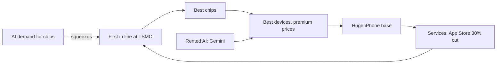

# Apple, 2025 to 2026: the rented brain

**Thesis:** The company whose creed was "own the core technology" now rents its AI brain from Google, and bets that the best device, not the best model, wins. This era is the rental. Part of the [[journeys/apple-journey|Apple journey]]; previous era: [[journeys/apple-journey-1998-2024|Apple, 1998 to 2024]].

## The story so far

Apple made its hardware chief, John Ternus, CEO, and Thompson says it has chosen not to build frontier AI models ([[2026-05-14-Interview-Ben-Thompson-MoffettNathanson|MoffettNathanson interview]]). Its new Siri runs on Google's Gemini ([[2026-07-13-Apple-Sues-OpenAI|Apple Sues OpenAI]]). Now AI demand is squeezing the supply chain Cook built, and AI firms want to reach users without the iPhone ([[2026-05-13-The-Deployment-Company-Back-to-the-70s-Apple-and-Intel|Apple and Intel]]; [[2026-07-13-Apple-Sues-OpenAI|Apple Sues OpenAI]]).

## Hook: 400 former employees at OpenAI

In July 2026, Apple sued OpenAI in federal court, claiming it stole trade secrets to build rival devices ([[2026-07-13-Apple-Sues-OpenAI|Apple Sues OpenAI]]). (A trade secret is private know-how a company keeps hidden to stay ahead.) Apple says over 400 of its former staff now work at OpenAI ([[2026-07-13-Apple-Sues-OpenAI|Apple Sues OpenAI]]). OpenAI's device effort is meant to reach consumers directly, not through the iPhone ([[2026-07-13-Apple-Sues-OpenAI|Apple Sues OpenAI]]).

## The journey

**2025: Peak profit, rented brain.** Services earned 26 percent of revenue but 41 percent of profit ([[2026-04-21-Tim-Cooks-Impeccable-Timing|Tim Cook's Timing]]). (Profit share above revenue share means services are much more profitable per dollar than phones.) Apple then chose to white-label Google's Gemini for Siri, which Thompson called good for now but a long-run dependence on others; Horace Dediu puts the cost at about $1 billion a year ([[2026-04-21-Tim-Cooks-Impeccable-Timing|Tim Cook's Timing]]; [[2026-03-16-Agents-Over-Bubbles|Agents Over Bubbles]]).

**April 2026: A hardware CEO.** Apple named Ternus CEO from September 1, with Cook becoming executive chairman ([[2026-04-21-Tim-Cooks-Impeccable-Timing|Tim Cook's Timing]]). Thompson calls the Gemini choice and the Ternus choice "the same decision": compete in AI through devices ([[2026-04-22-John-Ternus-and-Apples-Hardware-Defined-Future-SpaceXAI-and-Cursor|Ternus and Apple's Hardware]]).

**May 2026: AI eats Apple's chip supply.** The March quarter brought $111.2 billion in revenue and a 49.3 percent gross margin, an iPhone-era record ([[2026-05-06-Microsoft-Earnings-Apple-Earnings|Apple Earnings]]). (Gross margin is the share of each sales dollar left after the cost of making the product.) But AI now takes so much of TSMC's capacity that Apple ran short of A19 Pro chips and Mac chips ([[2026-05-13-The-Deployment-Company-Back-to-the-70s-Apple-and-Intel|Apple and Intel]]). So Apple reached a preliminary deal for Intel to make some of its chips, mainly for economic reasons, Thompson argues ([[2026-05-13-The-Deployment-Company-Back-to-the-70s-Apple-and-Intel|Apple and Intel]]), and had to raise prices mid-cycle ([[2026-07-13-Apple-Sues-OpenAI|Apple Sues OpenAI]]).

**September 2026: The iPhone as "personal hub".** Ternus unveiled the iPhone Duo, Apple's first foldable, with a 7.6-inch inner screen ([[2026-09-10-The-iPhone-Duo-The-Intelligent-Personal-Hub-Apple-Watch-Audio-Intelligence|iPhone Duo]]). He called the ideal AI device an "intelligent personal hub," and said nothing fits that better than the iPhone ([[2026-09-10-The-iPhone-Duo-The-Intelligent-Personal-Hub-Apple-Watch-Audio-Intelligence|iPhone Duo]]). Siri AI now acts inside over 300,000 apps ([[2026-09-10-The-iPhone-Duo-The-Intelligent-Personal-Hub-Apple-Watch-Audio-Intelligence|iPhone Duo]]). iPhone sales had already jumped 22% in the June 2026 quarter on the iPhone 17, partly from buyers who last upgraded four years earlier ([[2026-09-20-Why-Apple-Is-Betting-on-Foldable-iPhones|Foldable iPhones]]). But iPhone revenue was mostly flat from 2022 to 2025, rising just 4% in fiscal 2025 to nearly $210 billion ([[2026-09-20-Why-Apple-Is-Betting-on-Foldable-iPhones|Foldable iPhones]]). So Apple is betting foldables will lift it, as they lifted Huawei and Samsung outside North America ([[2026-09-20-Why-Apple-Is-Betting-on-Foldable-iPhones|Foldable iPhones]]). The Duo starts at $1,999, far pricier than any earlier iPhone ([[2026-09-20-Why-Apple-Is-Betting-on-Foldable-iPhones|Foldable iPhones]]). Foldables were only 2% of North American phone sales in 2025 ([[2026-09-20-Why-Apple-Is-Betting-on-Foldable-iPhones|Foldable iPhones]]). Samsung went first in 2019, so Apple again enters late and is expected to grow the category rather than invent it ([[2026-09-20-Why-Apple-Is-Betting-on-Foldable-iPhones|Foldable iPhones]]).

**September 2026: Back to servers?** AI labs bought tens of thousands of Mac minis and Mac Studios over the past year, causing an extreme shortage ([[2026-09-16-Apple-Considers-Return-to-Server-Market-Has-Talked-With-Nvidia-to-Use-Network-Tech|Apple Servers]]). The Mac was Apple's fastest-growing segment last quarter, up nearly 29% to $10.4 billion ([[2026-09-16-Apple-Considers-Return-to-Server-Market-Has-Talked-With-Nvidia-to-Use-Network-Tech|Apple Servers]]). So Apple is planning an enterprise server built on its own M8 Ultra chips, for AI developers, other businesses and governments ([[2026-09-16-Apple-Considers-Return-to-Server-Market-Has-Talked-With-Nvidia-to-Use-Network-Tech|Apple Servers]]). Ternus has backed it since it began about a year earlier, when he ran hardware engineering ([[2026-09-16-Apple-Considers-Return-to-Server-Market-Has-Talked-With-Nvidia-to-Use-Network-Tech|Apple Servers]]). Apple's own way of linking chips is too slow and costly at large scale, so it has looked at Nvidia's NVLink Fusion networking ([[2026-09-16-Apple-Considers-Return-to-Server-Market-Has-Talked-With-Nvidia-to-Use-Network-Tech|Apple Servers]]). That would extend a thaw: part of the rebuilt Siri already runs on Nvidia chips in Google data centers ([[2026-09-16-Apple-Considers-Return-to-Server-Market-Has-Talked-With-Nvidia-to-Use-Network-Tech|Apple Servers]]). History is a warning. Apple sold Xserve servers from 2002 to 2011, and the line failed largely because Apple did not care much about business customers, former staff say ([[2026-09-16-Apple-Considers-Return-to-Server-Market-Has-Talked-With-Nvidia-to-Use-Network-Tech|Apple Servers]]). Apple would also need developer software like Nvidia's CUDA, yet its own tool, MLX, has a small team and its leader left for Anthropic this year ([[2026-09-16-Apple-Considers-Return-to-Server-Market-Has-Talked-With-Nvidia-to-Use-Network-Tech|Apple Servers]]). (CUDA is Nvidia's toolkit for programming its chips.)

## The rival: OpenAI's device, and Meta's cloud agent

Apple and OpenAI signed a deal in 2024 to put ChatGPT in Siri, yet the new Siri runs on Gemini ([[2026-07-13-Apple-Sues-OpenAI|Apple Sues OpenAI]]). OpenAI now builds its own hardware, led by Tang Tan, to reach people without the iPhone ([[2026-07-13-Apple-Sues-OpenAI|Apple Sues OpenAI]]).

The sharper contrast is Meta's Muse. Apple rations AI between the phone and the cloud; Muse runs full time in the cloud on its own virtual computer ([[2026-09-10-The-iPhone-Duo-The-Intelligent-Personal-Hub-Apple-Watch-Audio-Intelligence|iPhone Duo]]). Both claim to be the "personal hub." They differ on where the brain lives.

## The idea behind it

- [[Commodity-Cost-Advantage]]: Apple is the "be different, charge more" company, and it bets AI models become the cheap commodity instead ([[2026-04-22-John-Ternus-and-Apples-Hardware-Defined-Future-SpaceXAI-and-Cursor|Ternus and Apple's Hardware]]).
- [[Local-Inference]]: Cook pitches running models on Apple chips; Thompson says the cloud is smarter ([[2026-05-06-Microsoft-Earnings-Apple-Earnings|Apple Earnings]]; [[2026-09-10-The-iPhone-Duo-The-Intelligent-Personal-Hub-Apple-Watch-Audio-Intelligence|iPhone Duo]]).
- [[Aggregation-Theory]]: if an agent becomes the gatekeeper, apps become its suppliers ([[2026-09-28-Apps-Agents-and-Aggregation|Apps, Agents, and Aggregation]]). That weakens Apple's app base.

## The loop

## Moving forward (as of 2026-10-08)

- **Chips.** Thompson argues Apple is now second in line to AI at TSMC, and that this costs it real money ([[2026-05-13-The-Deployment-Company-Back-to-the-70s-Apple-and-Intel|Apple and Intel]]). Cook said memory costs would weigh more after June ([[2026-05-06-Microsoft-Earnings-Apple-Earnings|Apple Earnings]]).
- **Agents versus apps.** Agents that use the web get links to nearly everything for free, while Apple needs developers to adopt its tools ([[2026-09-10-The-iPhone-Duo-The-Intelligent-Personal-Hub-Apple-Watch-Audio-Intelligence|iPhone Duo]]).
- **New devices are slipping.** Apple's smart glasses may slip to 2027 and its tabletop robot to 2028 ([[2026-04-27-AI-Hardware-Meta-Display|AI Hardware, Meta Display]]).
- **The big question.** AI may be a paradigm shift that threatens the iPhone itself ([[2026-07-13-Apple-Sues-OpenAI|Apple Sues OpenAI]]).
- **Servers.** Watch whether Apple can fix what sank Xserve, weak support for business customers, and match Nvidia's developer software ([[2026-09-16-Apple-Considers-Return-to-Server-Market-Has-Talked-With-Nvidia-to-Use-Network-Tech|Apple Servers]]).
- **Foldable demand.** Trade-ins of some recent iPhones could cut almost $900 off the Duo's price, and installment plans may help buyers justify it ([[2026-09-20-Why-Apple-Is-Betting-on-Foldable-iPhones|Foldable iPhones]]).

## Three "why?" questions

Why did Apple pick a hardware chief, not an AI leader?

Thompson says Apple has no AI visionary in its leadership, while its hardware is in excellent shape ([[2026-04-22-John-Ternus-and-Apples-Hardware-Defined-Future-SpaceXAI-and-Cursor|Ternus and Apple's Hardware]]). Thompson says Apple is betting the best hardware wins and AI becomes a commodity ([[2026-04-22-John-Ternus-and-Apples-Hardware-Defined-Future-SpaceXAI-and-Cursor|Ternus and Apple's Hardware]]).

Why is TSMC's favorite customer short of chips?

AI now takes so much fab capacity that Apple lost its flexible access ([[2026-05-13-The-Deployment-Company-Back-to-the-70s-Apple-and-Intel|Apple and Intel]]). New chips take about five months to make, so added lines came late ([[2026-05-13-The-Deployment-Company-Back-to-the-70s-Apple-and-Intel|Apple and Intel]]).

Why might Apple's app strength become a weakness?

Apple's vision assumes apps come first, but a real personal hub might hand work straight to an agent and not need apps at all ([[2026-09-10-The-iPhone-Duo-The-Intelligent-Personal-Hub-Apple-Watch-Audio-Intelligence|iPhone Duo]]).

## Sources

1. "Agents Over Bubbles." Stratechery, 2026-03-16.
2. "Tim Cook's Impeccable Timing." Stratechery, 2026-04-21.
3. "John Ternus and Apple's Hardware-Defined Future." Stratechery, 2026-04-22.
4. "AI Hardware, Meta Display, Redefining VR and AR." Stratechery, 2026-04-27.
5. "Microsoft Earnings, Apple Earnings." Stratechery, 2026-05-06.
6. "The Deployment Company, Back to the 70s, Apple and Intel." Stratechery, 2026-05-13.
7. "Interview with Ben Thompson at MoffettNathanson." Stratechery, 2026-05-14.
8. "Apple Sues OpenAI, Apple's Real Problem." Stratechery, 2026-07-13.
9. "The iPhone Duo, The Intelligent Personal Hub." Stratechery, 2026-09-10.
10. "Apps, Agents, and Aggregation." Stratechery, 2026-09-28.
11. "Apple Considers Return to Server Market, Has Talked With Nvidia to Use Network Tech." The Information, 2026-09-16.
12. "Why Apple Is Betting on Foldable iPhones." The Information, 2026-09-20.

**Older-data flag.** No source is older than two years.

**Where sources disagree.**
- Horace Dediu calls licensing Gemini brilliant because models are commoditizing; Thompson warns it locks Apple into depending on others for AI ([[2026-03-16-Agents-Over-Bubbles|Agents Over Bubbles]]; [[2026-04-21-Tim-Cooks-Impeccable-Timing|Tim Cook's Timing]]).
- Thompson in March 2026 doubted Apple's Gemini plan; by September he said the new Siri will likely get heavy use ([[2026-03-16-Agents-Over-Bubbles|Agents Over Bubbles]]; [[2026-09-10-The-iPhone-Duo-The-Intelligent-Personal-Hub-Apple-Watch-Audio-Intelligence|iPhone Duo]]).
- Cook pitches local models on Apple chips; Thompson says cloud models beat the device ([[2026-05-06-Microsoft-Earnings-Apple-Earnings|Apple Earnings]]; [[2026-09-10-The-iPhone-Duo-The-Intelligent-Personal-Hub-Apple-Watch-Audio-Intelligence|iPhone Duo]]).
- Ternus says the iPhone is the AI center; Thompson argued more AI devices make the phone less central ([[2026-09-10-The-iPhone-Duo-The-Intelligent-Personal-Hub-Apple-Watch-Audio-Intelligence|iPhone Duo]]; [[2026-04-27-AI-Hardware-Meta-Display|AI Hardware, Meta Display]]).
- Tony Fadell says Apple's board drove the OpenAI lawsuit; John Gruber points to Ternus ([[2026-07-14-The-OpenAI-Super-App-ChatGPT-Codex-Whither-Chat|OpenAI Super App]]).

See also: [[journeys/apple-journey|Apple journey (hub)]], [[journeys/apple-journey-1998-2024|Apple, 1998 to 2024]], [[journeys/meta-journey|Meta journey]], [[stories/ai-shift-2024-2026|The AI shift, 2024 to 2026]], [[what-changed]].

## Change log

- 2026-09-29: first build of apple-journey.md from proposal 2026-09-29.
- 2026-10-08: extended the September 2026 beat with the foldable bet (flat iPhone revenue, $1,999 Duo, late entry); added a "Back to servers?" beat (M8 Ultra server, NVLink Fusion talks, Xserve history, Mac mini shortage); updated Moving forward [Foldable iPhones, Apple Servers].
- 2026-10-08: Split from apple-journey.md on 2026-10-08 (proposal 2026-10-08). Text moved unchanged; added the era links.

<!-- claims: clm-afee2000dd0a2458d153, clm-710e75a5f4351db5ca48, clm-e56a9d8a81f2691a1199, clm-1106ba65787dcf8a47cc, clm-406d6e9d367db691e9bf, clm-1e8466e9b9970bcc13bc, clm-3103c0e4712bebd50b35, clm-cb493ed725e5657dff84, clm-e05bd1882f94eb6c6fb0, clm-1e3b19c907f7d5a14b6e, clm-16c4f4448c53bbd66bd4, clm-04b2bf2003dc28cb546f, clm-d201b561795514e554c8, clm-4e348b3d2c38daba7791, clm-aef418d49a754f515fee, clm-5d3c0d35cf2d2c039e53, clm-97aa9842d5c925d9e465, clm-01f694023539e20d5081, clm-65abac4d891e9c4d2c3d, clm-b4c18d6d3eaf8ef28252, clm-fdbc8cdb87d7465923fe, clm-4befcafa46671477607a, clm-a82f2b3bb42c6a2533fd, clm-a816c64354ace11a9d83, clm-c557ba611f0b2d617480, clm-f7fd93fb00efa9fb8d8d, clm-8fea09cf2cbccc69e57d, clm-c9ffffa332f565ab6766, clm-2ffa078fe722fc0059d6, clm-5f33ad8219cd5034fb15, clm-7d1cf43a2c1676491695, clm-a264f00d3a9712b4d3ae, clm-e7040cd0c5276fb15b10, clm-81a8ee93fa885ce9f3cb, clm-6aa6f94694915f42f731, clm-5cefc48978ca5d387519, clm-d2a9aefb5abab2f50f28, clm-c4d1d672aa09b2b029f1, clm-4057e2ecceef0b6660d4, clm-564d046a851719b45de7, clm-4c2d054f2b6c9fbff30f, clm-f96fb0f453a2ef6dcc33, clm-42a0f6deb1b9b929e0f3, clm-ee82ed5b824e7f9ccfd9, clm-0f5f491106294850a653, clm-71e0097ec38ab2fd8578, clm-7981992581333e72720c, clm-75b75942d480c071b655, clm-83db890230d96fa71f16, clm-93ee3cb7c3668774a9fd, clm-0e03ab8ceb0dbdcee898, clm-3f5d9a2ee9d9c1e4e5e2, clm-13663f91e244b365f9a1, clm-bbe60a7a20dfe94c9572, clm-8761556dd72f2a742013, clm-2c3b038f2a03f0c57844, clm-3ecaf6017390061c7f50, clm-0681eb10bede3cb77bc7, clm-0b2ea9c5036aeec35550, clm-d92222f82789e0db3d3b, clm-902813e4f6dcb40f32db, clm-4cdabbee02ad383f600d, clm-7603fd771fc75ecedb45, clm-f4e029800b6bf76dd1a1, clm-96f74139d5a6f7903ebb, clm-5c62a9bbef6f5e1a0d22, clm-0b43158a3f190cd4be19, clm-841e0c34a8d5ec7469e6, clm-2973b6a7f3fd099f3797, clm-813232489b65ec881473, clm-0f110e7d9e5d579deaf6 -->
