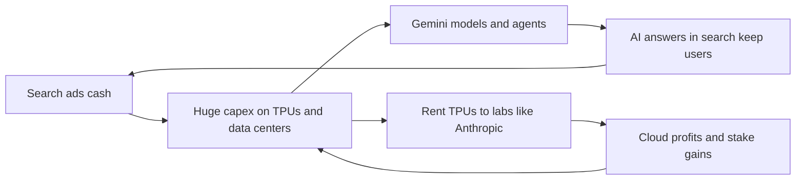

# Google: the search cash machine that is learning to be a landlord

**Thesis:** Google owns every layer of AI, from chips to models to apps, yet its clearest AI payoff so far comes from renting its chips and cloud to a rival lab, Anthropic.

## The story so far

Google got rich on search ads, a business Thompson calls the most beautiful model of all time ([[2026-06-02-The-Google-Capital-Company|The Google Capital Company]]). Its cloud arm lost money for years and only turned a profit in 2023 ([[2026-05-04-Google-Earnings-Meta-Earnings|Google and Meta Earnings]]). In 2026 that cloud arm is growing fast, partly by serving Anthropic ([[2026-05-04-Google-Earnings-Meta-Earnings|Google and Meta Earnings]]). Meanwhile Google's own Gemini models have slipped behind Anthropic and OpenAI ([[2026-09-23-Google-Nears-Release-of-Flagship-Gemini-4-AI-Model|Gemini 4 Nears]]).

## Hook: the best month since 2004

On April 30, 2026, Alphabet stock rose 10 percent after earnings, giving Google its best month since 2004 ([[2026-05-04-Google-Earnings-Meta-Earnings|Google and Meta Earnings]]). Thompson's reading: Wall Street saw an AI payoff in Google's cloud now ([[2026-05-04-Google-Earnings-Meta-Earnings|Google and Meta Earnings]]). Thompson also wonders how much of the cloud's "unbelievable" numbers came from Anthropic renting compute ([[2026-05-14-Interview-Ben-Thompson-MoffettNathanson|Thompson at MoffettNathanson]]).

## The journey

**2007: paying to stay the default.** Google's deal to be the default search on Apple's Safari began in 2002 and was extended to the iPhone in 2007 ([[2026-04-21-Tim-Cooks-Impeccable-Timing|Tim Cook's Timing]]). Thompson says Google's motive was to keep Apple out of search ([[2026-04-21-Tim-Cooks-Impeccable-Timing|Tim Cook's Timing]]). Because search pulled in users and their data, Google could sell very effective ads ([[2015-07-21-Aggregation-Theory|Aggregation Theory]]).

**2008 to 2023: a late, costly cloud.** Google's cloud offering arrived in 2008, two years after AWS ([[2025-Gallaugher-Ch08-Amazon|Gallaugher ch.8]], p.284). (Cloud means renting computers over the internet instead of owning them.) Because it started late, it stayed number three and lost billions for years ([[2025-Gallaugher-Ch08-Amazon|Gallaugher ch.8]], p.284). It turned its first quarterly profit in Q1 2023: $191 million on $7.45 billion of sales ([[2026-05-04-Google-Earnings-Meta-Earnings|Google and Meta Earnings]]).

**2023: own chips, and a stake in a rival.** Because AI chips were scarce, Google, Amazon and Meta began designing their own ([[2025-Gallaugher-Ch08-Amazon|Gallaugher ch.8]], p.298). Google's chip is the TPU. Google also became an investor in Anthropic ([[2025-Gallaugher-Ch08-Amazon|Gallaugher ch.8]], p.297). So in October 2025 Anthropic said it would use up to one million TPUs, bringing well over a gigawatt online in 2026 ([[2026-05-04-Google-Earnings-Meta-Earnings|Google and Meta Earnings]]). (A gigawatt is the output of a large power plant.)

**Late 2025: Gemini leads, then fades.** Gemini 3 was such a jump that OpenAI declared a "code red" to catch up ([[2026-09-23-Google-Nears-Release-of-Flagship-Gemini-4-AI-Model|Gemini 4 Nears]]). But by April 2026 the talk had moved to Anthropic's Claude and OpenAI's Codex ([[2026-04-23-Interview-Thomas-Kurian-Google-Cloud|Kurian interview]]). Thompson said Gemini lacked a compelling harness, the software that lets a model act as an agent ([[2026-03-16-Agents-Over-Bubbles|Agents Over Bubbles]]).

**April 2026: chips for rent.** Cloud chief Thomas Kurian says selling TPUs to outsiders fills idle chips at night and wins better supplier terms, so Google now places TPUs in customers' own sites ([[2026-04-23-Interview-Thomas-Kurian-Google-Cloud|Kurian interview]]).

**Q1 2026: the cloud pays off.** Google Cloud's sales rose 63 percent to $20.0 billion, with $6.6 billion in operating profit ([[2026-05-04-Google-Earnings-Meta-Earnings|Google and Meta Earnings]]). (Operating profit is what the business earns from its work, before interest and taxes.) Its backlog, signed work not yet billed, nearly doubled from $240 billion to $460 billion in one quarter ([[2026-05-04-Google-Earnings-Meta-Earnings|Google and Meta Earnings]]). Net income jumped 81 percent, but Thompson says the main driver was a paper gain on Google's roughly 14 percent Anthropic stake ([[2026-05-04-Google-Earnings-Meta-Earnings|Google and Meta Earnings]]).

**May 2026: AI in everything.** At I/O, Google launched the Gemini Spark personal agent, Gemini 3.5 Flash, and an overhauled search box ([[2026-05-20-Google-IO-World-Models-IO-Spaghetti|Google I/O]]). Because DeepMind cares most about world models, he argues, Google may trail in coding ([[2026-05-20-Google-IO-World-Models-IO-Spaghetti|Google I/O]]).

**June 2026: raising cash like a railroad.** Because demand for compute keeps outrunning supply, Alphabet said it would raise $80 billion in new shares, including $10 billion from Berkshire Hathaway ([[2026-06-02-The-Google-Capital-Company|The Google Capital Company]]). It already planned $180 to $190 billion of capex in 2026 ([[2026-05-04-Google-Earnings-Meta-Earnings|Google and Meta Earnings]]). (Capex is money spent on buildings and machines that last years.) Thompson's comparison: search is the cash machine that funds the cloud, the way candy profits once funded Buffett's railroad ([[2026-06-02-The-Google-Capital-Company|The Google Capital Company]]).

**September 2026: paying publishers.** Google long argued it need not pay sites, because search sent them traffic ([[2026-09-29-Google-Is-Paying-About-100-Digital-Publishers-for-AI-Overviews|Google Pays Publishers]]). But AI Overviews, the AI answers at the top of search, sharply cut that traffic ([[2026-09-29-Google-Is-Paying-About-100-Digital-Publishers-for-AI-Overviews|Google Pays Publishers]]). So Google now pays about 100 publishers based on how much they help AI answers ([[2026-09-29-Google-Is-Paying-About-100-Digital-Publishers-for-AI-Overviews|Google Pays Publishers]]).

**Autumn 2026: Gemini wins users back.** In a September 2026 survey of The Information's subscribers, Gemini use rose at ChatGPT's expense; the writer suggests more enterprise deals or tying Gemini into search as the cause ([[2026-10-08-Chinese-Open-Models-Win-Over-One-in-Five-of-The-Informations-Subscribers|Subscriber Survey]]). So on October 7 OpenAI launched visual answers in ChatGPT to catch up with a similar Gemini feature ([[2026-10-08-Chinese-Open-Models-Win-Over-One-in-Five-of-The-Informations-Subscribers|Subscriber Survey]]).

## The rival: OpenAI

OpenAI built ChatGPT, which Sam Altman calls the first huge new consumer product since Facebook ([[2026-04-28-Interview-Altman-Garman-Bedrock-Managed-Agents|Altman and Garman]]). Altman says OpenAI has beaten his own hopes against Google, but calls Google still underrated ([[2026-04-28-Interview-Altman-Garman-Bedrock-Managed-Agents|Altman and Garman]]). Thompson argues plain ChatGPT chat is threatened by Google putting Gemini everywhere ([[2026-07-14-The-OpenAI-Super-App-ChatGPT-Codex-Whither-Chat|The OpenAI Super App]]). Yet he argues Codex, OpenAI's coding agent, is the kind of product Google seems incapable of launching ([[2026-07-14-The-OpenAI-Super-App-ChatGPT-Codex-Whither-Chat|The OpenAI Super App]]). Still, Kurian says Google would love to offer OpenAI models on its cloud ([[2026-04-23-Interview-Thomas-Kurian-Google-Cloud|Kurian interview]]).

## The idea behind it

- [[Aggregation-Theory]]: Google owns the user, so suppliers and advertisers come to it ([[2015-07-21-Aggregation-Theory|Aggregation Theory]]).
- [[AI-Stack-Integration]]: Kurian argues owning the whole stack improves the models "every hour of every day" ([[2026-04-23-Interview-Thomas-Kurian-Google-Cloud|Kurian interview]]).
- [[Custom-Silicon]]: Thompson predicts TPUs give Google a lasting cost edge if compute becomes a commodity ([[2026-06-02-The-Google-Capital-Company|The Google Capital Company]]).
- [[Opportunity-Cost-of-Compute]]: TPUs made for Anthropic come out of Google's own supply, so Google chooses to earn by selling instead of using them ([[2026-05-14-Interview-Ben-Thompson-MoffettNathanson|Thompson at MoffettNathanson]]).

## The loop

> [!warning] Misstep: the Gemini 3.5 Pro that never came
> At I/O in May 2026, Sundar Pichai said Gemini 3.5 Pro would arrive in June ([[2026-09-23-Google-Nears-Release-of-Flagship-Gemini-4-AI-Model|Gemini 4 Nears]]). It never shipped; Google focused on cheaper Flash models instead ([[2026-09-23-Google-Nears-Release-of-Flagship-Gemini-4-AI-Model|Gemini 4 Nears]]). By September, Anthropic's Mythos and OpenAI's GPT-6 beat Google's best models ([[2026-09-23-Google-Nears-Release-of-Flagship-Gemini-4-AI-Model|Gemini 4 Nears]]).
>
> **Lesson (Thompson's):** a firm whose research chief has other priorities may not win the plain, money-making races like coding ([[2026-05-20-Google-IO-World-Models-IO-Spaghetti|Google I/O]]).

## Moving forward (as of 2026-10-09)

- **Gemini 4.** Google is close to releasing it, and its engineers already use it internally ([[2026-09-23-Google-Nears-Release-of-Flagship-Gemini-4-AI-Model|Gemini 4 Nears]]).
- **Landlord to a rival.** Amazon and Google remain Anthropic's biggest suppliers, with 11 gigawatts costing over $300 billion across about 10 years ([[2026-09-06-How-Anthropic-Clinched-517-Billion-in-Compute-Deals-in-11-Months|Anthropic's $517 Billion]]).
- **Margin question.** Thompson says Google will probably succeed in AI no matter what; the open question is its margin, the share of each sale kept as profit ([[2026-05-14-Interview-Ben-Thompson-MoffettNathanson|Thompson at MoffettNathanson]]).
- **Publishers and regulators.** The EU opened a probe in December 2025 into whether Google uses publisher content without fair pay ([[2026-09-29-Google-Is-Paying-About-100-Digital-Publishers-for-AI-Overviews|Google Pays Publishers]]).

## Three "why?" questions

Why would Google rent its best chips to a rival lab?

Kurian says Google earns from whichever layer a lab buys, so he does not see it as zero sum ([[2026-04-23-Interview-Thomas-Kurian-Google-Cloud|Kurian interview]]). Thompson notes Google chooses to earn more by selling TPUs to Anthropic than by keeping them ([[2026-05-14-Interview-Ben-Thompson-MoffettNathanson|Thompson at MoffettNathanson]]).

Why sell new shares instead of borrowing?

Debt is usually cheaper, because interest cuts taxes and owners keep all the gains ([[2026-06-02-The-Google-Capital-Company|The Google Capital Company]]). Thompson's simplest reading is that Google expects far more demand than anyone thinks and will fund supply by any means ([[2026-06-02-The-Google-Capital-Company|The Google Capital Company]]).

Why does Google keep winning when critics call it unfocused?

Thompson admits he is always wrong about Google, and its ability to wring money from search seems endless ([[2026-05-14-Interview-Ben-Thompson-MoffettNathanson|Thompson at MoffettNathanson]]). He concludes its lack of focus may be why it endures ([[2026-05-20-Google-IO-World-Models-IO-Spaghetti|Google I/O]]).

## Sources

1. [[2015-07-21-Aggregation-Theory|Aggregation Theory]] (Stratechery, 2015-07-21).
2. [[2025-Gallaugher-Ch08-Amazon|Gallaugher ch.8 Amazon]] (FlatWorld, 2025).
3. [[2026-03-16-Agents-Over-Bubbles|Agents Over Bubbles]] (Stratechery, 2026-03-16).
4. [[2026-04-21-Tim-Cooks-Impeccable-Timing|Tim Cook's Impeccable Timing]] (Stratechery, 2026-04-21).
5. [[2026-04-23-Interview-Thomas-Kurian-Google-Cloud|Kurian interview]] (Stratechery, 2026-04-23).
6. [[2026-04-28-Interview-Altman-Garman-Bedrock-Managed-Agents|Altman and Garman interview]] (Stratechery, 2026-04-28).
7. [[2026-05-04-Google-Earnings-Meta-Earnings|Google Earnings, Meta Earnings]] (Stratechery, 2026-05-04).
8. [[2026-05-14-Interview-Ben-Thompson-MoffettNathanson|Thompson at MoffettNathanson]] (Stratechery, 2026-05-14).
9. [[2026-05-20-Google-IO-World-Models-IO-Spaghetti|Google I/O]] (Stratechery, 2026-05-20).
10. [[2026-06-02-The-Google-Capital-Company|The Google Capital Company]] (Stratechery, 2026-06-02).
11. [[2026-07-14-The-OpenAI-Super-App-ChatGPT-Codex-Whither-Chat|The OpenAI Super App]] (Stratechery, 2026-07-14).
12. [[2026-09-06-How-Anthropic-Clinched-517-Billion-in-Compute-Deals-in-11-Months|Anthropic's $517 Billion]] (The Information, 2026-09-06).
13. [[2026-09-23-Google-Nears-Release-of-Flagship-Gemini-4-AI-Model|Gemini 4 Nears]] (The Information, 2026-09-23).
14. [[2026-09-29-Google-Is-Paying-About-100-Digital-Publishers-for-AI-Overviews|Google Pays Publishers]] (The Information, 2026-09-29).
15. [[2026-10-08-Chinese-Open-Models-Win-Over-One-in-Five-of-The-Informations-Subscribers|Subscriber Survey]] (The Information, 2026-10-08).

**Older than 2 years.** The ads logic rests on the 2015 [[2015-07-21-Aggregation-Theory|Aggregation Theory]]. The book's cloud ranking, chip and Anthropic facts describe 2023 or earlier.

**Where sources disagree.**
- Google Cloud's first profit: Q1 2023 per [[2026-05-04-Google-Earnings-Meta-Earnings|Google and Meta Earnings]] and [[2026-06-02-The-Google-Capital-Company|The Google Capital Company]]; Q2 2023 per the book ([[2025-Gallaugher-Ch08-Amazon|Gallaugher ch.8]], p.284).
- Gemini 3.5 Pro: "due within weeks" per [[2026-05-20-Google-IO-World-Models-IO-Spaghetti|Google I/O]]; never shipped per [[2026-09-23-Google-Nears-Release-of-Flagship-Gemini-4-AI-Model|Gemini 4 Nears]].

See also: [[journeys/anthropic-journey|Anthropic journey]], [[journeys/openai-journey|OpenAI journey]], [[journeys/nvidia-journey|Nvidia journey]], [[stories/ai-shift-2024-2026|The AI shift, 2024 to 2026]].

## Change log

- 2026-10-08: first build from proposal 2026-10-08.
- 2026-10-09: added Autumn 2026 beat: Gemini gains on ChatGPT in subscriber survey, OpenAI copies its visual answers [Subscriber Survey, 2026-10-08]

<!-- claims: clm-e05bd1882f94eb6c6fb0, clm-e33c937d8f146e6575b7, clm-bd0a33cfd7b85b11f8ff, clm-9d8de97fff58a658a6a3, clm-bbe2a34738e1e2674044, clm-32c681241217d6bbf32e, clm-115a00f7f523e8b21978, clm-1b4fed1e952af5466ad1, clm-f7092ff1b588384d2513, clm-ec806a6fa0cdab5e4077, clm-243201859c5b98438bea, clm-41430cee6346602c5bd0, clm-8dd38ead112a81582a5c, clm-ee542fdfc04b5ff8358a, clm-9b462387a7f2f6ae3c68, clm-d8779378a425f96443b0, clm-4fb66734e15d91957985, clm-8264bdab2b36f95e1611, clm-5c87b9cd80d50d0e66eb, clm-61bd86f911f44f6eaf58, clm-de6d44502f9e7d9417fa, clm-f862b5b438e4a71d52c7, clm-4965a19ddf180c9f3553, clm-eb61e9d62a4bcf348754, clm-e83ea5215438a04a2692, clm-5d252025fb9b98068fba, clm-b11dfd166d318690a9b8, clm-304f2183b2c60e2fb611, clm-587a6ff7a88988a5b37d, clm-8409f8d323074997b66d, clm-37a06c8b86bca54338e9, clm-e395ebd23b95d977ed81, clm-7a4f9b7f20fba95a7f1b, clm-8572a3ad48de70e32b7b, clm-894de43f68de903889a8, clm-d3e7a57b11f54551b4e6, clm-db5b5dde3ae522f54eb5, clm-78be174ab0c9d9c3b801, clm-452b64e03dbe4f90dba5, clm-acb1a2bdf306aeef6eb1, clm-ec31a5ec50407beead90, clm-ce3b89243008384860dd, clm-19dbb9143fdac36cda79, clm-740079675b73379fc161, clm-5c5505799464fec13b4a, clm-92298a5570a30c7895da, clm-d8f0d9f1d558a3c8c29a, clm-aea040929117cd2e819f, clm-4939df748bc03825bda6, clm-0b10242c58f41ed6f8dc, clm-9292565290f12fdac514, clm-a3cbe73ac4f2868aa7b8 -->
