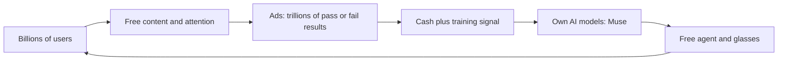

# Meta, 2013 to July 2026: the ad machine turns to AI

**Thesis:** Meta owns no phone and rents out no cloud, yet those gaps push it to spend everything on free AI for ordinary people, paid for and trained by its ad machine. This era builds the ad machine and points it at AI. Part of the [[journeys/meta-journey|Meta journey]]; next era: [[journeys/meta-journey-late-2026|Meta, August to September 2026]].

## The story so far

Thompson argued in 2015 that Facebook is an aggregator whose content comes free from its own users ([[2015-07-21-Aggregation-Theory|Aggregation Theory]]). That attention feeds one of the world's two biggest ad businesses ([[2025-Gallaugher-Ch08-Amazon|Gallaugher Ch 8]]). In 2026 Meta poured that money into AI, expected to top $130 billion this year ([[2026-09-09-OpenAI-Does-Math-Reward-Hacking-Meta-Launches-Personal-Agent|Meta Launches Personal Agent]]).

## The journey

**2013 to 2014: People, not apps.** In 2013 Facebook launched Facebook Home for Android, and Zuckerberg said "apps are not the center of the world, people are" ([[2026-09-28-Apps-Agents-and-Aggregation|Apps, Agents, and Aggregation]]). On February 18, 2014, Thompson argued messaging was mobile's killer app; the next day Facebook agreed to buy WhatsApp ([[2026-09-28-Apps-Agents-and-Aggregation|Apps, Agents, and Aggregation]]).

**2015: Users are the suppliers.** Thompson argued that because Facebook's content comes from its own users, it gets exclusive content for free ([[2015-07-21-Aggregation-Theory|Aggregation Theory]]). So he rated its position stronger than Google's ([[2015-07-21-Aggregation-Theory|Aggregation Theory]]).

**2021 to 2023: An ad giant builds its own tools.** Facebook's attempt to copy Twitch flopped ([[2025-Gallaugher-Ch08-Amazon|Gallaugher Ch 8]]). But in ads Meta ranked second, behind only Google ([[2025-Gallaugher-Ch08-Amazon|Gallaugher Ch 8]]). When GPUs ran short, Meta began designing its own AI chips ([[2025-Gallaugher-Ch08-Amazon|Gallaugher Ch 8]]). (GPUs are the chips that train and run AI.) Its Llama models were offered on Amazon's cloud by 2023 ([[2025-Gallaugher-Ch08-Amazon|Gallaugher Ch 8]]).

**September 2024: Orion, the glasses that stayed home.** Meta showed Orion, AR glasses with a 70-degree view and a wristband that read hand gestures from electrical signals in the arm, with no cameras ([[2024-12-02-The-Gen-AI-Bridge-to-the-Future|Gen AI Bridge]]). Orion did not ship; Thompson argued the hardware cost too much and the apps had to be built first ([[2024-12-02-The-Gen-AI-Bridge-to-the-Future|Gen AI Bridge]]). Thompson still called AI a bridge to wearables that was "bullish for Meta" ([[2024-12-02-The-Gen-AI-Bridge-to-the-Future|Gen AI Bridge]]).

**April 2026: The wristband ships.** The Ray-Ban Display put a small screen in the right lens, controlled by the Neural Band ([[2026-04-27-AI-Hardware-Meta-Display|AI Hardware, Meta Display]]). After using it, Thompson called Orion a dead end, because its eye-tracking input demands your focus, which makes it VR, not AR ([[2026-04-27-AI-Hardware-Meta-Display|AI Hardware, Meta Display]]). He argued AI, not apps, is the killer feature for these glasses ([[2026-04-27-AI-Hardware-Meta-Display|AI Hardware, Meta Display]]).

**April 30, 2026: Fastest growth in years, falling stock.** Meta's quarterly revenue rose 33 percent to $56.3 billion, its biggest jump in nearly five years ([[2026-05-04-Google-Earnings-Meta-Earnings|Google and Meta Earnings]]). But it said it would spend more on AI data centers than planned, and its shares fell almost 9 percent ([[2026-05-04-Google-Earnings-Meta-Earnings|Google and Meta Earnings]]). Thompson says Google showed a payoff through its cloud, while Zuckerberg offered versions of "trust me" ([[2026-05-04-Google-Earnings-Meta-Earnings|Google and Meta Earnings]]). Zuckerberg told investors to judge Meta on whether it builds personal agents that work for billions ([[2026-05-04-Google-Earnings-Meta-Earnings|Google and Meta Earnings]]).

**July 2026: AI meets the ad machine.** Meta released Muse Image, its first image model since rebuilding its AI lab under Alexandr Wang ([[2026-07-09-Muse-Image-Grok-4-5-Alex-Karp-on-CNBC|Muse Image]]). It will power Advantage+, Meta's tool that creates ads for advertisers ([[2026-07-09-Muse-Image-Grok-4-5-Alex-Karp-on-CNBC|Muse Image]]). Because trillions of Meta ads either lead to a sale or do not, Thompson argues a model plugged into that signal will improve sooner ([[2026-07-09-Muse-Image-Grok-4-5-Alex-Karp-on-CNBC|Muse Image]]).

## The rival: Google

**Google**, in Thompson's view, is Meta's closest twin, an aggregator that also needs its own models ([[2026-05-05-Amazons-Durability|Amazon's Durability]]). The difference, he argues, is the cloud. Google must weigh serving hungry customers like Anthropic, while serving consumers costs Meta no lost cloud sales ([[2026-05-04-Google-Earnings-Meta-Earnings|Google and Meta Earnings]]). In glasses, Google teamed with Samsung, Warby Parker and Gentle Monster to take on Meta ([[2026-05-20-Google-IO-World-Models-IO-Spaghetti|Google I/O]]).

## The idea behind it

- [[Verification-Advantage]]: ad results are a pass or fail signal that trains models faster ([[2026-07-09-Muse-Image-Grok-4-5-Alex-Karp-on-CNBC|Muse Image]]).
- [[Opportunity-Cost-of-Compute]]: with no cloud to rent out, Meta gives up nothing by spending chips on free users ([[2026-05-04-Google-Earnings-Meta-Earnings|Google and Meta Earnings]]).
- [[VR-vs-AR]]: input method, not the lens, decides whether glasses pull you out of the world ([[2026-04-27-AI-Hardware-Meta-Display|AI Hardware, Meta Display]]).

## The loop

## Three "why?" questions

Why could having no cloud business help Meta?

Meta must spend billions on AI because it is purely digital, but with no cloud to fall back on it will focus on consumers like no one else ([[2026-05-14-Interview-Ben-Thompson-MoffettNathanson|MoffettNathanson interview]]).

Why does Meta want its own models when Apple rents one?

Owning its model means no outside provider can cut its access or raise prices, and Meta can tune it on ad data only it has ([[2026-07-09-Muse-Image-Grok-4-5-Alex-Karp-on-CNBC|Muse Image]]).

Why did Thompson turn on Orion?

Orion's eye tracking demands your full focus, which makes it virtual reality; the Display plus Neural Band lets you stay in the world ([[2026-04-27-AI-Hardware-Meta-Display|AI Hardware, Meta Display]]).

## Sources

1. "Aggregation Theory." Stratechery, 2015-07-21. **Older than 2 years.**
2. "The Gen AI Bridge to the Future." Stratechery, 2024-12-02.
3. Gallaugher, *Information Systems* v10, Ch. 8 Amazon. FlatWorld, 2025.
4. "AI Hardware, Meta Display, Redefining VR and AR." Stratechery, 2026-04-27.
5. "Google Earnings, Meta Earnings." Stratechery, 2026-05-04.
6. "Amazon's Durability." Stratechery, 2026-05-05.
7. "Interview with Ben Thompson at MoffettNathanson." Stratechery, 2026-05-14.
8. "Google I/O, World Models, I/O Spaghetti." Stratechery, 2026-05-20.
9. "Muse Image, Grok 4.5, Alex Karp on CNBC." Stratechery, 2026-07-09.
10. "Who's Afraid of Chinese Models?" Stratechery, 2026-07-20.
11. "OpenAI Does Math, Reward-Hacking, Meta Launches Personal Agent." Stratechery, 2026-09-09.
12. "Apps, Agents, and Aggregation." Stratechery, 2026-09-28.

**Older-data flag.** The "users are the suppliers" point rests only on the 2015 article. The Twitch, ad-rank and chip facts (Gallaugher) describe 2021 to 2023. Early Facebook history before 2013 is not in the sources.

**Where sources disagree.**
- In 2024 Thompson praised Orion as true AR; in 2026 he calls it VR and a dead end ([[2024-12-02-The-Gen-AI-Bridge-to-the-Future|Gen AI Bridge]]; [[2026-04-27-AI-Hardware-Meta-Display|AI Hardware, Meta Display]]).
- Thompson calls Meta's lack of a cloud an advantage, yet says Meta sells spare compute to Anthropic ([[2026-05-04-Google-Earnings-Meta-Earnings|Google and Meta Earnings]]; [[2026-07-20-Whos-Afraid-of-Chinese-Models|Chinese Models]]).
- Wall Street sold Meta's stock after earnings; Thompson calls Meta's ad base anti-fragile, with an "astronomical" runway even with zero AI progress ([[2026-05-04-Google-Earnings-Meta-Earnings|Google and Meta Earnings]]; [[2026-05-14-Interview-Ben-Thompson-MoffettNathanson|MoffettNathanson interview]]).

See also: [[journeys/meta-journey|Meta journey (hub)]], [[journeys/meta-journey-late-2026|Meta, August to September 2026]], [[journeys/apple-journey|Apple journey]], [[stories/ai-shift-2024-2026|The AI shift, 2024 to 2026]], [[what-changed]].

## Change log

- 2026-10-08: Split from meta-journey.md on 2026-10-08 (proposal 2026-10-08). Text moved unchanged; added the era links.
- 2026-10-13: next-era link retitled to "Meta, August to September 2026" after that era was split per proposal 2026-10-13.

<!-- claims: clm-94f2e127d9808ed908c8, clm-74555c4c9397e4a9ed34, clm-51dab3c30191769a1788, clm-ac846916ea8c70aa46a7, clm-5a2239c06b60c3ef5640, clm-4a91c856fc4e7e3c98dc, clm-e96922c827890cae1d2f, clm-2227383f9382b38fe29a, clm-4eb424d7feb3c734f0a2, clm-115a00f7f523e8b21978, clm-9fcf0ce469f2466dea8c, clm-f3c0925125f7d16ba984, clm-32ec2486de274f9582fe, clm-2eb901aed17c91b0284f, clm-3e75258328653374f736, clm-d4735e3a265e16eee03f, clm-fa5cd0ae8aefa87d7fe1, clm-b5b3da6964e2f31301f6, clm-b6f71235af564624cd95, clm-095d45fcbd5dcd2f81d9, clm-ccd1eaba5800ad8e197a, clm-4ceda1aed256e376764b, clm-d8f0d9f1d558a3c8c29a, clm-9f1f998d3e7fb3673496, clm-c9f61c90bdbd5c6b1b92, clm-746cfb9f8d69984c1813, clm-b60c090300eea28c4503, clm-850051c7e4b8b3d8063a, clm-253f6d191513361946e5, clm-4ddb49478dc5cc759863, clm-8dec3a4bd9fc28d0e060, clm-1a208b189dc0f2046370, clm-79871d5821c65ec3ce0c, clm-2208749a626cb4dd3eed, clm-0ffaa8015e93c8705628, clm-c796af2fe89fb68ad52e, clm-c307ea9bf101fdc2b427, clm-e9e1022d5d92487cc593, clm-bb84f0ec478c11ae7dab, clm-8d303170f3fff556e8c7, clm-ef2d127de37b942baad0, clm-c880db3bb94e35379928, clm-6523c4b89c875e867add, clm-1199c7eccf9e6f41007e, clm-0b84a1148e96291cce69, clm-a8c718796b30f9c80d21, clm-b8f7030b0485c4d048a9, clm-33a731d47c222d8196f7 -->
