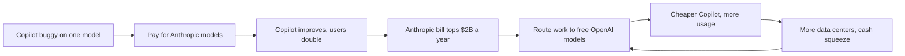

# Microsoft: the free model, the paid model and the bill

**Thesis:** Microsoft's AI story is a fight over cost, not just over quality. It paid a rival lab to make Copilot good, then leaned back on the OpenAI models it gets for free, because AI data centers are eating its cash.

## The story so far

Microsoft came late to the cloud ([[2025-Gallaugher-Ch08-Amazon|Gallaugher ch.8]], p.284). In 2023 it bet on OpenAI to give Azure a technology AWS lacked ([[2025-Gallaugher-Ch08-Amazon|Gallaugher ch.8]], p.284). In 2026 it let OpenAI sell on other clouds, but kept a license to OpenAI's models through 2032 ([[2026-04-28-Interview-Altman-Garman-Bedrock-Managed-Agents|Altman and Garman]]). Copilot, its AI helper for Office, went from buggy to a growing business under Charles Lamanna ([[2026-10-12-How-Microsofts-New-Office-Chief-Fixed-Copilot-and-Won-Over-Nadella|Microsoft's Office Chief]]). Now Azure grows fast, yet its bosses are asked to cut costs ([[2026-10-13-Microsoft-Cloud-President-Asks-Leaders-to-Find-20-Cost-Cuts|Azure Cost Cuts]]).

## Hook: the demo that cost money

In summer 2025, Charles Lamanna asked Satya Nadella to pay for Anthropic's models to fix Copilot, which customers called buggy and weak at Excel and PowerPoint work ([[2026-10-12-How-Microsofts-New-Office-Chief-Fixed-Copilot-and-Won-Over-Nadella|Microsoft's Office Chief]]). Commercial chief Judson Althoff pushed back, because Anthropic's models cost far more than OpenAI's, which Microsoft uses at no extra cost under its partnership ([[2026-10-12-How-Microsofts-New-Office-Chief-Fixed-Copilot-and-Won-Over-Nadella|Microsoft's Office Chief]]). Lamanna won with demos: Anthropic's models were then better at the math Excel needs and at making good-looking slides ([[2026-10-12-How-Microsofts-New-Office-Chief-Fixed-Copilot-and-Won-Over-Nadella|Microsoft's Office Chief]]). Microsoft's payments to Anthropic for customer Copilot use are now on track to top $2 billion a year ([[2026-10-12-How-Microsofts-New-Office-Chief-Fixed-Copilot-and-Won-Over-Nadella|Microsoft's Office Chief]]).

## The journey

**2010 to 2023: late to the cloud, early to OpenAI.** Azure came out in 2010, so AWS had a head start of several years ([[2025-Gallaugher-Ch08-Amazon|Gallaugher ch.8]], p.284). By 2023 AWS held about a third of the world's cloud market, as much as Microsoft and Google combined ([[2025-Gallaugher-Ch08-Amazon|Gallaugher ch.8]], p.283). Because Microsoft wanted a lead technology AWS lacked, it invested $13 billion in OpenAI ([[2025-Gallaugher-Ch08-Amazon|Gallaugher ch.8]], p.284). So in January 2023 it planned to put OpenAI's technology into Bing search, Word and Outlook ([[2023-01-09-Six-OpenAI-Rivals-Google-and-Microsoft-Are-Watching|Six OpenAI Rivals]]). That bet pushed Amazon into its own AI bet on Anthropic ([[2025-Gallaugher-Ch08-Amazon|Gallaugher ch.8]], p.297).

**2025: a tangled Copilot.** Separate Windows and Office groups built their own Copilot features, and employees called the result a tangled mess that caused infighting ([[2026-10-12-How-Microsofts-New-Office-Chief-Fixed-Copilot-and-Won-Over-Nadella|Microsoft's Office Chief]]). Lamanna argued Copilot had been built for one model maker, OpenAI, and that this "model monogamy" made adding new models very hard ([[2026-10-12-How-Microsofts-New-Office-Chief-Fixed-Copilot-and-Won-Over-Nadella|Microsoft's Office Chief]]). Azure had its own drag: at the start of 2025 Microsoft paused many data center projects, which later held back Azure's growth ([[2026-10-13-Microsoft-Cloud-President-Asks-Leaders-to-Find-20-Cost-Cuts|Azure Cost Cuts]]). Still, in November 2025 Anthropic agreed to spend at least $30 billion on about 1 gigawatt of Azure servers ([[2026-09-06-How-Anthropic-Clinched-517-Billion-in-Compute-Deals-in-11-Months|Anthropic's $517 Billion]]). (A gigawatt is roughly the output of one large power plant.)

**February to April 2026: OpenAI leaves home.** In February Microsoft lost Azure's exclusive hold on OpenAI, but kept sole rights to host "stateless" versions of its models (ones that remember nothing between requests) ([[2026-02-27-What-Amazon-and-Microsoft-Will-Win-or-Lose-From-OpenAIs-New-Deals|OpenAI's New Deals]]). Thompson argues that exclusivity was hurting Microsoft, because companies want models on the cloud they already use, and that helped Anthropic grow ([[2026-04-28-Interview-Altman-Garman-Bedrock-Managed-Agents|Altman and Garman]]). So on April 27 the two firms rewrote their deal: OpenAI can sell on any cloud, but products ship first on Azure ([[2026-04-28-Interview-Altman-Garman-Bedrock-Managed-Agents|Altman and Garman]]). Microsoft's license now runs to 2032 no matter what, though it is no longer exclusive ([[2026-04-28-Interview-Altman-Garman-Bedrock-Managed-Agents|Altman and Garman]]).

**March to May 2026: selling work, not seats.** In March Nadella made Lamanna head of all Copilot engineering, reporting straight to him ([[2026-10-12-How-Microsofts-New-Office-Chief-Fixed-Copilot-and-Won-Over-Nadella|Microsoft's Office Chief]]). Microsoft launched E7, a $99 per seat monthly bundle, twice the price of E5, with Copilot Cowork, an agent that does tasks ([[2026-03-16-Agents-Over-Bubbles|Agents Over Bubbles]]). In the March quarter, sales rose 18% to $82.9 billion and Azure grew 40% ([[2026-05-06-Microsoft-Earnings-Apple-Earnings|Microsoft and Apple earnings]]). Copilot reached 20 million paid users ([[2026-05-06-Microsoft-Earnings-Apple-Earnings|Microsoft and Apple earnings]]). Thompson argues agents threaten a per-seat business, because one agent does the work of more than one person ([[2026-05-06-Microsoft-Earnings-Apple-Earnings|Microsoft and Apple earnings]]). Finance chief Amy Hood added that OpenAI's models are free to Microsoft for a long time, which helps margins ([[2026-05-06-Microsoft-Earnings-Apple-Earnings|Microsoft and Apple earnings]]). (Margin is the share of each sale kept as profit.)

**July to October 2026: the cheap model wins.** Because Microsoft runs OpenAI's models for free, leaning on them improves its margins ([[2026-10-12-How-Microsofts-New-Office-Chief-Fixed-Copilot-and-Won-Over-Nadella|Microsoft's Office Chief]]). So in July it began sending complex Copilot questions to OpenAI's GPT-5.6 by default ([[2026-10-05-Microsoft-Slashes-Internal-Claude-Spending-by-a-Third|Microsoft Cuts Claude]]). In August, executive Jay Parikh wrote that OpenAI models give more value per dollar, and staff were told to prefer non-Anthropic models ([[2026-10-05-Microsoft-Slashes-Internal-Claude-Spending-by-a-Third|Microsoft Cuts Claude]]). Microsoft's own Claude spend, projected at over $1 billion a year in May, has been cut by more than a third ([[2026-10-05-Microsoft-Slashes-Internal-Claude-Spending-by-a-Third|Microsoft Cuts Claude]]). Engineers also built a router that picks the cheapest model able to do each task ([[2026-10-12-How-Microsofts-New-Office-Chief-Fixed-Copilot-and-Won-Over-Nadella|Microsoft's Office Chief]]). Lamanna told staff Microsoft should be "the Costco of AI": best value at the best price ([[2026-10-12-How-Microsofts-New-Office-Chief-Fixed-Copilot-and-Won-Over-Nadella|Microsoft's Office Chief]]).

**October 2026: the turnaround and the bill.** Copilot's corporate users more than doubled in 2026, to over 30 million ([[2026-10-12-How-Microsofts-New-Office-Chief-Fixed-Copilot-and-Won-Over-Nadella|Microsoft's Office Chief]]). Nadella then gave Lamanna Office too, an organization of about 25,000 people ([[2026-10-12-How-Microsofts-New-Office-Chief-Fixed-Copilot-and-Won-Over-Nadella|Microsoft's Office Chief]]). Azure made $101.9 billion in the 12 months to June, up 40%, and is now about 31% of Microsoft's revenue ([[2026-10-13-Microsoft-Cloud-President-Asks-Leaders-to-Find-20-Cost-Cuts|Azure Cost Cuts]]). But free cash flow was $20 billion in the June quarter, down 20% from a year earlier, as AI data center spending took its toll ([[2026-10-13-Microsoft-Cloud-President-Asks-Leaders-to-Find-20-Cost-Cuts|Azure Cost Cuts]]). (Free cash flow is the cash left after running costs and new buildings and machines.) So Azure president Girish Bablani asked leaders in his 11,500-person unit to find cost cuts of at least 20%, per one person ([[2026-10-13-Microsoft-Cloud-President-Asks-Leaders-to-Find-20-Cost-Cuts|Azure Cost Cuts]]). Microsoft denied that report ([[2026-10-13-Microsoft-Cloud-President-Asks-Leaders-to-Find-20-Cost-Cuts|Azure Cost Cuts]]). On October 12 it unveiled Maia 300, its own AI chip, for large rollouts from 2027 ([[2026-10-12-Meta-Reaches-AIs-Crowded-Frontier-Will-Users-Care|Meta Reaches the Frontier]]). (See [[Custom-Silicon]].)

**October 2026: the AI capex squeeze and $150 billion Xbox buyout interest.** As Microsoft poured massive capital expenditures into AI infrastructure, non-AI divisions faced severe budget and margin pressure ([[2026-10-20-Private-Equity-Firms-Weighed-Buyout-of-Microsofts-Xbox|Xbox Buyout Weighed]]). Xbox, which generates about 7 percent of Microsoft revenue and includes the $75 billion Activision Blizzard purchase, saw fiscal 2026 revenue decline 7 percent to $21.8 billion while adjusted profit margins fell to 3 percent ([[2026-10-20-Private-Equity-Firms-Weighed-Buyout-of-Microsofts-Xbox|Xbox Buyout Weighed]]). In response, Xbox CEO Asha Sharma laid off 3,200 staff, roughly 20 percent of its workforce, to focus on core franchises, while private equity groups explored buying the division for $100 billion to $150 billion before Microsoft insisted Xbox was not for sale ([[2026-10-20-Private-Equity-Firms-Weighed-Buyout-of-Microsofts-Xbox|Xbox Buyout Weighed]]). Component price inflation driven by AI hardware demand also led Xbox to forecast that its planned 2028 console could cost consumers between $1,200 and $1,800 ([[2026-10-20-Private-Equity-Firms-Weighed-Buyout-of-Microsofts-Xbox|Xbox Buyout Weighed]]). In cybersecurity, Microsoft and peers like Palo Alto Networks deployed multi-model defensive systems combining open and commercial models to counter multi-agent bank hacks while restraining enterprise inference costs ([[2026-10-21-How-Bank-Hackers-Got-Claude-to-Do-Dirty-Work|Bank Hackers Claude Dirty Work]]).

## The rival: AWS

AWS is the foil. Thompson became bullish on AWS partly because it does not compete with its customers ([[2026-05-14-Interview-Ben-Thompson-MoffettNathanson|Thompson at MoffettNathanson]]). Microsoft, by contrast, told analysts it missed Azure targets by giving more computing power to its own AI work ([[2026-05-14-Interview-Ben-Thompson-MoffettNathanson|Thompson at MoffettNathanson]]). The tech chief of Caylent, an AWS consultancy, says AWS is now pulling some spending away from Azure ([[2026-09-08-How-Six-AWS-Engineers-Rebuilt-Bedrock-to-Challenge-Microsoft|Bedrock Rebuilt]]). Yet Azure still grew faster: 43% in the June 2026 quarter against AWS's 37% ([[2026-10-13-Microsoft-Cloud-President-Asks-Leaders-to-Find-20-Cost-Cuts|Azure Cost Cuts]]). And the two converge. OpenAI can now sell on AWS ([[2026-04-28-Interview-Altman-Garman-Bedrock-Managed-Agents|Altman and Garman]]), and Anthropic rents servers from both ([[2026-09-06-How-Anthropic-Clinched-517-Billion-in-Compute-Deals-in-11-Months|Anthropic's $517 Billion]]). Both feel the same squeeze: AWS has also made cuts, including layoffs, because data center spending hurt its free cash flow ([[2026-10-13-Microsoft-Cloud-President-Asks-Leaders-to-Find-20-Cost-Cuts|Azure Cost Cuts]]).

> [!warning] Misstep: one model for everything
> Lamanna says Copilot was built assuming one model maker, OpenAI ([[2026-10-12-How-Microsofts-New-Office-Chief-Fixed-Copilot-and-Won-Over-Nadella|Microsoft's Office Chief]]). Customers called it buggy ([[2026-10-12-How-Microsofts-New-Office-Chief-Fixed-Copilot-and-Won-Over-Nadella|Microsoft's Office Chief]]). National Life Group's tech chief called it essentially useless in 2023; it improved by spring 2026, but most of his staff use ChatGPT and will not switch back ([[2026-10-12-How-Microsofts-New-Office-Chief-Fixed-Copilot-and-Won-Over-Nadella|Microsoft's Office Chief]]).
>
> **Lesson (Lamanna's):** depending on one model bakes in that model's habits and makes adding better ones very hard ([[2026-10-12-How-Microsofts-New-Office-Chief-Fixed-Copilot-and-Won-Over-Nadella|Microsoft's Office Chief]]).

## The idea behind it

- [[Seats-Plus-Consumption]]: Microsoft now charges a fixed fee per person plus a meter for agent work ([[2026-05-06-Microsoft-Earnings-Apple-Earnings|Microsoft and Apple earnings]]).
- [[Custom-Silicon]]: Maia 300 is Microsoft's own chip, one of several clouds' bids to buy fewer Nvidia chips ([[2026-09-13-Nvidias-Growing-Dependence-On-a-Few-Big-Customers|Nvidia's Few Big Customers]]).
- [[Opportunity-Cost-of-Compute]]: chips Microsoft used for its own AI were chips it could not rent on Azure ([[2026-05-14-Interview-Ben-Thompson-MoffettNathanson|Thompson at MoffettNathanson]]).

## The loop

## Moving forward (as of 2026-10-21)

- **Capital squeeze on non-AI units.** Allocating tens of billions toward AI data centers pressures consumer divisions like Xbox, where a 20% headcount cut and soaring console hardware costs attracted $100B to $150B private equity buyout interest ([[2026-10-20-Private-Equity-Firms-Weighed-Buyout-of-Microsofts-Xbox|Xbox Buyout Weighed]]).
- **Multi-model cybersecurity defense.** To defend enterprise customers against multi-agent attack harnesses without excessive compute overhead, Microsoft is deploying hybrid multi-model defenses that balance capability and cost ([[2026-10-21-How-Bank-Hackers-Got-Claude-to-Do-Dirty-Work|Bank Hackers Claude Dirty Work]]).

- **Usage, not seats.** Thompson argues the real danger is customers gaining from AI, but not Microsoft's AI, with usage flowing to the model labs ([[2026-05-06-Microsoft-Earnings-Apple-Earnings|Microsoft and Apple earnings]]). Subscribers use Copilot less, even as Microsoft signs more corporate customers ([[2026-10-08-Chinese-Open-Models-Win-Over-One-in-Five-of-The-Informations-Subscribers|Subscriber Survey]]).
- **Price cuts.** Copilot costs $30 per user per month, plus usage fees ([[2026-09-22-Software-Firms-Discount-AI-to-Keep-Customers-From-Anthropic-OpenAI|Software Discounts]]). Microsoft plans 30% to 50% discounts on corporate Copilot ([[2026-09-22-Software-Firms-Discount-AI-to-Keep-Customers-From-Anthropic-OpenAI|Software Discounts]]).
- **Coders leaving.** The early GitHub Copilot and Cursor duopoly is gone; Claude Code now leads ([[2026-10-08-Chinese-Open-Models-Win-Over-One-in-Five-of-The-Informations-Subscribers|Subscriber Survey]]).
- **Will OpenAI win by default?** Thompson predicted Microsoft may make OpenAI's model work best simply because it is free ([[2026-05-06-Microsoft-Earnings-Apple-Earnings|Microsoft and Apple earnings]]). Payments to Anthropic for customer Copilot use are still on track to top $2 billion a year ([[2026-10-12-How-Microsofts-New-Office-Chief-Fixed-Copilot-and-Won-Over-Nadella|Microsoft's Office Chief]]).
- **Who is next.** Several senior executives see Lamanna as a possible successor to Nadella ([[2026-10-12-How-Microsofts-New-Office-Chief-Fixed-Copilot-and-Won-Over-Nadella|Microsoft's Office Chief]]).

## Three "why?" questions

Why pay Anthropic when OpenAI's models were free?

Anthropic's models were then better at Excel math and good-looking slides ([[2026-10-12-How-Microsofts-New-Office-Chief-Fixed-Copilot-and-Won-Over-Nadella|Microsoft's Office Chief]]). Once OpenAI's models caught back up, Copilot leaned more on OpenAI to improve margins ([[2026-10-12-How-Microsofts-New-Office-Chief-Fixed-Copilot-and-Won-Over-Nadella|Microsoft's Office Chief]]).

Why let OpenAI sell on AWS?

Thompson argues Azure's exclusive hold was hurting Microsoft's own OpenAI investment, because companies want models on the cloud they already use ([[2026-04-28-Interview-Altman-Garman-Bedrock-Managed-Agents|Altman and Garman]]). Microsoft kept a license through 2032 ([[2026-04-28-Interview-Altman-Garman-Bedrock-Managed-Agents|Altman and Garman]]).

Why cut costs while Azure is growing fast?

The Information reads the cost talks as a sign of how heavily data center spending weighs on Microsoft ([[2026-10-13-Microsoft-Cloud-President-Asks-Leaders-to-Find-20-Cost-Cuts|Azure Cost Cuts]]). Some leaders also cite matching offers from Anthropic and Meta, which try to hire Microsoft staff ([[2026-10-13-Microsoft-Cloud-President-Asks-Leaders-to-Find-20-Cost-Cuts|Azure Cost Cuts]]).

## Sources

1. [[2025-Gallaugher-Ch08-Amazon|Gallaugher, *Information Systems* v10, ch.8 Amazon]] (FlatWorld, 2025).
2. [[2026-04-28-Interview-Altman-Garman-Bedrock-Managed-Agents|Interview with Sam Altman and Matt Garman about Bedrock Managed Agents]] (Stratechery, 2026-04-28).
3. [[2026-10-12-How-Microsofts-New-Office-Chief-Fixed-Copilot-and-Won-Over-Nadella|How Microsoft's New Office Chief Fixed Copilot and Won Over Nadella]] (The Information, 2026-10-12).
4. [[2026-10-13-Microsoft-Cloud-President-Asks-Leaders-to-Find-20-Cost-Cuts|Microsoft Cloud President Asks Leaders to Find 20% Cost Cuts]] (The Information, 2026-10-13).
5. [[2023-01-09-Six-OpenAI-Rivals-Google-and-Microsoft-Are-Watching|Six OpenAI Rivals Google and Microsoft Are Watching]] (The Information, 2023-01-09).
6. [[2026-09-06-How-Anthropic-Clinched-517-Billion-in-Compute-Deals-in-11-Months|How Anthropic Clinched $517 Billion in Compute Deals in 11 Months]] (The Information, 2026-09-06).
7. [[2026-02-27-What-Amazon-and-Microsoft-Will-Win-or-Lose-From-OpenAIs-New-Deals|What Amazon and Microsoft Will Win or Lose From OpenAI's New Deals]] (The Information, 2026-02-27).
8. [[2026-03-16-Agents-Over-Bubbles|Agents Over Bubbles]] (Stratechery, 2026-03-16).
9. [[2026-05-06-Microsoft-Earnings-Apple-Earnings|Microsoft Earnings, Apple Earnings]] (Stratechery, 2026-05-06).
10. [[2026-10-05-Microsoft-Slashes-Internal-Claude-Spending-by-a-Third|Microsoft Slashes Internal Claude Spending by a Third]] (The Information, 2026-10-05).
11. [[2026-10-12-Meta-Reaches-AIs-Crowded-Frontier-Will-Users-Care|Meta Reaches AI's Crowded Frontier: Will Users Care?]] (The Information, 2026-10-12).
12. [[2026-05-14-Interview-Ben-Thompson-MoffettNathanson|Interview with Ben Thompson at MoffettNathanson]] (Stratechery, 2026-05-14).
13. [[2026-09-08-How-Six-AWS-Engineers-Rebuilt-Bedrock-to-Challenge-Microsoft|How Six AWS Engineers Rebuilt Bedrock to Challenge Microsoft]] (The Information, 2026-09-08).
14. [[2026-09-13-Nvidias-Growing-Dependence-On-a-Few-Big-Customers|Nvidia's Growing Dependence On a Few Big Customers]] (The Information, 2026-09-13).
15. [[2026-10-08-Chinese-Open-Models-Win-Over-One-in-Five-of-The-Informations-Subscribers|Chinese Open Models Win Over One in Five of The Information's Subscribers]] (The Information, 2026-10-08).
16. [[2026-09-22-Software-Firms-Discount-AI-to-Keep-Customers-From-Anthropic-OpenAI|Software Firms Discount AI to Keep Customers From Anthropic, OpenAI]] (The Information, 2026-09-22).
17. [[2026-10-20-Private-Equity-Firms-Weighed-Buyout-of-Microsofts-Xbox|Private Equity Firms Weighed $100 Billion-Plus Buyout of Microsoft’s Xbox]] (The Information, 2026-10-20).
18. [[2026-10-21-How-Bank-Hackers-Got-Claude-to-Do-Dirty-Work|How Bank Hackers Got Claude to Do Their Dirty Work]] (The Information, 2026-10-21).

**Older than 2 years.** Microsoft's January 2023 plans rest on a 2023 source ([[2023-01-09-Six-OpenAI-Rivals-Google-and-Microsoft-Are-Watching|Six OpenAI Rivals]]). The book is from 2025, but its cloud market shares and OpenAI investment describe 2023.

**Where sources disagree.**
- Microsoft's OpenAI investment: $13 billion on p.284, $11 billion on p.297 of the same book ([[2025-Gallaugher-Ch08-Amazon|Gallaugher ch.8]]).
- Azure's growth in the June 2026 quarter: 42% ([[2026-09-08-How-Six-AWS-Engineers-Rebuilt-Bedrock-to-Challenge-Microsoft|Bedrock Rebuilt]]) or 43% ([[2026-10-13-Microsoft-Cloud-President-Asks-Leaders-to-Find-20-Cost-Cuts|Azure Cost Cuts]]).
- Azure cost cuts: The Information reports a 20% cost-cut ask; Microsoft calls the report inaccurate ([[2026-10-13-Microsoft-Cloud-President-Asks-Leaders-to-Find-20-Cost-Cuts|Azure Cost Cuts]]).
- Microsoft's customer Copilot payments to Anthropic: at least $2 billion a year and roughly flat in total ([[2026-10-05-Microsoft-Slashes-Internal-Claude-Spending-by-a-Third|Microsoft Cuts Claude]]), or on track to top $2 billion with slowed growth ([[2026-10-12-How-Microsofts-New-Office-Chief-Fixed-Copilot-and-Won-Over-Nadella|Microsoft's Office Chief]]).

See also: [[journeys/openai-journey|OpenAI journey]], [[journeys/anthropic-journey|Anthropic journey]], [[journeys/amazon-journey|Amazon journey]], [[journeys/nvidia-journey|Nvidia journey]], [[stories/ai-shift-2024-2026|The AI shift, 2024 to 2026]], [[what-changed]].

## Change log

- 2026-10-13: Created journey per proposal 2026-10-13.
- 2026-10-21: added AI capex pressure on Xbox (revenue down 7%, margin 3%, 3,200 layoffs under Asha Sharma), PE $100B-$150B buyout interest, $1,200-$1,800 next-gen console forecast, and multi-model cyber defenses [Xbox Buyout Weighed, Bank Hackers Claude Dirty Work, 2026-10-20 to 21]

<!-- claims: clm-bd0a33cfd7b85b11f8ff, clm-67c0b6a739fa16cb30a1, clm-040d6119909321d24b3c, clm-0d51d23348d6ea00b93b, clm-0f71d48bfea31cb2ae35, clm-54e1da4c6315bfaa6136, clm-042198972950ca7e393d, clm-2c2e4a6dd2aeabf81b98, clm-674e68ee36442ab74b53, clm-7c243aa83b678c27ffa0, clm-971f4040b2b7a954d86f, clm-ea6d720b817ab8b50804, clm-d2ed4708f3c75b1ffc05, clm-668b4b337ea46e815a22, clm-3912d088973d129a218b, clm-bf11d810f08b2490979b, clm-216dedabf6ebb743cc36, clm-ecd00f2c82882749c5cc, clm-3866895e4d410890a57d, clm-443eebe3fc17d6bc76f2, clm-df846070170dc82a2f65, clm-296913003fc39eab35eb, clm-f91667c7635b2438944f, clm-16e767084ea4e08d117e, clm-fff4d53fdb3947acf1fe, clm-e473781981d7af6bd09d, clm-5d7859dc553992f29460, clm-f376c564f5327d0910d7, clm-f7eb61b95b8a1e9ed002, clm-cdf888eb53ef6b98aea5, clm-37a9a908376e5c604466, clm-c96f2e881844cdec6868, clm-0bad5319405b1e637d81, clm-69849583cb98ac093963, clm-a19c8b5d7e1b1fd081e6, clm-108b71e0eb721138e521, clm-afb59ed60104461f9af8, clm-6e1c9006b82478cfc484, clm-f1a05b4097044cd75508, clm-8eff4a38a3d77fc78ea6, clm-0c56c9e75500d7cfd9ee, clm-ac960ae0e543a268907c, clm-4e90e336161467bf40ed, clm-e672a838a0f31ca6e99e, clm-a9f9546b460cc79c4f7b, clm-05e8d3285703b0c3e7d8, clm-aa6010cf1b944097de3e, clm-56b52f0a3a29c37b8688, clm-096cb87f4c06d97e46f5, clm-62b3706f7ffe2c975284, clm-b259f70dd4c1a77acbcd, clm-f29501cf1336ace40f4d, clm-fcd74c1c7540f769cb89, clm-064ad8487b73f169618e, clm-ee8150521a3f48dc09b6, clm-0679795fd271648dc13c, clm-95136aa939f3370ce4fa, clm-9a40b66aa244ed0f3e38, clm-8a780addc9d2a4f9575b, clm-1ff06977cad3aa14dfe7, clm-0012cbb3c904bdee17ca, clm-db4b14b634812c1cd7ca, clm-1b7301a2ac81c3377472, clm-1eb4284f69b8545b1869, clm-446d5dbf60bb57eccc59, clm-332449dcf2af3330b3b0, clm-ba45dc81bb1631e203b2 -->
