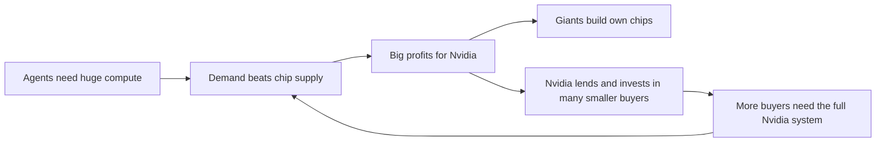

# Nvidia, late 2026: the seller becomes the banker

**Thesis:** Nvidia sells far more than chips. It sells whole systems, and in 2026 it began lending money and buying companies so that many buyers, not a few giants, keep needing it. This era is the lending and the buying. Part of the [[journeys/nvidia-journey|Nvidia journey]]; previous era: [[journeys/nvidia-journey-2023-2026|Nvidia, 2023 to 2026]].

## The story so far

Demand for scarce, costly AI chips helped make Nvidia a company worth over a trillion dollars ([[2025-Gallaugher-Ch08-Amazon|Gallaugher ch.8]], p.298). Since then its sales are capped by how many chips its suppliers can make, not by how many buyers want them ([[2026-09-01-Nvidia-Earnings-Dollars-Per-Gigawatt-Open-and-Hugging-Face|Nvidia Earnings, Aug]]). Its biggest buyers, the cloud giants, also build their own chips to need it less ([[2026-09-13-Nvidias-Growing-Dependence-On-a-Few-Big-Customers|Nvidia's Few Big Customers]]). So Nvidia now spends its cash to grow a wider circle of buyers ([[2026-10-07-Where-Nvidias-100-Billion-Dealmaking-Juggernaut-Will-Go-Next|Nvidia's Dealmaking]]).

## The journey

**Mid 2026: the seller becomes a lender.** Because only a few giants could buy at scale, sales bunched up: three customers made 44 percent of sales in the six months to July ([[2026-09-13-Nvidias-Growing-Dependence-On-a-Few-Big-Customers|Nvidia's Few Big Customers]]). So Nvidia stretched payment terms from 45 to 60 days, and may offer up to a year ([[2026-09-13-Nvidias-Growing-Dependence-On-a-Few-Big-Customers|Nvidia's Few Big Customers]]). In August Huang gathered Blackstone, Apollo and Goldman Sachs to finance $500 billion of Nvidia hardware ([[2026-10-07-Where-Nvidias-100-Billion-Dealmaking-Juggernaut-Will-Go-Next|Nvidia's Dealmaking]]). For OpenAI's Ohio data center, Nvidia guaranteed $105 billion of credit, down from $250 billion first discussed ([[2026-10-07-Where-Nvidias-100-Billion-Dealmaking-Juggernaut-Will-Go-Next|Nvidia's Dealmaking]]). (A credit guarantee means Nvidia pays if the borrower cannot.)

**Autumn 2026: buying the open ecosystem.** Huang wants thousands of thriving AI models, so that OpenAI and a few big buyers do not hold too much power over Nvidia ([[2026-10-07-Where-Nvidias-100-Billion-Dealmaking-Juggernaut-Will-Go-Next|Nvidia's Dealmaking]]). So Nvidia bought Hugging Face, the main home for open AI models, for $12.9 billion, over 80 times its yearly revenue ([[2026-10-07-Where-Nvidias-100-Billion-Dealmaking-Juggernaut-Will-Go-Next|Nvidia's Dealmaking]]). It also signed a $6 billion deal with Poolside and planned about $3 billion for Perplexity ([[2026-10-07-Where-Nvidias-100-Billion-Dealmaking-Juggernaut-Will-Go-Next|Nvidia's Dealmaking]]). In October it was in early talks to buy, or invest more in, Reflection AI, an open-weight model maker valued at about $25 billion ([[2026-10-12-OpenAIs-Plan-To-Revive-Sora|OpenAI's Sora Plan]]). (Open-weight means anyone can download and run the model.)

**October 2026: pulling rivals inside.** Because rival chip makers could not dent Nvidia's lead, more of them now pair their chips with its GPUs instead of replacing them ([[2026-10-08-Nvidia-to-Invest-in-Chip-Rival-d-Matrix-as-Its-Challengers-Choose-Partnership|Nvidia and d-Matrix]]). So Nvidia plans to invest in d-Matrix, an inference chip startup, its first such deal since its $20 billion Groq licensing deal in December 2025 ([[2026-10-08-Nvidia-to-Invest-in-Chip-Rival-d-Matrix-as-Its-Challengers-Choose-Partnership|Nvidia and d-Matrix]]). (Inference means running a trained model to answer.) The Justice Department is probing whether the Groq deal was shaped to dodge an antitrust review ([[2026-10-08-Nvidia-to-Invest-in-Chip-Rival-d-Matrix-as-Its-Challengers-Choose-Partnership|Nvidia and d-Matrix]]).

**October 2026: investors stockpile chips.** Because the shortage led Microsoft and other big clouds to send GPUs to their own teams and bigger customers earlier in 2026, small startups struggled to get any ([[2026-10-12-Andreessen-Horowitz-General-Catalyst-Race-to-Secure-the-Chips-Their-Startups-Need|VCs Race for Chips]]). So venture firms now build clusters for the startups they fund: Andreessen Horowitz runs 20,000 GPUs and is in talks to expand ([[2026-10-12-Andreessen-Horowitz-General-Catalyst-Race-to-Secure-the-Chips-Their-Startups-Need|VCs Race for Chips]]). Crucible Capital built a 576-chip cluster of Nvidia B300s and sells part of it to a frontier lab ([[2026-10-12-Andreessen-Horowitz-General-Catalyst-Race-to-Secure-the-Chips-Their-Startups-Need|VCs Race for Chips]]). (A cluster is many chips wired to work as one computer.)

## The idea behind it

- [[Commoditize-Your-Complements]]: Thompson argues buying Hugging Face keeps open models thriving, which protects Nvidia's margins ([[2026-09-01-Nvidia-Earnings-Dollars-Per-Gigawatt-Open-and-Hugging-Face|Nvidia Earnings, Aug]]).
- [[Export-Controls]]: US limits on Nvidia chips push DeepSeek toward Huawei ([[2026-09-23-DeepSeeks-Annualized-Revenue-Hits-1-Billion-as-Startup-Finalizes-7-5-Billion-Fundraising|DeepSeek Revenue]]).

## The loop

## Moving forward (as of 2026-10-13)

- **Lender's risk.** By giving buyers up to a year to pay, Nvidia acts like a lender, tying its fate to its customers' finances ([[2026-09-13-Nvidias-Growing-Dependence-On-a-Few-Big-Customers|Nvidia's Few Big Customers]]). Its credit default swap spreads widened in August ([[2026-10-07-Where-Nvidias-100-Billion-Dealmaking-Juggernaut-Will-Go-Next|Nvidia's Dealmaking]]). (Those are prices investors pay to insure against a firm not paying debts; wider means more worry.) Huang says, "I'm not taking any risks" ([[2026-10-07-Where-Nvidias-100-Billion-Dealmaking-Juggernaut-Will-Go-Next|Nvidia's Dealmaking]]).
- **Money for GPU buyers is tightening.** Nvidia-backed Firmus pulled a planned IPO of nearly $5 billion at above a $30 billion valuation, citing market swings ([[2026-10-11-Amazons-Bargains-Include-Its-Stock|Amazon's Bargains]]). (An IPO is a first sale of shares to the public.) It is now exploring a $2 billion to $3 billion private round instead ([[2026-10-12-OpenAIs-Plan-To-Revive-Sora|OpenAI's Sora Plan]]). In a $5 billion loan sale for Volta, JPMorgan and Goldman Sachs backed a $1.3 billion loan themselves but not the $3.7 billion loan for GPU purchases ([[2026-10-13-Neocloud-Prime-Intellect-Acquires-Startup-To-Speed-Up-Inference|Prime Intellect Deal]]). (Backing a loan means the bank promises to fund it even if other lenders do not buy in.)
- **Unbundling the GPU.** Thompson predicts agent work will favor cheap memory and good-enough chips, with fast CPUs for tool use ([[2026-05-11-The-Inference-Shift|The Inference Shift]]).
- **China.** DeepSeek still trains on Nvidia chips, likely from the black market ([[2026-09-21-DeepSeek-Bets-Big-on-Huawei-Chips-to-Bypass-US-Export-Controls|DeepSeek Bets on Huawei]]). New Chinese entrants want them too: game maker miHoYo is trying to get Nvidia's Blackwell chips to train better models ([[2026-10-09-Chinas-AI-Model-Race-Is-Just-Getting-More-Crowded|China's Model Race]]).

## Three "why?" questions

Why would a chip seller lend money to its buyers?

Because only a few giants could buy at scale, sales bunched up: three customers made 44 percent of sales in the six months to July ([[2026-09-13-Nvidias-Growing-Dependence-On-a-Few-Big-Customers|Nvidia's Few Big Customers]]).

Why would a chip maker pay $12.9 billion for a model website?

Huang wants many thriving models so no few buyers control Nvidia's sales ([[2026-10-07-Where-Nvidias-100-Billion-Dealmaking-Juggernaut-Will-Go-Next|Nvidia's Dealmaking]]).

Why are venture firms buying GPUs for their startups?

Because the shortage led Microsoft and other big clouds to send GPUs to their own teams and bigger customers earlier in 2026, small startups struggled to get any ([[2026-10-12-Andreessen-Horowitz-General-Catalyst-Race-to-Secure-the-Chips-Their-Startups-Need|VCs Race for Chips]]).

## Sources

1. [[2026-05-11-The-Inference-Shift|The Inference Shift]] (Stratechery, 2026-05-11).
2. [[2026-09-01-Nvidia-Earnings-Dollars-Per-Gigawatt-Open-and-Hugging-Face|Nvidia Earnings, Aug]] (Stratechery, 2026-09-01).
3. [[2026-09-13-Nvidias-Growing-Dependence-On-a-Few-Big-Customers|Nvidia's Few Big Customers]] (The Information, 2026-09-13).
4. [[2026-09-21-DeepSeek-Bets-Big-on-Huawei-Chips-to-Bypass-US-Export-Controls|DeepSeek Bets on Huawei]] (The Information, 2026-09-21).
5. [[2026-09-23-DeepSeeks-Annualized-Revenue-Hits-1-Billion-as-Startup-Finalizes-7-5-Billion-Fundraising|DeepSeek Revenue]] (The Information, 2026-09-23).
6. [[2026-10-07-Where-Nvidias-100-Billion-Dealmaking-Juggernaut-Will-Go-Next|Nvidia's Dealmaking]] (The Information, 2026-10-07).
7. [[2026-10-08-Nvidia-to-Invest-in-Chip-Rival-d-Matrix-as-Its-Challengers-Choose-Partnership|Nvidia and d-Matrix]] (The Information, 2026-10-08).
8. [[2026-10-09-Chinas-AI-Model-Race-Is-Just-Getting-More-Crowded|China's Model Race]] (The Information, 2026-10-09).
9. [[2026-10-11-Amazons-Bargains-Include-Its-Stock|Amazon's Bargains]] (The Information, 2026-10-11).
10. [[2026-10-12-Andreessen-Horowitz-General-Catalyst-Race-to-Secure-the-Chips-Their-Startups-Need|VCs Race for Chips]] (The Information, 2026-10-12).
11. [[2026-10-12-OpenAIs-Plan-To-Revive-Sora|OpenAI's Sora Plan]] (The Information, 2026-10-12).
12. [[2026-10-13-Neocloud-Prime-Intellect-Acquires-Startup-To-Speed-Up-Inference|Prime Intellect Deal]] (The Information, 2026-10-13).

**Where sources disagree.**
- Who Nvidia depends on: CFO Kress said in February 2026 the five biggest cloud firms were over half of data center revenue ([[2026-09-13-Nvidias-Growing-Dependence-On-a-Few-Big-Customers|Nvidia's Few Big Customers]]); Huang said in August that non-hyperscalers are about half and growing 100 percent a year ([[2026-09-01-Nvidia-Earnings-Dollars-Per-Gigawatt-Open-and-Hugging-Face|Nvidia Earnings, Aug]]).
- Huawei as a threat: DeepSeek's founder thinks Huawei will match Nvidia within a few years ([[2026-09-21-DeepSeek-Bets-Big-on-Huawei-Chips-to-Bypass-US-Export-Controls|DeepSeek Bets on Huawei]]), yet he also said a top model would need 200,000 Huawei chips against 50,000 Nvidia ones, and Huawei could not supply enough ([[2026-09-21-DeepSeek-Bets-Big-on-Huawei-Chips-to-Bypass-US-Export-Controls|DeepSeek Bets on Huawei]]).

See also: [[journeys/nvidia-journey|Nvidia journey (hub)]], [[journeys/nvidia-journey-2023-2026|Nvidia, 2023 to 2026]], [[journeys/openai-journey|OpenAI journey]], [[stories/ai-shift-2024-2026|The AI shift, 2024 to 2026]], [[Jensen-Huang]], [[Nvidia]].

## Change log

- 2026-10-13: Split from nvidia-journey.md per proposal 2026-10-13. Text moved unchanged; added the era intro, the era links and two "why?" questions from existing cited text.

<!-- claims: clm-fcbd42125d3dac02d6d3, clm-0b8e1da6dff4bcf89596, clm-49e700b30551eaf659e9, clm-c0c4094293d315729ad5, clm-3612e6a34df64983e50c, clm-89f123836c3cf166975f, clm-61514f3c8dbb32c46270, clm-90a96ad5e299ad8b3ac5, clm-3a4f05d1c2bb646cd316, clm-ba28062190adcb59f3f7, clm-aa6010cf1b944097de3e, clm-5995ca5a16578a448d43, clm-8aaa070d95ad852f5bc4, clm-5f19f204e80f5ad7623d, clm-c6e065cb5277de70ba37, clm-ff02535ae1e20260cd69, clm-bab5d68dff2841fd7466, clm-a1d88914764431ddaf83, clm-f95e63c6993118c148a5, clm-eb2b80eacd90569f8604, clm-91aa14d90e01b14cfbc1, clm-1248b8a1fe3452c17966, clm-5d6003d8bb5de6f9aec5, clm-66a5bc8a67abd17ebfd7, clm-381c4ac7c29bb0c4c831, clm-e1d4304faf713e9a777b, clm-bb564d43693ccdec06ee, clm-4dd8806082749cc010dd, clm-16ab43eed3086425a400, clm-9be48f0650cb834f91b6, clm-59fa5dfe8da1a975683e, clm-ecf4c2745610001ce9b9, clm-a6c4b6ebdc7a9f26a927, clm-ddae05e3b2dd3e68e31e -->
