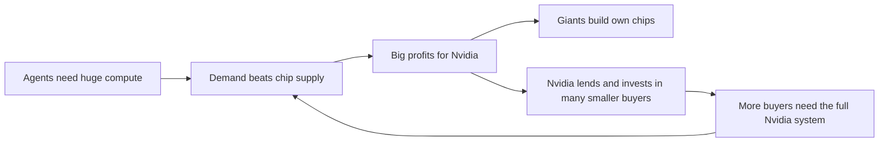

# Nvidia: the chip seller that became the AI industry's banker

**Thesis:** Nvidia sells far more than chips. It sells whole systems, and in 2026 it began lending money and buying companies so that many buyers, not a few giants, keep needing it.

## The story so far

Demand for scarce, costly AI chips helped make Nvidia a company worth over a trillion dollars ([[2025-Gallaugher-Ch08-Amazon|Gallaugher ch.8]], p.298). Since then its sales are capped by how many chips its suppliers can make, not by how many buyers want them ([[2026-09-01-Nvidia-Earnings-Dollars-Per-Gigawatt-Open-and-Hugging-Face|Nvidia Earnings, Aug]]). Its biggest buyers, the cloud giants, also build their own chips to need it less ([[2026-09-13-Nvidias-Growing-Dependence-On-a-Few-Big-Customers|Nvidia's Few Big Customers]]). So Nvidia now spends its cash to grow a wider circle of buyers ([[2026-10-07-Where-Nvidias-100-Billion-Dealmaking-Juggernaut-Will-Go-Next|Nvidia's Dealmaking]]).

## Hook: the lab that got away

For years Nvidia sold almost nothing to Anthropic, because Anthropic ran on Google's TPU chips and Amazon's Trainium chips after taking their money ([[2026-05-26-Nvidia-Earnings-The-AI-Stack-Nvidias-New-Reporting|Nvidia Earnings, May]]). Jensen Huang, Nvidia's CEO, called it a mistake not to invest in Anthropic early, when Google and AWS did ([[2026-05-05-Amazons-Durability|Amazon's Durability]]).

## The journey

**2023: the shortage starts.** Because GPUs (the chips that train and run AI) were scarce, Amazon, Meta and Google began designing their own AI chips ([[2025-Gallaugher-Ch08-Amazon|Gallaugher ch.8]], p.298). Nvidia led training because it locked up high-bandwidth memory (very fast chip memory) before rivals and invested in links between chips ([[2026-05-11-The-Inference-Shift|The Inference Shift]]). In fiscal 2023 no single customer bought even 10 percent of Nvidia's sales ([[2026-09-13-Nvidias-Growing-Dependence-On-a-Few-Big-Customers|Nvidia's Few Big Customers]]).

**2025: power becomes the yardstick.** Because AI data centers run short of electricity, Huang argued at GTC 2025 that tokens per watt matters more than chip price ([[2026-05-05-Amazons-Durability|Amazon's Durability]]). (A token is a small chunk of text an AI reads or writes.) So Nvidia began pricing itself by the gigawatt: its sales chance per gigawatt grew from about $18 billion with Hopper to $25 billion with Blackwell and $40 billion with Vera Rubin ([[2026-09-01-Nvidia-Earnings-Dollars-Per-Gigawatt-Open-and-Hugging-Face|Nvidia Earnings, Aug]]). (A gigawatt is roughly the output of one large power plant.)

**February 2026: OpenAI doubles down.** OpenAI agreed to use an extra 5 gigawatts of Vera Rubin chips, 3 for running models and 2 for training ([[2026-02-27-What-Amazon-and-Microsoft-Will-Win-or-Lose-From-OpenAIs-New-Deals|OpenAI's New Deals]]). Nvidia's $30 billion investment in OpenAI appears to replace an earlier $100 billion plan that was never finalized ([[2026-02-27-What-Amazon-and-Microsoft-Will-Win-or-Lose-From-OpenAIs-New-Deals|OpenAI's New Deals]]).

**April 2026: a record quarter.** Thompson calls TSMC's (the chip factory's) new 3-nanometer plants "basically Rubin fabs" ([[2026-04-20-TSMC-Earnings-New-N3-Fabs-The-Nvidia-Ramp|TSMC Earnings]]). In the April quarter, sales hit $81.6 billion, up 85 percent in a year ([[2026-05-26-Nvidia-Earnings-The-AI-Stack-Nvidias-New-Reporting|Nvidia Earnings, May]]). Net income was $58.3 billion, more than three times a year earlier ([[2026-05-26-Nvidia-Earnings-The-AI-Stack-Nvidias-New-Reporting|Nvidia Earnings, May]]). (Net income is profit after all costs and taxes.)

**May 2026: agents bring Anthropic back.** Because agents (AI that does tasks, not just answers) use huge amounts of compute, Huang said demand had "gone parabolic" ([[2026-05-26-Nvidia-Earnings-The-AI-Stack-Nvidias-New-Reporting|Nvidia Earnings, May]]). So Nvidia added Anthropic as a partner and lined up capacity for it on Azure, AWS and CoreWeave ([[2026-05-26-Nvidia-Earnings-The-AI-Stack-Nvidias-New-Reporting|Nvidia Earnings, May]]).

**August 2026: growth set by supply.** Nvidia had grown 100 percent and forecast 70 percent growth for next year, far above the 45 percent analysts expected ([[2026-09-01-Nvidia-Earnings-Dollars-Per-Gigawatt-Open-and-Hugging-Face|Nvidia Earnings, Aug]]). Huang said demand is much greater than 70 percent, but supply caps what Nvidia can promise ([[2026-09-01-Nvidia-Earnings-Dollars-Per-Gigawatt-Open-and-Hugging-Face|Nvidia Earnings, Aug]]).

**Mid 2026: the seller becomes a lender.** Because only a few giants could buy at scale, sales bunched up: three customers made 44 percent of sales in the six months to July ([[2026-09-13-Nvidias-Growing-Dependence-On-a-Few-Big-Customers|Nvidia's Few Big Customers]]). So Nvidia stretched payment terms from 45 to 60 days, and may offer up to a year ([[2026-09-13-Nvidias-Growing-Dependence-On-a-Few-Big-Customers|Nvidia's Few Big Customers]]). In August Huang gathered Blackstone, Apollo and Goldman Sachs to finance $500 billion of Nvidia hardware ([[2026-10-07-Where-Nvidias-100-Billion-Dealmaking-Juggernaut-Will-Go-Next|Nvidia's Dealmaking]]). For OpenAI's Ohio data center, Nvidia guaranteed $105 billion of credit, down from $250 billion first discussed ([[2026-10-07-Where-Nvidias-100-Billion-Dealmaking-Juggernaut-Will-Go-Next|Nvidia's Dealmaking]]). (A credit guarantee means Nvidia pays if the borrower cannot.)

**Autumn 2026: buying the open ecosystem.** Huang wants thousands of thriving AI models, so that OpenAI and a few big buyers do not hold too much power over Nvidia ([[2026-10-07-Where-Nvidias-100-Billion-Dealmaking-Juggernaut-Will-Go-Next|Nvidia's Dealmaking]]). So Nvidia bought Hugging Face, the main home for open AI models, for $12.9 billion, over 80 times its yearly revenue ([[2026-10-07-Where-Nvidias-100-Billion-Dealmaking-Juggernaut-Will-Go-Next|Nvidia's Dealmaking]]). It also signed a $6 billion deal with Poolside and planned about $3 billion for Perplexity ([[2026-10-07-Where-Nvidias-100-Billion-Dealmaking-Juggernaut-Will-Go-Next|Nvidia's Dealmaking]]). In October it was in early talks to buy, or invest more in, Reflection AI, an open-weight model maker valued at about $25 billion ([[2026-10-12-OpenAIs-Plan-To-Revive-Sora|OpenAI's Sora Plan]]). (Open-weight means anyone can download and run the model.)

**October 2026: pulling rivals inside.** Because rival chip makers could not dent Nvidia's lead, more of them now pair their chips with its GPUs instead of replacing them ([[2026-10-08-Nvidia-to-Invest-in-Chip-Rival-d-Matrix-as-Its-Challengers-Choose-Partnership|Nvidia and d-Matrix]]). So Nvidia plans to invest in d-Matrix, an inference chip startup, its first such deal since its $20 billion Groq licensing deal in December 2025 ([[2026-10-08-Nvidia-to-Invest-in-Chip-Rival-d-Matrix-as-Its-Challengers-Choose-Partnership|Nvidia and d-Matrix]]). (Inference means running a trained model to answer.) The Justice Department is probing whether the Groq deal was shaped to dodge an antitrust review ([[2026-10-08-Nvidia-to-Invest-in-Chip-Rival-d-Matrix-as-Its-Challengers-Choose-Partnership|Nvidia and d-Matrix]]).

**October 2026: investors stockpile chips.** Because the shortage led Microsoft and other big clouds to send GPUs to their own teams and bigger customers earlier in 2026, small startups struggled to get any ([[2026-10-12-Andreessen-Horowitz-General-Catalyst-Race-to-Secure-the-Chips-Their-Startups-Need|VCs Race for Chips]]). So venture firms now build clusters for the startups they fund: Andreessen Horowitz runs 20,000 GPUs and is in talks to expand ([[2026-10-12-Andreessen-Horowitz-General-Catalyst-Race-to-Secure-the-Chips-Their-Startups-Need|VCs Race for Chips]]). Crucible Capital built a 576-chip cluster of Nvidia B300s and sells part of it to a frontier lab ([[2026-10-12-Andreessen-Horowitz-General-Catalyst-Race-to-Secure-the-Chips-Their-Startups-Need|VCs Race for Chips]]). (A cluster is many chips wired to work as one computer.)

## The rival: the customers' own chips

Nvidia's fiercest rivals are its own customers. Hyperscalers (the giant cloud firms) were about half of its data center revenue as of May 2026, and Thompson calls them "frenemies" because they most want to turn Nvidia into a plain chip maker ([[2026-05-26-Nvidia-Earnings-The-AI-Stack-Nvidias-New-Reporting|Nvidia Earnings, May]]). Google and Amazon already use their own chip designs, and Microsoft, Meta and SpaceX are making theirs ([[2026-09-13-Nvidias-Growing-Dependence-On-a-Few-Big-Customers|Nvidia's Few Big Customers]]). In October 2026 Microsoft announced its Maia 300 chip and plans to deploy it at multi-gigawatt scale from 2027 ([[2026-10-13-Neocloud-Prime-Intellect-Acquires-Startup-To-Speed-Up-Inference|Prime Intellect Deal]]). In 2026 Google began selling its TPUs outright, not just renting them ([[2026-09-23-Google-Nears-Release-of-Flagship-Gemini-4-AI-Model|Gemini 4 Nears]]). Thompson argues Nvidia's CUDA software moat matters less than thought, since Anthropic and Google built leading models without it ([[2026-05-26-Nvidia-Earnings-The-AI-Stack-Nvidias-New-Reporting|Nvidia Earnings, May]]).

Yet the two sides also converge. In August 2026 AWS said it would use more NVLink Fusion, Nvidia's chip-linking kit that it opened to other firms' chips ([[2026-09-16-Apple-Considers-Return-to-Server-Market-Has-Talked-With-Nvidia-to-Use-Network-Tech|Apple Server Talks]]).

## The idea behind it

- [[Custom-Silicon]]: big buyers design their own chips to escape Nvidia's prices ([[2025-Gallaugher-Ch08-Amazon|Gallaugher ch.8]], p.298).
- [[Dollars-Per-Gigawatt]]: Nvidia measures its market by power, not by chips ([[2026-09-01-Nvidia-Earnings-Dollars-Per-Gigawatt-Open-and-Hugging-Face|Nvidia Earnings, Aug]]).
- [[AI-Stack-Integration]]: once supply meets demand, most value goes to whoever integrates around a bottleneck ([[2026-05-26-Nvidia-Earnings-The-AI-Stack-Nvidias-New-Reporting|Nvidia Earnings, May]]).
- [[Commoditize-Your-Complements]]: Thompson argues buying Hugging Face keeps open models thriving, which protects Nvidia's margins ([[2026-09-01-Nvidia-Earnings-Dollars-Per-Gigawatt-Open-and-Hugging-Face|Nvidia Earnings, Aug]]).
- [[Export-Controls]]: US limits on Nvidia chips push DeepSeek toward Huawei ([[2026-09-23-DeepSeeks-Annualized-Revenue-Hits-1-Billion-as-Startup-Finalizes-7-5-Billion-Fundraising|DeepSeek Revenue]]).

## The loop

> [!warning] Misstep: missing Anthropic
> Google and AWS invested heavily in Anthropic early so it would use their compute, and Nvidia did not ([[2026-05-05-Amazons-Durability|Amazon's Durability]]). So Anthropic ran on TPUs and Trainium, and Nvidia's sales to it were "largely zero" until 2026 ([[2026-05-26-Nvidia-Earnings-The-AI-Stack-Nvidias-New-Reporting|Nvidia Earnings, May]]).
>
> **Lesson (Huang's own):** he called not investing early a mistake ([[2026-05-05-Amazons-Durability|Amazon's Durability]]). Nvidia's 2026 deal spree, $30 billion in OpenAI alone, is that lesson applied ([[2026-10-07-Where-Nvidias-100-Billion-Dealmaking-Juggernaut-Will-Go-Next|Nvidia's Dealmaking]]).

## Moving forward (as of 2026-10-13)

- **Lender's risk.** By giving buyers up to a year to pay, Nvidia acts like a lender, tying its fate to its customers' finances ([[2026-09-13-Nvidias-Growing-Dependence-On-a-Few-Big-Customers|Nvidia's Few Big Customers]]). Its credit default swap spreads widened in August ([[2026-10-07-Where-Nvidias-100-Billion-Dealmaking-Juggernaut-Will-Go-Next|Nvidia's Dealmaking]]). (Those are prices investors pay to insure against a firm not paying debts; wider means more worry.) Huang says, "I'm not taking any risks" ([[2026-10-07-Where-Nvidias-100-Billion-Dealmaking-Juggernaut-Will-Go-Next|Nvidia's Dealmaking]]).
- **Money for GPU buyers is tightening.** Nvidia-backed Firmus pulled a planned IPO of nearly $5 billion at above a $30 billion valuation, citing market swings ([[2026-10-11-Amazons-Bargains-Include-Its-Stock|Amazon's Bargains]]). (An IPO is a first sale of shares to the public.) It is now exploring a $2 billion to $3 billion private round instead ([[2026-10-12-OpenAIs-Plan-To-Revive-Sora|OpenAI's Sora Plan]]). In a $5 billion loan sale for Volta, JPMorgan and Goldman Sachs backed a $1.3 billion loan themselves but not the $3.7 billion loan for GPU purchases ([[2026-10-13-Neocloud-Prime-Intellect-Acquires-Startup-To-Speed-Up-Inference|Prime Intellect Deal]]). (Backing a loan means the bank promises to fund it even if other lenders do not buy in.)
- **Unbundling the GPU.** Thompson predicts agent work will favor cheap memory and good-enough chips, with fast CPUs for tool use ([[2026-05-11-The-Inference-Shift|The Inference Shift]]).
- **China.** DeepSeek still trains on Nvidia chips, likely from the black market ([[2026-09-21-DeepSeek-Bets-Big-on-Huawei-Chips-to-Bypass-US-Export-Controls|DeepSeek Bets on Huawei]]). New Chinese entrants want them too: game maker miHoYo is trying to get Nvidia's Blackwell chips to train better models ([[2026-10-09-Chinas-AI-Model-Race-Is-Just-Getting-More-Crowded|China's Model Race]]).

## Three "why?" questions

Why are Nvidia's huge earnings "boring"?

Thompson argues sales are set by how many parts suppliers can make, so the numbers are predictable in a world short of chips ([[2026-09-01-Nvidia-Earnings-Dollars-Per-Gigawatt-Open-and-Hugging-Face|Nvidia Earnings, Aug]]).

Why would a chip maker pay $12.9 billion for a model website?

Huang wants many thriving models so no few buyers control Nvidia's sales ([[2026-10-07-Where-Nvidias-100-Billion-Dealmaking-Juggernaut-Will-Go-Next|Nvidia's Dealmaking]]).

Why can't the cloud giants simply drop Nvidia?

Thompson argues only hyperscalers and frontier labs are big enough to make it pay; in a fragmented world Nvidia wins ([[2026-09-01-Nvidia-Earnings-Dollars-Per-Gigawatt-Open-and-Hugging-Face|Nvidia Earnings, Aug]]).

## Sources

1. [[2025-Gallaugher-Ch08-Amazon|Gallaugher ch.8]] (FlatWorld, 2025).
2. [[2026-02-27-What-Amazon-and-Microsoft-Will-Win-or-Lose-From-OpenAIs-New-Deals|OpenAI's New Deals]] (The Information, 2026-02-27).
3. [[2026-04-20-TSMC-Earnings-New-N3-Fabs-The-Nvidia-Ramp|TSMC Earnings]] (Stratechery, 2026-04-20).
4. [[2026-05-05-Amazons-Durability|Amazon's Durability]] (Stratechery, 2026-05-05).
5. [[2026-05-11-The-Inference-Shift|The Inference Shift]] (Stratechery, 2026-05-11).
6. [[2026-05-26-Nvidia-Earnings-The-AI-Stack-Nvidias-New-Reporting|Nvidia Earnings, May]] (Stratechery, 2026-05-26).
7. [[2026-09-01-Nvidia-Earnings-Dollars-Per-Gigawatt-Open-and-Hugging-Face|Nvidia Earnings, Aug]] (Stratechery, 2026-09-01).
8. [[2026-09-13-Nvidias-Growing-Dependence-On-a-Few-Big-Customers|Nvidia's Few Big Customers]] (The Information, 2026-09-13).
9. [[2026-09-16-Apple-Considers-Return-to-Server-Market-Has-Talked-With-Nvidia-to-Use-Network-Tech|Apple Server Talks]] (The Information, 2026-09-16).
10. [[2026-09-21-DeepSeek-Bets-Big-on-Huawei-Chips-to-Bypass-US-Export-Controls|DeepSeek Bets on Huawei]] (The Information, 2026-09-21).
11. [[2026-09-23-DeepSeeks-Annualized-Revenue-Hits-1-Billion-as-Startup-Finalizes-7-5-Billion-Fundraising|DeepSeek Revenue]] (The Information, 2026-09-23).
12. [[2026-09-23-Google-Nears-Release-of-Flagship-Gemini-4-AI-Model|Gemini 4 Nears]] (The Information, 2026-09-23).
13. [[2026-10-07-Where-Nvidias-100-Billion-Dealmaking-Juggernaut-Will-Go-Next|Nvidia's Dealmaking]] (The Information, 2026-10-07).
14. [[2026-10-08-Nvidia-to-Invest-in-Chip-Rival-d-Matrix-as-Its-Challengers-Choose-Partnership|Nvidia and d-Matrix]] (The Information, 2026-10-08).
15. [[2026-10-09-Chinas-AI-Model-Race-Is-Just-Getting-More-Crowded|China's Model Race]] (The Information, 2026-10-09).
16. [[2026-10-11-Amazons-Bargains-Include-Its-Stock|Amazon's Bargains]] (The Information, 2026-10-11).
17. [[2026-10-12-Andreessen-Horowitz-General-Catalyst-Race-to-Secure-the-Chips-Their-Startups-Need|VCs Race for Chips]] (The Information, 2026-10-12).
18. [[2026-10-12-OpenAIs-Plan-To-Revive-Sora|OpenAI's Sora Plan]] (The Information, 2026-10-12).
19. [[2026-10-13-Neocloud-Prime-Intellect-Acquires-Startup-To-Speed-Up-Inference|Prime Intellect Deal]] (The Information, 2026-10-13).

**Older than 2 years.** The "trillion-dollar" label and the start of in-house chips rest on the book's 2023 view.

**Where sources disagree.**
- Who Nvidia depends on: CFO Kress said in February 2026 the five biggest cloud firms were over half of data center revenue ([[2026-09-13-Nvidias-Growing-Dependence-On-a-Few-Big-Customers|Nvidia's Few Big Customers]]); Huang said in August that non-hyperscalers are about half and growing 100 percent a year ([[2026-09-01-Nvidia-Earnings-Dollars-Per-Gigawatt-Open-and-Hugging-Face|Nvidia Earnings, Aug]]).
- Huawei as a threat: DeepSeek's founder thinks Huawei will match Nvidia within a few years ([[2026-09-21-DeepSeek-Bets-Big-on-Huawei-Chips-to-Bypass-US-Export-Controls|DeepSeek Bets on Huawei]]), yet he also said a top model would need 200,000 Huawei chips against 50,000 Nvidia ones, and Huawei could not supply enough ([[2026-09-21-DeepSeek-Bets-Big-on-Huawei-Chips-to-Bypass-US-Export-Controls|DeepSeek Bets on Huawei]]).

See also: [[journeys/anthropic-journey|Anthropic journey]], [[journeys/openai-journey|OpenAI journey]], [[journeys/google-journey|Google journey]], [[stories/ai-shift-2024-2026|The AI shift, 2024 to 2026]], [[Jensen-Huang]], [[Nvidia]].

## Change log

- 2026-10-08: first build from proposal 2026-10-08.
- 2026-10-09: added October 2026 beat: Nvidia invests in rival d-Matrix, rivals pair with its GPUs, DOJ probes Groq deal [Nvidia and d-Matrix, 2026-10-08]
- 2026-10-13: added Reflection AI talks, new beat on VC firms stockpiling GPUs, Microsoft Maia 300, tightening money for GPU buyers (Firmus IPO pulled, Volta GPU loan), miHoYo seeking Blackwell [China's Model Race, Amazon's Bargains, VCs Race for Chips, OpenAI's Sora Plan, Prime Intellect Deal]

<!-- claims: clm-48d13eca737e1740046c, clm-115a00f7f523e8b21978, clm-c0420d16b846c9f5b195, clm-34d07e2311799dbdd51a, clm-f505cbe2522b26c3a2f3, clm-4cd6b6eb00b099aa7d5a, clm-1e5d1b1096724f953371, clm-e098cd2e006eb74dd212, clm-201742be86edacc8f0b1, clm-73fc816544ee9e5af08d, clm-2773b6dafd62fe461c0c, clm-e1ca90a02f8e1fcca1c6, clm-586b27815a762bc12e52, clm-fcbd42125d3dac02d6d3, clm-ffce9acf754bf7911efc, clm-035fcc91e5a2f5df4cc1, clm-0b8e1da6dff4bcf89596, clm-49e700b30551eaf659e9, clm-c0c4094293d315729ad5, clm-3612e6a34df64983e50c, clm-89f123836c3cf166975f, clm-61514f3c8dbb32c46270, clm-90a96ad5e299ad8b3ac5, clm-3a4f05d1c2bb646cd316, clm-ba28062190adcb59f3f7, clm-d6d049f7af6dbbef7640, clm-aa6010cf1b944097de3e, clm-22c8490997fb7940f00b, clm-9fa8a432ceca0f27f666, clm-43c49b2b15c0188856de, clm-98b0a2a99e507632b017, clm-5995ca5a16578a448d43, clm-8aaa070d95ad852f5bc4, clm-c2d2d8d18f3f81d8aa1e, clm-ec4a08996f8ff7dc6781, clm-67d90a173da76eab9316, clm-0cf15556de2ac669fb95, clm-5f19f204e80f5ad7623d, clm-c6e065cb5277de70ba37, clm-ff02535ae1e20260cd69, clm-3caac4b6388d768085e1, clm-bab5d68dff2841fd7466, clm-a1d88914764431ddaf83, clm-c98c4720cec919a6ef79, clm-db09efaa32d1cd7e313a, clm-f95e63c6993118c148a5, clm-eb2b80eacd90569f8604, clm-91aa14d90e01b14cfbc1, clm-1248b8a1fe3452c17966, clm-5d6003d8bb5de6f9aec5, clm-66a5bc8a67abd17ebfd7, clm-381c4ac7c29bb0c4c831, clm-e1d4304faf713e9a777b, clm-bb564d43693ccdec06ee, clm-4dd8806082749cc010dd, clm-16ab43eed3086425a400, clm-9be48f0650cb834f91b6, clm-ac04bb04cbe7a08b9a3c, clm-59fa5dfe8da1a975683e, clm-ecf4c2745610001ce9b9, clm-a6c4b6ebdc7a9f26a927, clm-ddae05e3b2dd3e68e31e -->
