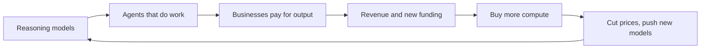

# OpenAI, 2022 to July 2026: from chatbot to work tool

**Thesis:** OpenAI won the biggest consumer audience in AI almost by accident, then in 2026 bet that the money is in doing people's work, not chatting with them. This era runs from ChatGPT's launch to that bet. Part of the [[journeys/openai-journey|OpenAI journey]]; next era: [[journeys/openai-journey-late-2026|OpenAI, July to October 2026]].

## The story so far

ChatGPT's launch in November 2022 was the first big turning point for AI chatbots ([[2026-03-16-Agents-Over-Bubbles|Agents Over Bubbles]]). More than 1 billion people now use it each month, and most do not pay ([[2026-09-09-OpenAI-Restricts-Adobe-and-Other-Competitors-From-Advertising-in-ChatGPT|ChatGPT Ad Limits]]). In 2026 OpenAI turned its desktop app into a work tool built on Codex, its coding agent ([[2026-07-14-The-OpenAI-Super-App-ChatGPT-Codex-Whither-Chat|The OpenAI Super App]]). It also loosened its tie to Microsoft and spread out across many clouds and chips ([[2026-04-28-Interview-Altman-Garman-Bedrock-Managed-Agents|Altman and Garman]]).

## Hook: the Mac app that renamed itself

In July 2026 the Mac apps updated, and OpenAI's Codex app renamed itself ChatGPT ([[2026-07-14-The-OpenAI-Super-App-ChatGPT-Codex-Whither-Chat|The OpenAI Super App]]). The new app opens to a choice between ChatGPT Work and Codex; chat sits in a side pane, which Thompson says feels like an afterthought ([[2026-07-14-The-OpenAI-Super-App-ChatGPT-Codex-Whither-Chat|The OpenAI Super App]]).

## The journey

**2023: Microsoft's money.** Because Microsoft wanted a lead technology AWS lacked, it invested heavily in OpenAI ([[2025-Gallaugher-Ch08-Amazon|Gallaugher ch.8]], p.284). So in January 2023 Microsoft planned to use OpenAI's tech in Bing search, Word and Outlook ([[2023-01-09-Six-OpenAI-Rivals-Google-and-Microsoft-Are-Watching|Six OpenAI Rivals]]). One was Anthropic, founded by two former OpenAI vice presidents ([[2023-01-09-Six-OpenAI-Rivals-Google-and-Microsoft-Are-Watching|Six OpenAI Rivals]]).

**2024: reasoning.** In 2024 no GPT-5 level model came out; the bigger news was OpenAI's o1 ([[2024-12-02-The-Gen-AI-Bridge-to-the-Future|The Gen AI Bridge]]). Because o1 reasons over its answer before giving it, it became the second big turning point, in September 2024 ([[2026-03-16-Agents-Over-Bubbles|Agents Over Bubbles]]).

**Late 2025: agents.** OpenAI's Noam Brown argues reasoning made agents work, because reasoning models can catch and fix their own mistakes ([[2026-09-14-OpenAIs-Top-Priority-for-AI-Agents-is-Automating-AI-Research|Noam Brown interview]]). (An agent is an AI that carries out tasks on its own, not just answers.) So OpenAI released GPT-5.2-Codex on December 18, 2025, matching Anthropic's new coding agent ([[2026-03-16-Agents-Over-Bubbles|Agents Over Bubbles]]). Gemini 3 was also such a jump that OpenAI declared a "code red" to catch up ([[2026-09-23-Google-Nears-Release-of-Flagship-Gemini-4-AI-Model|Gemini 4 Nears]]).

**February 2026: money from everyone.** Because OpenAI needed far more computing power, it raised money at a $730 billion value before the new cash ([[2026-02-27-What-Amazon-and-Microsoft-Will-Win-or-Lose-From-OpenAIs-New-Deals|OpenAI's New Deals]]). Amazon put in $15 billion up front, SoftBank $30 billion, and Nvidia $30 billion ([[2026-02-27-What-Amazon-and-Microsoft-Will-Win-or-Lose-From-OpenAIs-New-Deals|OpenAI's New Deals]]). ChatGPT ads also began for some US users that month ([[2026-09-09-OpenAI-Restricts-Adobe-and-Other-Competitors-From-Advertising-in-ChatGPT|ChatGPT Ad Limits]]).

**April 2026: leaving Microsoft's house.** Thompson argues Azure's hold on OpenAI models hurt, because companies want models on the cloud they already use ([[2026-04-28-Interview-Altman-Garman-Bedrock-Managed-Agents|Altman and Garman]]). So on April 27 the two firms changed their deal: OpenAI can now sell on any cloud, and Microsoft's license runs to 2032 but is no longer exclusive ([[2026-04-28-Interview-Altman-Garman-Bedrock-Managed-Agents|Altman and Garman]]). (A license is the right to use something; exclusive means only you have it.)

**July 2026: from chat to work.** Thompson argues consumer chats make poor training feedback, and free users eat computing power ([[2026-07-09-Muse-Image-Grok-4-5-Alex-Karp-on-CNBC|Muse, Grok, Karp]]). So on July 9 OpenAI launched GPT-5.6 and ChatGPT Work, an agent mixing ChatGPT with Codex, as a direct answer to Anthropic's Claude Cowork ([[2026-07-14-The-OpenAI-Super-App-ChatGPT-Codex-Whither-Chat|The OpenAI Super App]]).

**2026: cutting the side bets.** Because Sora cost so much to build and run, OpenAI shut down the video model and its TikTok-like app earlier in 2026 ([[2026-10-12-OpenAIs-Plan-To-Revive-Sora|Reviving Sora]]). So its servers went to ChatGPT and to fighting Anthropic in coding and business customers ([[2026-10-12-OpenAIs-Plan-To-Revive-Sora|Reviving Sora]]). Now a film startup co-founded by Sora's former research lead is in talks to use Sora, which would give OpenAI a stake (part-ownership) in it ([[2026-10-12-OpenAIs-Plan-To-Revive-Sora|Reviving Sora]]). But the focus is slipping: OpenAI revived robotics work, started a creator product division, and is pushing hard on a costly personal device ([[2026-10-12-OpenAIs-Plan-To-Revive-Sora|Reviving Sora]]).

## The rival: Anthropic

Anthropic exists because its founders distrusted Sam Altman, Thompson says ([[2026-09-21-Frontier-Overhangs|Frontier Overhangs]]). Thompson argues Anthropic chose right by focusing on businesses, because companies pay for productivity and most consumers do not ([[2026-03-16-Agents-Over-Bubbles|Agents Over Bubbles]]). OpenAI went the other way: Altman chose to serve everyone, when winning one market first would have been better, Thompson says ([[2026-05-14-Interview-Ben-Thompson-MoffettNathanson|Thompson at MoffettNathanson]]). Anthropic pulled far ahead in revenue in 2026 and widened the lead from May to August ([[2026-09-28-Anthropic-Moves-to-Cut-Off-Discounts-When-Customers-Hit-Their-Cap|Anthropic Discount Caps]]). How the two then converged is in the [[journeys/openai-journey-late-2026|next era]].

## The idea behind it

- [[LLM-Inflection-Points]]: ChatGPT, o1 and coding agents were the three jumps ([[2026-05-11-The-Inference-Shift|The Inference Shift]]).
- [[AI-Stack-Integration]]: Altman agrees the model and the harness (the software around it) are where value collects ([[2026-04-28-Interview-Altman-Garman-Bedrock-Managed-Agents|Altman and Garman]]).
- [[Verification-Advantage]]: work tasks can be checked, chats mostly cannot ([[2026-07-09-Muse-Image-Grok-4-5-Alex-Karp-on-CNBC|Muse, Grok, Karp]]).

## The loop

> [!warning] Misstep: checkout inside ChatGPT
> In April 2026 a retail post said shoppers were buying directly inside ChatGPT ([[2026-04-12-How-Agentic-Commerce-Is-Transforming-Retail-and-Beyond|Agentic Commerce]]). Morton says the checkout was dropped soon after launch ([[2026-06-18-Interview-Michael-Morton-E-Commerce-AI|Morton interview]]). He says ChatGPT needed Amazon more than Amazon needed ChatGPT, and shoppers could tell items were missing ([[2026-06-18-Interview-Michael-Morton-E-Commerce-AI|Morton interview]]).
>
> **Lesson (Thompson's):** Google and Meta learned that owning checkout does not work, and ads are more profitable, so the failure may have helped OpenAI ([[2026-06-18-Interview-Michael-Morton-E-Commerce-AI|Morton interview]]).

## Two "why?" questions

Why was a billion free users a problem?

Thompson argues free users ate computing power without paying ([[2026-05-14-Interview-Ben-Thompson-MoffettNathanson|Thompson at MoffettNathanson]]). He says had OpenAI started ads in 2023, it could now fund research from them ([[2026-05-14-Interview-Ben-Thompson-MoffettNathanson|Thompson at MoffettNathanson]]).

Why did OpenAI give up Microsoft's exclusive deal?

Thompson argues OpenAI saw AWS as so big a chance that it gave up some Azure-related revenue to get there ([[2026-04-28-Interview-Altman-Garman-Bedrock-Managed-Agents|Altman and Garman]]).

## Sources

1. [[2023-01-09-Six-OpenAI-Rivals-Google-and-Microsoft-Are-Watching|Six OpenAI Rivals]] (The Information, 2023-01-09).
2. [[2024-12-02-The-Gen-AI-Bridge-to-the-Future|The Gen AI Bridge]] (Stratechery, 2024-12-02).
3. [[2025-Gallaugher-Ch08-Amazon|Gallaugher ch.8]] (FlatWorld, 2025).
4. [[2026-02-27-What-Amazon-and-Microsoft-Will-Win-or-Lose-From-OpenAIs-New-Deals|OpenAI's New Deals]] (The Information, 2026-02-27).
5. [[2026-03-16-Agents-Over-Bubbles|Agents Over Bubbles]] (Stratechery, 2026-03-16).
6. [[2026-04-12-How-Agentic-Commerce-Is-Transforming-Retail-and-Beyond|Agentic Commerce]] (commercetools, 2026-04-12).
7. [[2026-04-28-Interview-Altman-Garman-Bedrock-Managed-Agents|Altman and Garman]] (Stratechery, 2026-04-28).
8. [[2026-05-11-The-Inference-Shift|The Inference Shift]] (Stratechery, 2026-05-11).
9. [[2026-05-14-Interview-Ben-Thompson-MoffettNathanson|Thompson at MoffettNathanson]] (Stratechery, 2026-05-14).
10. [[2026-06-18-Interview-Michael-Morton-E-Commerce-AI|Morton interview]] (Stratechery, 2026-06-18).
11. [[2026-07-09-Muse-Image-Grok-4-5-Alex-Karp-on-CNBC|Muse, Grok, Karp]] (Stratechery, 2026-07-09).
12. [[2026-07-14-The-OpenAI-Super-App-ChatGPT-Codex-Whither-Chat|The OpenAI Super App]] (Stratechery, 2026-07-14).
13. [[2026-09-09-OpenAI-Restricts-Adobe-and-Other-Competitors-From-Advertising-in-ChatGPT|ChatGPT Ad Limits]] (The Information, 2026-09-09).
14. [[2026-09-14-OpenAIs-Top-Priority-for-AI-Agents-is-Automating-AI-Research|Noam Brown interview]] (The Information, 2026-09-14).
15. [[2026-09-21-Frontier-Overhangs|Frontier Overhangs]] (Stratechery, 2026-09-21).
16. [[2026-09-23-Google-Nears-Release-of-Flagship-Gemini-4-AI-Model|Gemini 4 Nears]] (The Information, 2026-09-23).
17. [[2026-09-28-Anthropic-Moves-to-Cut-Off-Discounts-When-Customers-Hit-Their-Cap|Anthropic Discount Caps]] (The Information, 2026-09-28).
18. [[2026-10-12-OpenAIs-Plan-To-Revive-Sora|Reviving Sora]] (The Information, 2026-10-12).

**Older than 2 years.** The 2023 beat rests on a January 2023 article (source 1) and on the 2025 book's account of 2023 deals (source 3).

**Where sources disagree.**
- Microsoft's OpenAI investment: $13 billion on p.284, $11 billion on p.297 of the same book ([[2025-Gallaugher-Ch08-Amazon|Gallaugher ch.8]]).

See also: [[journeys/openai-journey|OpenAI journey (hub)]], [[journeys/openai-journey-late-2026|OpenAI, July to October 2026]], [[journeys/anthropic-journey|Anthropic journey]], [[journeys/google-journey|Google journey]], [[journeys/nvidia-journey|Nvidia journey]], [[stories/ai-shift-2024-2026|The AI shift, 2024 to 2026]], [[what-changed]].

## Change log

- 2026-10-08: first build of openai-journey.md from proposal 2026-10-08.
- 2026-10-13: added Sora cut and side-bet beat ([[2026-10-12-OpenAIs-Plan-To-Revive-Sora|Reviving Sora]]).
- 2026-10-13: split from openai-journey.md per proposal 2026-10-13. Text moved unchanged; added the era thesis line, era links and one link sentence in the rival section.

<!-- claims: clm-35028dda6e2470f2ce0a, clm-f306b04b571634dc170c, clm-01606f31506c6d566005, clm-0a7198e722a2262cf2db, clm-3912d088973d129a218b, clm-040d6119909321d24b3c, clm-0d51d23348d6ea00b93b, clm-0f71d48bfea31cb2ae35, clm-4c6c74434f032e1612b6, clm-96e16ed100214a1773c2, clm-eb57b4a9f0a67c0dde88, clm-104988c5511e00135c45, clm-f0cb5e257c3d37f83d17, clm-ec806a6fa0cdab5e4077, clm-4953f4a0964111c02810, clm-46639ec9d714809ecaf3, clm-358a6a62af5dfdd3231e, clm-e098cd2e006eb74dd212, clm-5a5f5abf98264911381d, clm-668b4b337ea46e815a22, clm-bf11d810f08b2490979b, clm-23e73bc63fe4f03a2df4, clm-8146442b2c2c048de48a, clm-449fb92c0a1b39d5205a, clm-a9af6fd1eb06ecd6cc24, clm-dbebc729b27184fb1dc2, clm-188f77eee1b4ab113e40, clm-d6251a819c5fd632917e, clm-321ac1798e7bd5d3648a, clm-d77c3cd156dba0207161, clm-31db6aae9a5b31c75620, clm-fed6735dd4e64d956f58, clm-e50f43991ebb836b03e0, clm-6a989ca01592ef868140, clm-5891bc9c99836ac4aa05, clm-29f3cfe2e495cbf98955, clm-193d561061f3e494b80b, clm-2ba4e3f00655a4d28e89, clm-0002e45cdd119cf09393, clm-be1086160c1cc8ce51bc, clm-f2de80f6d0d4a95299b5, clm-939c61c1fca26bcd9ee9, clm-c9fcdb8a88c4d87b689d, clm-424d8b119e51bc05f3f4 -->
