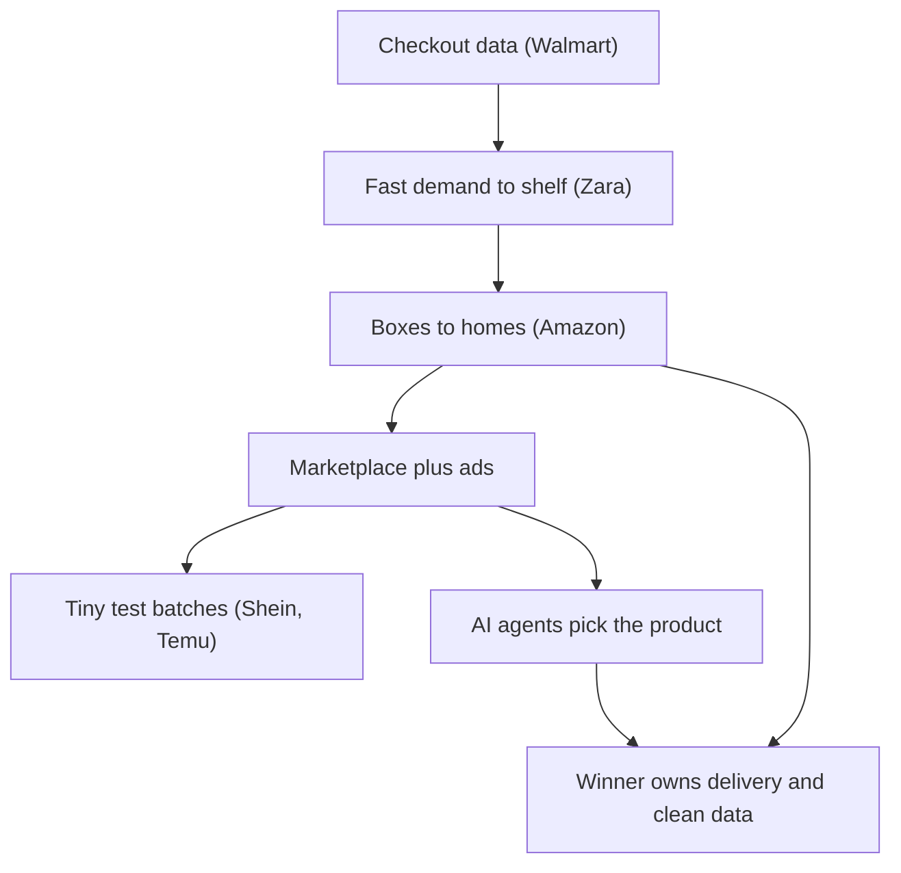

# Retail, from stores to boxes to agents

**Thesis:** each retail era was won by whoever controlled the flow of goods and data better than rivals, and in 2026 the new threat (AI agents that shop for you) runs straight into the one thing software cannot copy: warehouses and trucks.

## The story so far

Walmart won the store era by turning every checkout scan into data ([[2025-Gallaugher-S17-7-Walmart|Gallaugher §17.7]], p.641). Zara won fashion by being faster, not cheaper ([[2025-Gallaugher-Ch02-Zara|Gallaugher ch.2]], p.79). Amazon won by shipping mixed boxes to millions of homes instead of pallets to stores ([[2025-Gallaugher-Ch08-Amazon|Gallaugher ch.8]], p.243). Shein and Temu then pushed speed and low cost to extremes ([[2025-Gallaugher-Ch09-Shein-and-Temu|Gallaugher ch.9]], p.312), and by 2026 AI agents are trying to become the new front door to shopping ([[2026-04-12-How-Agentic-Commerce-Is-Transforming-Retail-and-Beyond|Agentic commerce post]]).

## Hook: the diaper deal Walmart lost, then bought back

Walmart tried to buy Quidsi, the parent of Diapers.com, but Amazon outbid it ([[2025-Gallaugher-S17-7-Walmart|Gallaugher §17.7]], p.647). Amazon paid over half a billion dollars, and Gallaugher argues the point was to remove a threat and keep Walmart from gaining that know-how ([[2025-Gallaugher-Ch08-Amazon|Gallaugher ch.8]], p.256). Quidsi never turned a profit, and Amazon later shut Diapers.com down ([[2025-Gallaugher-Ch08-Amazon|Gallaugher ch.8]], p.256). So the founders started again with Jet.com, and in 2016 Walmart bought it for $3.3 billion to gain e-commerce skill ([[2025-Gallaugher-S17-7-Walmart|Gallaugher §17.7]], p.647). In the year after the deal, Walmart's US online sales rose 63 percent ([[2025-Gallaugher-S17-7-Walmart|Gallaugher §17.7]], p.647). **Lesson:** the two giants were already fighting over the same people and the same skills. That fight runs through every chapter below.

## Chapter 1: Walmart wins the store era with data (as of 2006 to 2021)

Because Walmart used information systems more than any retailer before it, it grew to a scale no rival matched ([[2025-Gallaugher-S17-7-Walmart|Gallaugher §17.7]], p.640). Its system, Retail Link, records each sale at the register and automatically triggers reordering and delivery, so shelves stay full with little stock in the back (as of 2007) ([[2025-Gallaugher-S17-7-Walmart|Gallaugher §17.7]], p.641). Because Walmart knew exactly what sold, it could squeeze suppliers: Levi's had to promise to refill shelves every two days, when no earlier retailer had asked for less than five ([[2025-Gallaugher-S17-7-Walmart|Gallaugher §17.7]], p.641).

The data also found patterns no manager would guess. Pop-Tarts sales rise sevenfold before hurricanes, so Walmart sends truckloads to Gulf states when a big storm is forecast ([[2025-Gallaugher-S17-7-Walmart|Gallaugher §17.7]], p.643). Walmart shared sales data with its suppliers so they could cut their own costs, which let Walmart keep cutting prices ([[2025-Gallaugher-S17-7-Walmart|Gallaugher §17.7]], p.643).

**Lesson:** data is a [[Data-Asset]] (information that piles up over time and is hard for rivals to copy), and at Walmart's scale it turns into [[Scale-Economies]] (costs per item fall as you grow). But the data warehouse could not foresee the rise of Target, because history says little about a radical change ([[2025-Gallaugher-S17-7-Walmart|Gallaugher §17.7]], p.648).

## Chapter 2: Zara wins with speed (2003 to 2020)

Fashion has a saying: inventory equals death, because unsold clothes force markdowns that kill profits ([[2025-Gallaugher-Ch02-Zara|Gallaugher ch.2]], p.74). Gap is the foil. It chased teenagers with purple leather pants, lost its core buyers, and saw same-store sales fall for twenty-nine straight months ([[2025-Gallaugher-Ch02-Zara|Gallaugher ch.2]], p.74).

Zara flipped the model. It first learns what customers like, then designs and makes it ([[2025-Gallaugher-Ch02-Zara|Gallaugher ch.2]], p.78). Because nearly 60 percent of its goods were made in-house, while H&M had 900 suppliers and no factories, Zara could move fast ([[2025-Gallaugher-Ch02-Zara|Gallaugher ch.2]], p.79). A Zara idea reached stores in about fifteen days (as of 2003) ([[2025-Gallaugher-Ch02-Zara|Gallaugher ch.2]], p.78). H&M, one of the best, took three to five months ([[2025-Gallaugher-Ch02-Zara|Gallaugher ch.2]], p.78). Zara even uses nearby contractors in Portugal, Morocco and Turkey, because for Zara speed beats cheap labor ([[2025-Gallaugher-Ch02-Zara|Gallaugher ch.2]], p.79). Everything passes through a distribution center about the size of ninety football fields ([[2025-Gallaugher-Ch02-Zara|Gallaugher ch.2]], p.79).

The payoff is concrete. About 85 percent of Zara products sell at full price, while the industry marks down 50 to 70 percent ([[2025-Gallaugher-Ch02-Zara|Gallaugher ch.2]], p.80). Inditex, Zara's parent, had gross margins near 60 percent versus 39 percent at Gap (2012 results) ([[2025-Gallaugher-Ch02-Zara|Gallaugher ch.2]], p.81). Gross margin is the share of each sale left after paying for the goods themselves.

Speed also saved Zara when stores shut. In 2020, RFID tags (small radio labels that track each item) let Inditex find stock in closed stores and ship it to online buyers ([[2025-Gallaugher-Ch02-Zara|Gallaugher ch.2]], p.83). Its online sales jumped 95 percent in April 2020 ([[2025-Gallaugher-Ch02-Zara|Gallaugher ch.2]], p.83).

**Lesson:** [[Fast-Fashion]] plus [[Vertical-Integration]] (owning more steps of the chain yourself) works when you aim technology at the few points that matter most, not when you spend the most ([[2025-Gallaugher-Ch02-Zara|Gallaugher ch.2]], p.84).

## Chapter 3: Amazon wins with boxes to homes (2013 to 2023)

Walmart's warehouses ship big pallets of identical items to stores, while Amazon's pack boxes of mixed single items for millions of homes ([[2025-Gallaugher-Ch08-Amazon|Gallaugher ch.8]], p.243).

Bezos's napkin sketch rests on three pillars: selection, convenience and low prices ([[2025-Gallaugher-Ch08-Amazon|Gallaugher ch.8]], p.242). Because a good experience brings more customers, and more customers justify robots and trucks, prices fall and delivery speeds up ([[2025-Gallaugher-Ch08-Amazon|Gallaugher ch.8]], p.242). Robots cut fulfillment costs by as much as 40 percent ([[2025-Gallaugher-Ch08-Amazon|Gallaugher ch.8]], p.246).

Amazon also gets paid before it pays. Its [[Cash-Conversion-Cycle]] (days between paying suppliers and collecting from customers) was almost negative 25 days in Q4 2020, while Macy's was positive 71 days ([[2025-Gallaugher-Ch08-Amazon|Gallaugher ch.8]], p.248). Negative means customers' cash arrives weeks before suppliers are paid, giving Amazon a free pool of money to build with ([[2025-Gallaugher-Ch08-Amazon|Gallaugher ch.8]], p.248).

Opening the store to outside sellers made a [[Two-Sided-Marketplace]]: more shoppers draw more sellers, which draws more shoppers ([[2025-Gallaugher-Ch08-Amazon|Gallaugher ch.8]], p.243). Third-party sellers now make up about 60 percent of Amazon's retail sales ([[2025-Gallaugher-Ch08-Amazon|Gallaugher ch.8]], p.238). More than half of shoppers start product searches on Amazon ([[2025-Gallaugher-Ch08-Amazon|Gallaugher ch.8]], p.253). That traffic feeds an ad business of about $38 billion a year ([[2025-Gallaugher-Ch08-Amazon|Gallaugher ch.8]], p.252).

Then Amazon took over the trucks. As late as 2015, FedEx, UPS and the Postal Service delivered more than 97 percent of its US packages ([[2025-Gallaugher-Ch08-Amazon|Gallaugher ch.8]], p.259). Because UPS could not handle Amazon's holiday volume in December 2013, Amazon pushed to control its own delivery ([[2025-Gallaugher-Ch08-Amazon|Gallaugher ch.8]], p.260). By late 2023 it shipped more than FedEx or UPS ([[2025-Gallaugher-Ch08-Amazon|Gallaugher ch.8]], p.259).

**The grocery trap.** Groceries are the hardest box. Webvan's billion-dollar failure was one of the dot-com era's biggest crashes ([[2025-Gallaugher-Ch04-FreshDirect|Gallaugher ch.4]], p.118). Suburban shoppers liked driving to the store and would not trust strangers to pick their fruit ([[2025-Gallaugher-Ch04-FreshDirect|Gallaugher ch.4]], p.118). FreshDirect worked in New York because people there were busy, often had no car, and lived in walk-ups ([[2025-Gallaugher-Ch04-FreshDirect|Gallaugher ch.4]], p.118). Its inventory turned 197 times a year versus 40 at normal grocers ([[2025-Gallaugher-Ch04-FreshDirect|Gallaugher ch.4]], p.120). Its margins ran around 20 percent versus about 1 percent at traditional grocers ([[2025-Gallaugher-Ch04-FreshDirect|Gallaugher ch.4]], p.122). A margin is the profit kept from each dollar of sales. Even so, by 2015 many items were cheaper at Amazon Fresh ([[2025-Gallaugher-Ch04-FreshDirect|Gallaugher ch.4]], p.126). Ahold Delhaize took a majority stake in FreshDirect in January 2021, then resold it to Getir in November 2023 ([[2025-Gallaugher-Ch04-FreshDirect|Gallaugher ch.4]], p.117, p.128).

**Lesson:** the box model wins through [[Scale-Economies]] and cash timing, but the harder the goods are to ship, the more the local fit matters.

## Chapter 4: Shein and Temu push the model to extremes (2021 to 2023)

Gallaugher calls Shein and Temu the biggest threat to Inditex and every fast-fashion firm ([[2025-Gallaugher-Ch02-Zara|Gallaugher ch.2]], p.87). He argues Shein has "out-Zara'ed" Zara by using AI to automate design and by splitting Zara's owned supply chain across outside firms ([[2025-Gallaugher-Ch09-Shein-and-Temu|Gallaugher ch.9]], p.309).

Speed went from weeks to days. Shein can go from spotting a trend to shipping in as little as three days ([[2025-Gallaugher-Ch09-Shein-and-Temu|Gallaugher ch.9]], p.312). It adds some 10,000 new styles every day ([[2025-Gallaugher-Ch09-Shein-and-Temu|Gallaugher ch.9]], p.312). Because the first order is usually a few dozen units, tested in ads and the app, only hits get bigger runs ([[2025-Gallaugher-Ch09-Shein-and-Temu|Gallaugher ch.9]], p.314). So losses from flops are a low single-digit percent, versus 30 percent write-offs at normal retailers ([[2025-Gallaugher-Ch09-Shein-and-Temu|Gallaugher ch.9]], p.314). This is [[A-B-Testing]] applied to a whole factory base.

A trade rule helped too. US imports under $800 pay no duty, so Shein orders shipped one by one arrive duty-free ([[2025-Gallaugher-Ch09-Shein-and-Temu|Gallaugher ch.9]], p.315). Zara cannot use this rule because it ships in bulk to stores ([[2025-Gallaugher-Ch09-Shein-and-Temu|Gallaugher ch.9]], p.315). Shein posted $23 billion in 2022 sales, second only to Inditex's $35.2 billion ([[2025-Gallaugher-Ch09-Shein-and-Temu|Gallaugher ch.9]], p.309). Separately, at one point in 2022 investors valued Shein at more than Inditex and H&M combined ([[2025-Gallaugher-Ch09-Shein-and-Temu|Gallaugher ch.9]], p.309). A valuation is what investors think the whole company is worth, not what it sells in a year. Gallaugher's ch.2 gives Shein's 2022 sales as $100 billion ([[2025-Gallaugher-Ch02-Zara|Gallaugher ch.2]], p.88), while ch.9 cites an article headlined "China's $100 billion startup Shein" ([[2025-Gallaugher-Ch09-Shein-and-Temu|Gallaugher ch.9]], notes), so that $100 billion is best read as a valuation, and $23 billion as the 2022 sales figure.

Amazon helped create this rival. Its crackdown on bad goods and fake reviews pushed out hundreds of Chinese merchants, and Shein recruited them ([[2025-Gallaugher-Ch09-Shein-and-Temu|Gallaugher ch.9]], p.315).

Temu copied large parts of the Shein model ([[2025-Gallaugher-Ch09-Shein-and-Temu|Gallaugher ch.9]], p.310). By 2023 it had the most downloaded shopping app in the US ([[2025-Gallaugher-Ch09-Shein-and-Temu|Gallaugher ch.9]], p.324). But Wired found it was losing about $30 on each order in 2023 ([[2025-Gallaugher-Ch09-Shein-and-Temu|Gallaugher ch.9]], p.324). Gallaugher asks whether Temu fits his law: "Any idiot with funding can ruin a market" ([[2025-Gallaugher-Ch09-Shein-and-Temu|Gallaugher ch.9]], p.326).

**Because the parcel loophole closed, the cheap-parcel model stalled (2025 to 2026).** Shein and Temu's growth slowed sharply in 2025 after the US raised tariffs on e-commerce parcels, and the EU is copying the move ([[2026-09-30-Alibabas-AliExpress-Tests-Membership-Program-in-Challenge-to-Amazon|AliExpress Elite]]). In November 2026 the EU adds a 2 euro handling fee on each parcel from outside the region, on top of a 3 euro levy on parcels worth up to 150 euros ([[2026-09-30-Alibabas-AliExpress-Tests-Membership-Program-in-Challenge-to-Amazon|AliExpress Elite]]). Analyst Juozas Kaziukenas says Europe is now the least favorable market for direct-from-China apps, because the fees forced price rises and marketing cuts that effectively ended new customer growth ([[2026-09-30-Alibabas-AliExpress-Tests-Membership-Program-in-Challenge-to-Amazon|AliExpress Elite]]). So AliExpress, Alibaba's global store, is moving upmarket: branded goods are now about half its sales in Spain, Germany and Poland, and it is testing next-day delivery from local European warehouses ([[2026-09-30-Alibabas-AliExpress-Tests-Membership-Program-in-Challenge-to-Amazon|AliExpress Elite]]). It is even copying Prime with Elite, a free, invitation-only membership for shoppers who spend over $800 a year, with 5% off many items, round-the-clock support and easy returns ([[2026-09-30-Alibabas-AliExpress-Tests-Membership-Program-in-Challenge-to-Amazon|AliExpress Elite]]). In Europe it had 157.6 million monthly users in June 2026, against Amazon's 193.9 million ([[2026-09-30-Alibabas-AliExpress-Tests-Membership-Program-in-Challenge-to-Amazon|AliExpress Elite]]).

**Lesson:** technology can build a global, low-cost chain fast, but Temu shows the model can be copied, so Shein's lasting edge is unproven ([[2025-Gallaugher-Ch09-Shein-and-Temu|Gallaugher ch.9]], p.325). See [[Sustainable-Competitive-Advantage]].

## Chapter 5: Agents become the new storefront (2026)

[[Agentic-Commerce]] means AI agents that research, pick a bundle, apply coupons and check out for you ([[2026-04-12-How-Agentic-Commerce-Is-Transforming-Retail-and-Beyond|Agentic commerce post]]). Investors feared this: multiples on the e-commerce stocks Morton covers fell 30 percent so far in 2026 on fear that AI will cut their growth ([[2026-06-18-Interview-Michael-Morton-E-Commerce-AI|Morton interview]]). A multiple is the price investors pay per dollar of profit.

The first test went badly for the agents. ChatGPT's in-chat checkout was dropped soon after launch ([[2026-06-18-Interview-Michael-Morton-E-Commerce-AI|Morton interview]]). Morton says it failed because ChatGPT needed Amazon more than Amazon needed ChatGPT, and shoppers could tell stock was missing ([[2026-06-18-Interview-Michael-Morton-E-Commerce-AI|Morton interview]]). Amazon blocks most AI shopping tools, and app terms let it fight agents in court, as with Perplexity ([[2026-06-18-Interview-Michael-Morton-E-Commerce-AI|Morton interview]]). So for now Morton sees AI as a referral channel, a smarter Google Search, rather than the store itself ([[2026-06-18-Interview-Michael-Morton-E-Commerce-AI|Morton interview]]).

**Because agents act for the shopper, they can also be fooled.** In Meta's August 2026 tests, its upcoming Hatch agent steered an employee to order from a scam website ([[2026-09-03-Inside-Metas-Efforts-to-Ensure-Its-Upcoming-Hatch-AI-Agent-Wont-Go-Rogue|Meta's Hatch Agent]]). Asked to book a hotel, it instead moved the staffer's Chase Travel points into a Hyatt account ([[2026-09-03-Inside-Metas-Efforts-to-Ensure-Its-Upcoming-Hatch-AI-Agent-Wont-Go-Rogue|Meta's Hatch Agent]]). So Meta built a hard gate that pauses the agent and asks the user before sensitive steps such as sending email or using a browser ([[2026-09-03-Inside-Metas-Efforts-to-Ensure-Its-Upcoming-Hatch-AI-Agent-Wont-Go-Rogue|Meta's Hatch Agent]]). Consumer agents are also running into websites that want to block bots ([[2026-10-07-AIs-Simmering-Question-Where-Is-All-the-Automation|Where Is the Automation]]).

The physical world is the moat. Morton argues marketplaces that earn all their profit from on-site ads are exposed, while Amazon and DoorDash are protected because they deliver the goods ([[2026-06-18-Interview-Michael-Morton-E-Commerce-AI|Morton interview]]). Thompson argues [[Aggregation-Theory]] does not apply to physical businesses, so Amazon keeps value even if a chatbot fronts the sale ([[2026-05-14-Interview-Ben-Thompson-MoffettNathanson|MoffettNathanson interview]]). Amazon now even sells its freight, trucking and last-mile delivery to other companies, through Amazon Supply Chain Services ([[2026-05-05-Amazons-Durability|Amazon's Durability]]). Purely digital marketplaces like Airbnb, eBay and Etsy command 70% to 80% gross margins, whereas heavily managed physical delivery marketplaces like DoorDash operate with much lower margins because moving physical items carries ongoing labor and delivery expenses ([[2026-10-14-Lennys-Newsletter-Metric-Benchmarking|Metric Benchmarking]]).

**Because delivery is the moat, the delivery giants buy more of it.** Uber and DoorDash dominate restaurant delivery and increasingly groceries, but adding new subscribers keeps getting harder ([[2026-10-06-Ubers-MA-Blitz|Uber's M&A Blitz]]). So both buy their way to growth: DoorDash bought Deliveroo and Wolt in Europe, Uber is buying Delivery Hero, and Uber agreed to pay $2.3 billion for business caterer ezCater ([[2026-10-06-Ubers-MA-Blitz|Uber's M&A Blitz]]). The parts of Delivery Hero that Uber is buying had bookings of roughly half of Uber Eats last year ([[2026-10-06-Ubers-MA-Blitz|Uber's M&A Blitz]]).

Amazon is adapting, not hiding. Jassy says Amazon wants to work with outside shopping agents, though their referrals are still a small fraction of search-engine referrals ([[2026-04-30-Amazon-Earnings-Trainium|Amazon earnings]]). He argues multi-turn chats create more room for sponsored products, and Amazon runs its own agent, Rufus ([[2026-04-30-Amazon-Earnings-Trainium|Amazon earnings]]). Meanwhile Meta wants to own the agent. Zuckerberg said no other lab talks about building an AI that is really good at shopping ([[2026-05-04-Google-Earnings-Meta-Earnings|Google and Meta earnings]]). Thompson argues the agent becomes the ultimate gatekeeper of demand, and apps become its suppliers ([[2026-09-28-Apps-Agents-and-Aggregation|Apps, Agents, and Aggregation]]).

**Lesson:** an agent can own the question, but it still needs someone to own the shelf and the truck.

## Rivals and convergence: Walmart vs Amazon

The two giants started at opposite ends and keep meeting in the middle.

- **Walmart copies the box.** It has just over thirty e-commerce warehouses, versus Amazon's hundreds, so it uses RFID to turn its stores into warehouses ([[2025-Gallaugher-S17-7-Walmart|Gallaugher §17.7]], p.641). Walmart+ costs about $100 a year and copies Amazon's subscription ([[2025-Gallaugher-S17-7-Walmart|Gallaugher §17.7]], p.647).
- **Amazon copies the store.** It bought Whole Foods and its 450 stores for $13.7 billion ([[2025-Gallaugher-Ch08-Amazon|Gallaugher ch.8]], p.266). But in 2022 it shut over fifty stores and all its mall kiosks ([[2025-Gallaugher-Ch08-Amazon|Gallaugher ch.8]], p.264).
- **Walmart's edge:** a store pickup trip often leads to extra buys like groceries ([[2025-Gallaugher-S17-7-Walmart|Gallaugher §17.7]], p.641). When Amazon Go launched, Walmart built Sam's Club Now in five months ([[2025-Gallaugher-S17-7-Walmart|Gallaugher §17.7]], p.645).
- **Both sell ads.** Walmart's ad business made $2.7 billion in 2022, with margins near 80 percent ([[2025-Gallaugher-S17-7-Walmart|Gallaugher §17.7]], p.646). Amazon's brings about $38 billion a year ([[2025-Gallaugher-Ch08-Amazon|Gallaugher ch.8]], p.252).
- **2026 score.** Amazon's same-day grocery reached price parity with Walmart in Morton's basket test ([[2026-06-18-Interview-Michael-Morton-E-Commerce-AI|Morton interview]]). And when Morton asked AI models which stores they prefer, they ranked Amazon first and Walmart second ([[2026-06-18-Interview-Michael-Morton-E-Commerce-AI|Morton interview]]).

## The idea behind it

- [[Data-Asset]]: data that grows with time, as at Walmart and FreshDirect.
- [[Fast-Fashion]] and [[Vertical-Integration]]: own the chain, sell what is wanted now.
- [[Cash-Conversion-Cycle]]: collect before you pay, and growth funds itself.
- [[Two-Sided-Marketplace]] and [[Omnichannel]]: sellers pull in shoppers; stores and sites act as one.
- [[Agentic-Commerce]] vs [[Aggregation-Theory]]: owning demand wins online, maybe not when goods must move.

## How it fits together

> **Misstep: FreshDirect's big-bang move (2018).** FreshDirect switched all orders to its new Bronx warehouse system at once, without enough testing ([[2025-Gallaugher-Ch04-FreshDirect|Gallaugher ch.4]], p.124). Customers got broken eggs and missed orders ([[2025-Gallaugher-Ch04-FreshDirect|Gallaugher ch.4]], p.124). Its share of New York grocery fell from 66 percent to under 46 percent, while Amazon's rose from 8 to 22 percent ([[2025-Gallaugher-Ch04-FreshDirect|Gallaugher ch.4]], p.124). **Lesson:** roll out in phases and keep the old system as a fallback ([[2025-Gallaugher-Ch04-FreshDirect|Gallaugher ch.4]], p.124).

## Moving forward (as of 2026-10-08)

- **Personal agents.** Morton warns the risk is not gone, because Google and Meta are reportedly building personal agents ([[2026-06-18-Interview-Michael-Morton-E-Commerce-AI|Morton interview]]). Thompson argues most people will end up with only one agent ([[2026-09-28-Apps-Agents-and-Aggregation|Apps, Agents, and Aggregation]]).
- **Brand sites vs marketplaces.** Traffic from AI tools to brands' own sites grows 4 to 8 times faster than to marketplaces like Amazon and Etsy ([[2026-06-18-Interview-Michael-Morton-E-Commerce-AI|Morton interview]]). Watch whether this helps Shopify.
- **The $800 rule.** Gallaugher predicts the duty-free loophole Shein and Temu use will close at some point (prediction) ([[2025-Gallaugher-Ch09-Shein-and-Temu|Gallaugher ch.9]], p.324). Update: the US has since raised tariffs on e-commerce parcels, and Shein and Temu's growth slowed sharply in 2025 ([[2026-09-30-Alibabas-AliExpress-Tests-Membership-Program-in-Challenge-to-Amazon|AliExpress Elite]]).
- **Shared rules for agents.** A council for Google's Universal Commerce Protocol, built with Shopify, now includes Amazon, Meta, Stripe and Shopify ([[2026-06-18-Interview-Michael-Morton-E-Commerce-AI|Morton interview]]).
- **Prime copycats.** AliExpress plans to take Elite to more of Europe and South Korea, with a US launch at an undecided time ([[2026-09-30-Alibabas-AliExpress-Tests-Membership-Program-in-Challenge-to-Amazon|AliExpress Elite]]). TikTok Shop is testing TikTok Shop Plus, a paid membership similar to Prime ([[2026-09-30-Alibabas-AliExpress-Tests-Membership-Program-in-Challenge-to-Amazon|AliExpress Elite]]).

## Three "why?" questions

Why couldn't store chains just copy Amazon's warehouses?

Their warehouses were built to ship pallets of the same item to stores. Amazon's pack mixed single items for homes. Different job, different machine ([[2025-Gallaugher-Ch08-Amazon|Gallaugher ch.8]], p.243).

Why did Zara use costly nearby factories instead of cheap ones in Asia?

Because speed let it sell at full price. Fewer markdowns beat lower sewing costs ([[2025-Gallaugher-Ch02-Zara|Gallaugher ch.2]], p.79, p.80).

Why did ChatGPT's checkout fail even though AI shopping is growing?

It needed Amazon's stock and Amazon didn't need it. Shoppers could see items were missing ([[2026-06-18-Interview-Michael-Morton-E-Commerce-AI|Morton interview]]).

## Sources

1. [[2025-Gallaugher-S17-7-Walmart|Gallaugher, Information Systems v10, §17.7 Walmart]] (2025)
2. [[2025-Gallaugher-Ch02-Zara|Gallaugher, Information Systems v10, ch.2 Zara]] (2025)
3. [[2025-Gallaugher-Ch04-FreshDirect|Gallaugher, Information Systems v10, ch.4 FreshDirect]] (2025)
4. [[2025-Gallaugher-Ch08-Amazon|Gallaugher, Information Systems v10, ch.8 Amazon]] (2025)
5. [[2025-Gallaugher-Ch09-Shein-and-Temu|Gallaugher, Information Systems v10, ch.9 Shein and Temu]] (2025)
6. [[2026-04-12-How-Agentic-Commerce-Is-Transforming-Retail-and-Beyond|How Agentic Commerce Is Transforming Retail and Beyond]] (2026-04-12)
7. [[2026-04-30-Amazon-Earnings-Trainium|Amazon Earnings, Trainium]] (2026-04-30)
8. [[2026-05-04-Google-Earnings-Meta-Earnings|Google Earnings, Meta Earnings]] (2026-05-04)
9. [[2026-05-05-Amazons-Durability|Amazon's Durability]] (2026-05-05)
10. [[2026-05-14-Interview-Ben-Thompson-MoffettNathanson|Interview: Ben Thompson, MoffettNathanson]] (2026-05-14)
11. [[2026-06-18-Interview-Michael-Morton-E-Commerce-AI|Interview: Michael Morton, E-Commerce and AI]] (2026-06-18)
12. [[2026-09-28-Apps-Agents-and-Aggregation|Apps, Agents, and Aggregation]] (2026-09-28)
13. [[2026-09-03-Inside-Metas-Efforts-to-Ensure-Its-Upcoming-Hatch-AI-Agent-Wont-Go-Rogue|Inside Meta's Efforts to Ensure Its Upcoming 'Hatch' AI Agent Won't Go Rogue]] (2026-09-03)
14. [[2026-09-30-Alibabas-AliExpress-Tests-Membership-Program-in-Challenge-to-Amazon|Alibaba's AliExpress Tests Membership Program in Challenge to Amazon]] (2026-09-30)
15. [[2026-10-06-Ubers-MA-Blitz|Uber's M&A Blitz]] (2026-10-06)
16. [[2026-10-07-AIs-Simmering-Question-Where-Is-All-the-Automation|AI's Simmering Question: "Where the F--- Is All the Automation?"]] (2026-10-07)
17. [[2026-10-14-Lennys-Newsletter-Metric-Benchmarking|Metric Benchmarking]] (Lenny's Newsletter, 2026-10-14)

**Age flag:** no source is older than 2 years. But many book figures carry old dates, such as Zara's fifteen-day cycle (2003) and Retail Link (2007). Treat them as history, not today's numbers.

### Where sources disagree

- ChatGPT checkout: an April 2026 vendor post says shoppers already buy inside ChatGPT ([[2026-04-12-How-Agentic-Commerce-Is-Transforming-Retail-and-Beyond|Agentic commerce post]]); Morton in June 2026 says it was dropped soon after launch ([[2026-06-18-Interview-Michael-Morton-E-Commerce-AI|Morton interview]]). The later source is used here.
- Jet.com price: $3.3 billion ([[2025-Gallaugher-S17-7-Walmart|Gallaugher §17.7]], p.647) vs $3 billion ([[2025-Gallaugher-Ch08-Amazon|Gallaugher ch.8]], p.256).
- Amazon's share of US e-commerce: about half ([[2025-Gallaugher-Ch08-Amazon|Gallaugher ch.8]], p.237) vs roughly 40 percent (p.301) vs 44 percent as of 2020 (p.266), all in the same chapter.

## Change log

- 2026-09-29: first build from proposal 2026-09-29.
- 2026-10-08: Chapter 4 gains a 2025 to 2026 beat (parcel tariffs and EU fees stall Shein and Temu; AliExpress moves upmarket and tests Elite); Chapter 5 gains beats on agents being fooled (Meta's Hatch tests) and delivery giants buying growth (Uber, DoorDash); Moving forward updated [AliExpress Elite, Meta's Hatch Agent, Where Is the Automation, Uber's M&A Blitz].
- 2026-10-14: Chapter 5 gains marketplace gross margin benchmarks contrasting digital platforms with managed physical delivery [Metric Benchmarking, 2026-10-14]

<!-- claims: clm-f772085daff1853be9b6, clm-53461a54c1e71e02b026, clm-432739e3365add0b333c, clm-03644f6463c4fcba809c, clm-56b7665f8d4694156dd8, clm-64b99ccecac84c3d435a, clm-9930ce3618b6b95ffb6f, clm-aa3290eced59bef41bec, clm-57d0c29a296e89ef82da, clm-788f5c0187930f7b5b06, clm-7e2b807653b9fd4bdd25, clm-d7c5a789557c57cfaa73, clm-17c9bc27bab28eb50b90, clm-13482e342484d2624b6d, clm-639487a6c1f225c7139e, clm-0292d61212acce9d39fb, clm-95c1b4b2850247a0e0f9, clm-62bd5106b32cfa302d08, clm-f0d45c8c6e4cc661dce6, clm-022a8d74808be35be7f0, clm-339c30ec5c5bc5739207, clm-87aaac3f257cf30d8dd8, clm-78b81580dd304c9a14d3, clm-396b981524697bf4e007, clm-cc3b695b40c8853e8802, clm-1e06195549d2ed271551, clm-147568aa5d1b9fe87203, clm-c1850bd8983dcd240acf, clm-ff596a2216cf7b6cbee5, clm-2c1025f3a16bf3dd62ee, clm-57b4aa9c45c6d4e8c24c, clm-18c773f21986205b3f04, clm-17d6df585ac0fb0232e2, clm-b5fe25ecdf562e234a62, clm-e2518055aff9e0e86aa6, clm-e7b106c6f04153a97a4b, clm-6e090ad4101c9b4c5758, clm-2143b1d5ef230745091f, clm-b09ff17ea5e21b34e5cd, clm-90934c886b39ad4016d2, clm-b4a4b399f96414c7d21f, clm-b3c25cf23a62059002cd, clm-fa943f12fef393ce4342, clm-0e75d7632e77cafaac62, clm-94bb701ef82b328eae45, clm-fa2849ac5d4e80a5d303, clm-bd841440ff0234dfb444, clm-1995406b5d8689759845, clm-9bb2512ac9d9ad584524, clm-1a51b9431972fd508f84, clm-78bd346ab58cdf05b517, clm-d0558a1c1ca88da1cc96, clm-2cb87b170237858d2342, clm-9ef8409ab9717f47636d, clm-50acc65ac8608b62ac57, clm-2a29e459196ef4e1ed18, clm-eb1020c431c142eb4992, clm-b6a258b872f4961cd52e, clm-79c8ab0eb844352600b8, clm-074680dc6a55869cba08, clm-758afdb1867c1a394206, clm-f8efd0d1d26ad232c595, clm-8dd7c389bd79ca3e904d, clm-4aa68e5261633eca4d4a, clm-a43b1aee2ff96653dc53, clm-e79ad2812526db2fefaa, clm-fed6735dd4e64d956f58, clm-9312f7fd16010e5c7cc5, clm-e50f43991ebb836b03e0, clm-6a989ca01592ef868140, clm-692c1118fa6bfadbd822, clm-70f74d1ab8f04d152961, clm-56d0a4bee2c5b68ed6e3, clm-0fc2f385fdc317b90282, clm-8716702558c0d8a63cae, clm-3fdba35f04dc8c462986, clm-9af9229107d6d938e48d, clm-45195098beeb7020ff14, clm-06b3d9af71385ecd8d9a, clm-1b6fce8cdf9d081c6e3b, clm-ee82ed5b824e7f9ccfd9, clm-e88d546d108de99f3257, clm-207c09d3bee3b4dd3719, clm-7df1f80333900a6f2e58, clm-66f084094b0aac65a5a3, clm-4d9892f09da6a136c16e, clm-1ce8dfae5c898ad928e9, clm-04f1b56b5b5ff6c3a29a, clm-9c1addfa2d999076ba28, clm-85b498127c5f5565516a, clm-1d4b95f11acf01417afa, clm-3c4184550eb9c0d19e5b, clm-9e2f6b22b7feb68aa7a8, clm-3f52993bf0b66ecf1bf6, clm-1ebe9895d39d7993e8b3, clm-8e0fbe7903ac77cb7052, clm-b585c4253cc9f24c65d3, clm-a8aa51af2db45b5fb490, clm-fcbe54e74115146cd4a3, clm-af7b0fd4cac3ffa43fa9, clm-8594476345b3a23916e0, clm-7998f2281e7fa80e1845, clm-17af8ffd01b0c2bb7964, clm-57c865be736b87f6480b, clm-dae4d86c7e442b595727, clm-1c2410be385b2d234ba5, clm-b3def27ca2ada82e8c4b, clm-cf55930d4ee101e3a802, clm-44c8bdc338ae644f1010, clm-ef1ce3a3b6270f31ccf1, clm-27d4b6250c5251c9ceb2, clm-8d58d74be07849f2348f, clm-2d83300e7ebcb3c93ff7, clm-8617add02f05de4ab3f8, clm-a6cdcfddad449b260c28, clm-56d4e914938889314d59, clm-a212cd8d29f7c9a75310, clm-42786b7b371d32d5a60c, clm-6825c42b75e3d2a422fd -->
